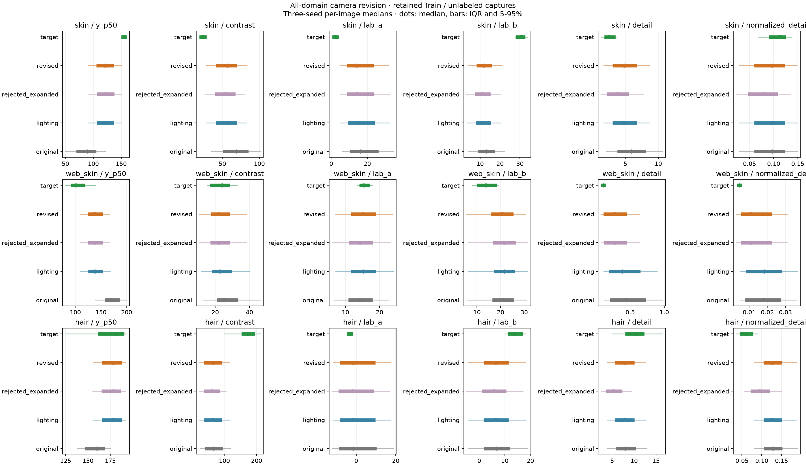

# 피부·얼굴·두피 촬영 변환 재검토 수정본 · 2026-11-11

## 1. 완료 범위

사용자는 두피뿐 아니라 피부·얼굴·두피 세 분야 모두 흐림·미세 대비와 색 변환 방향을 다시 정하도록 요청했다. 유지된 Train 검토용 PNG 461장과 실제 촬영 124장을 같은 측정 방식으로 대조해 새 후보를 고정했다. 이전 확대 설정·노트북·분석 결과·저장 모델은 보존했다.

**이번에 완료한 것은 이미지 변환의 측정·후보 결정·새 실행 노트북 준비다. 새 Colab 학습이나 분류 성능 개선 검증은 아직 하지 않았다.** 11월 10일에 시작한 분석 폴더 이름은 보존했고, 자정을 지나 완료한 새 설정·노트북·결과 ZIP 이름은 20261111을 사용한다.

| 분야 | 색 변환 결정 | 미세 대비 | 추가 흐림 |
| --- | --- | --- | --- |
| 피부 | 붉은색 소폭 감소·노란색 소폭 증가 후보 | 추가 변화 제외 | 제외 |
| 얼굴 | 빨강·초록 축 유지·노란색 소폭 감소 후보 | 감소 범위 유지 | 측정 범위 유지 |
| 두피 | 이번 추가 색 변환 제외 | 추가 변화 제외 | 제외 |

세 분야 모두 재검토한 결과이며 모든 분야에 같은 변환을 강제로 넣지 않았다. 두피는 새 후보에서도 측정한 조명 변화에 대한 적응을 수행한다.

## 2. 고정 조건과 바꾼 조건

- 고정 조건은 이전 확대 후보의 밝기·대비·좌우 조명 설정, 원본 데이터 버전·분할·클래스 순서·출발 모델·입력 크기다. 학습량 5 epoch, seed 42, Adam 학습률 0.00001, 배치 크기 16/8/8, 변환 확률 0.5와 미세조정 범위도 고정한다.
- 학습에서 바꾸는 한 조건은 촬영 변환 설정 묶음이다. 그 안의 색 방향·범위와 흐림·미세 대비 포함 여부를 함께 수정한다. 학습 결과를 개별 색/초점 요소 하나의 효과로 해석하지 않는다.
- 이미지 분석에서는 고정된 소수 후보를 요소별로 비교했다. 이 분석은 모델을 여러 번 학습한 실험이 아니다. MMD·CORAL 손실은 이번 후속 비교에 추가하지 않는다.

## 3. 자료와 측정

피부 223장·얼굴 118장·두피 120장의 원본 Train 검토용 PNG를 사용했다. 현재 유지한 Train 목록·클래스와 PNG 해시를 검증했다. 얼굴 관심 영역은 104장에서 측정 가능했고 나머지 14장은 원본과 변환 모두 같은 방식으로 제외했다. 전체 Source Train을 새로 변환한 결과로 표현하지 않는다.

실제 촬영은 피부 42장·얼굴 42장·두피 40장이다. 원본 촬영 파일의 fingerprint를 다시 확인했다. 4명·한 세션의 질환 정답 미확인 calibration 자료이며 독립 Target Test가 아니다. 얼굴은 기존 중앙 정사각형 입력과 기록한 얼굴 위치를 사용한다.

같은 사진에 같은 경로 기반 난수를 사용한다. seed 42·707·1707의 세 번 모두 같은 측정 영역을 유지하고, 사진별 세 측정값의 중앙값을 집계한다. 변환은 조사할 때 반드시 적용하지만 실제 학습 적용 확률은 0.5다. 모든 비교를 동일한 8비트 PNG 측정 경로로 진행한다. 새 빠른 PNG 인코딩은 압축률만 바꾸며 측정용 RGB 정수값은 같다.

분포 비교에는 Wasserstein-1 거리를 사용했다. 같은 지표의 분포가 가까울수록 작다. Source 클래스별, Target 사람·촬영 조건별 비중을 같게 했다. 서로 단위가 다른 지표를 더해 종합 유사도나 백분율을 만들지 않았다.

## 4. 색 방향 결정 규칙

1. 세 분야 모두 추가 색·미세 대비·흐림을 끈 조명 적용 상태부터 측정한다. 밝기 조작 자체가 색 지표에 미치는 영향을 먼저 반영하기 위한 것이다.
2. 이 상태의 Source 클래스별 중앙값의 중앙값을 기준으로 Target 사람/조건별 중앙값 8개의 25–75분위 구간을 비교한다. 그 구간이 기준을 걸치면 방향을 강제로 정하지 않는다.
3. 한 사람씩 제외한 네 경우에도 방향이 같을 때만 작은 색 후보를 만든다. 이는 민감도 점검이며 사람 단위 성능 교차검증은 아니다.
4. 변화 폭 상한은 같은 참여자 안에서 관찰한 해당 색 채널 변화의 절댓값 75분위수와 3 Lab 단위 중 작은 값이다. 범위에는 0을 포함한다. 전체 Source/Target의 질환 색 차이를 그대로 따라가지 않는다.
5. 두 색 축을 모두 악화시키지 않고 최소 한 축의 거리가 줄어야 후보를 유지한다. 사진별 중앙값과 세 개 난수 조건에서 각각 이 기준을 확인한다. 둘 다, b축만, a축만, 변화 없음의 고정 순서로 판정하고 가능한 후보 중 첫 것을 고른다. 같은 파라미터의 중복 조합은 재측정하지 않았다.

이 규칙은 이번 파일럿의 보수적 공학 기준이다. 색 차이가 순수 카메라 효과라고 입증하거나 질환 정보 보존을 검증한 기준은 아니다. 단순히 한 색 지표를 더 가깝게 만들기 위해 다른 축의 악화를 허용하지 않았다.

## 5. 흐림·미세 대비 결정 규칙

원래 미세 경계 지표 외에 `미세 경계 / 대비`를 추가했다. 대비가 커서 경계 수치도 큰 경우를 일부 구분하려는 보조 지표이며, 초점만을 분리 측정하는 물리 지표는 아니다.

색 후보를 적용한 상태에서 없음·미세 대비만·흐림만·둘 다의 고정 후보를 비교했다. 절대 경계와 대비 보정 경계의 분포 거리가 모두 악화되지 않고 최소 하나가 줄어야 유지한다. 두피는 모발·그림자를 함께 포함하는 어두운 가는 구조 비율도 같은 기준으로 점검한다. 각각의 난수 조건에서도 통과해야 한다. 통과 후보는 둘 다, 미세 대비만, 흐림만 순으로 확인하고, 통과하지 못하면 추가 변화를 제외한다.

- 피부는 흐림으로 절대 경계 지표가 실제에 가까워져도 대비 보정 경계가 더 멀어져 제외했다. 미세 대비 후보도 두 지표를 함께 만족하지 못했다.
- 얼굴은 미세 대비 감소와 흐림을 함께 적용한 후보가 두 경계 지표에서 모두 통과했다.
- 두피는 대비 보정 경계만 좋아지는 반면 절대 경계와 어두운 가는 구조 비율은 더 멀어졌다. 추가 흐림·미세 대비 감소를 제외했다. 이를 근거로 반대로 선명도를 강하게 높이는 변환도 추가하지 않았다.

## 6. 고정한 실제 파라미터

| 분야 | Lab a 이동 | Lab b 이동 | 미세 대비 배율 | 흐림 sigma · ROI 64 기준 | 입력 크기 환산 배율 |
| --- | --- | --- | --- | --- | --- |
| skin | `[-0.9609375, 0.0]` | `[0.0, 0.92578125]` | `[1.0, 1.0]` | `[0.0, 0.0]` | `1.75` |
| web_skin | `[0.0, 0.0]` | `[-1.9033203125, 0.0]` | `[0.85, 0.9145815899839365]` | `[0.0, 0.4]` | `1.9375` |
| hair | `[0.0, 0.0]` | `[0.0, 0.0]` | `[1.0, 1.0]` | `[0.0, 0.0]` | `3.0` |

피부의 작은 a 감소·b 증가 후보는 색 두 축 점검을 통과했다. 얼굴 a는 참여자별 방향이 안정적이지 않아 0으로 유지하고, b 감소 후보만 적용한다. 두피 a도 방향이 안정적이지 않았다. 두피 b 증가 후보는 b 거리 7.606510416666664를 7.130664062500001로 줄였지만 a 거리를 7.449218750000032에서 7.476562500000034로 늘려 이번 보수적 기준에서는 제외했다. 이 작은 악화가 질환 분류 성능 저하를 입증하는 것은 아니다.

## 7. 새로 측정한 지표 비교

다음 값은 분류 Accuracy가 아닌 이미지 지표의 거리다. 낮을수록 해당 지표의 분포가 가깝다. 전체 분위수·분산은 요약 JSON에 보관했다. 수정 후 모든 지표가 이전보다 좋아졌다고 주장하지 않는다.

| 분야 | 지표 | 조명만 | 보류한 이전 확대 후보 | 수정본 |
| --- | --- | ---: | ---: | ---: |
| skin | lab_a | 14.183792836654677 | 13.91495697463777 | 13.738697586428227 |
| skin | lab_b | 18.477449190443778 | 18.72769191576081 | 17.99167091259052 |
| skin | detail | 2.346414466256275 | 1.4608195499125847 | 2.3426686764987457 |
| skin | normalized_detail | 0.0180754112219366 | 0.030298120571285385 | 0.01805824493704202 |
| web_skin | lab_a | 3.1716180572711097 | 3.215274132287579 | 3.1670041532856024 |
| web_skin | lab_b | 7.005957159914388 | 6.935661128952596 | 6.262208961215439 |
| web_skin | detail | 0.33243061356781606 | 0.20001745245263713 | 0.20009771130963216 |
| web_skin | normalized_detail | 0.014523245773384087 | 0.009825825019090169 | 0.009809927354870136 |
| hair | lab_a | 7.449218750000032 | 7.3234375000000345 | 7.449218750000032 |
| hair | lab_b | 7.606510416666664 | 8.20455729166666 | 7.606510416666664 |
| hair | detail | 2.738410005966802 | 5.046722493569033 | 2.738410005966802 |
| hair | normalized_detail | 0.06624834115643602 | 0.034304841646391256 | 0.06624834115643602 |

피부는 추가 흐림을 제거하면서 절대 경계 거리가 이전 확대 후보보다 커졌지만 대비 보정 경계 거리는 작아졌다. 두피도 두 지표가 서로 다른 방향을 보인다. 이는 모든 지표를 같게 맞춘 것이 아니라, 일부 지표만 좋아지는 강한 흐림을 피한 결정이다. 얼굴은 작은 색 후보가 b축 차이를 줄이지만 전체 색·질환 구성 차이는 남는다.

새 후보의 부동소수점 입력에서 신규 0/255 채널 끝점 발생의 최댓값은 세 분야 모두 0.0이었다. 질환 경계·특징 보존의 임상적 검증은 아니다.




## 8. 새 학습 실행 안내

[새 노트북](../../notebooks/camera_adaptation/MediFlow_Camera_Revised_Adaptation_20261111.ipynb) · [고정 설정](../../configs/camera_revised_20261111.json)

기존 `MediFlow_Measured_Stronger_Adaptation_20261110.ipynb`은 보류한 확대 후보 기록으로 보존한다. 새 실행에는 위 20261111 수정본을 사용한다. 기존 공통 ZIP v3를 재사용하며 새 실행 ZIP 업로드나 Target 복호화 키 입력은 필요 없다. Colab에서 GPU 선택 → 모두 실행 → Drive 연결 순서로 실행한다.

출발 모델은 피부 초기 B0·224, 얼굴 선정 PMG·B0·256, 두피 선정 B1·384 5클래스의 1차 학습 전 상태다. 세 분야를 각각 5 epoch 순서대로 학습한다. 기존 2차와 학습량을 맞춘 비교이며 충분한 학습량임을 입증한 수치는 아니다. 입력은 RGB float32 0–255이며 외부 `/255`를 추가하지 않는다.

실행 중 분야·epoch·배치·검증·저장을 표시하고 완료한 회차와 분야를 재사용한다. 학습 전·기존 2차·수정본을 같은 원본·기존 2차 변환·수정 조명·수정 확장 Validation으로 비교한다. Validation으로 회차·후속 후보를 고르고 기존 공식 후보 색인은 자동 변경하지 않는다. Source Test는 다시 추론하지 않는다.

두피는 추가 색·흐림·미세 대비가 모두 제외돼 수정 조명과 수정 확장 조건의 변환이 같다.
두 조건을 독립적인 평가 두 개로 해석하지 않는다.

Drive의 새 결과 위치는 다음과 같다.

```text
내 드라이브/MediFlow_adaptation_runs/4ae6e07eb4af1225/measured_strength_988987c37997/
```

마지막에는 `MediFlow_Revised_Camera_Results_20261111.zip`을 내려받고 같은 파일을 위 폴더에도 보관한다. 최적 모델 3개·학습 이력·검증 비교표·학습곡선·설정·코드·분할·누수 점검이 포함된다. 모든 회차의 큰 모델 파일을 ZIP에 중복 포함하지 않는다. 현재 로컬에서 이 학습 결과 ZIP을 생성한 것은 아니다.

## 9. 코드·보관·검증

[후보 계산·이미지 대조 코드](../../src/mediflow_datasets/camera_revision.py) · [노트북 생성 코드](../../scripts/build_adaptation_revised.py) · [규칙 검사](../../tests/test_camera_revision.py) · [후보별 판정](../../presentation/report_assets/camera_profile_revision_20261110/decisions.json) · [사진별 측정](../../presentation/report_assets/camera_profile_revision_20261110/measurements.json) · [분포 요약](../../presentation/report_assets/camera_profile_revision_20261110/summary.json) · [검증·환경](../../presentation/report_assets/camera_profile_revision_20261110/verification.json)

`ruff check src tests scripts/build_adaptation_revised.py` 통과. pytest 전체 190개 통과·3개 건너뜀. 건너뛴 항목은 기본 로컬 환경에 matplotlib이 없어 실행하지 않은 기존 그래프 관련 검사다. 이번 그림은 별도 준비된 matplotlib으로 실제 생성하고 시각 확인했다. 새 검사는 색 방향·클래스 비중·사람 제외 민감도·Test 사용 거부·두 경계 지표의 상반된 개선 거부를 확인한다.

노트북 Python 문법, 내장된 4개 실행 모듈의 바이트, 내장 설정과 로컬 설정의 바이트, 실행·저장 폴더 식별값과 결과 ZIP 이름을 대조했다. 실제 Colab GPU에서 새 세 분야 학습을 검증한 것은 아니다.

재현할 때 아래 출력 경로는 존재하지 않는 새 폴더를 지정한다. 기존 출력 폴더가 있으면 중단하며 자동 삭제하지 않는다. 환경 버전과 해시는 검증 JSON에 기록했다. 로컬 그림 라이브러리는 `.tmp/final-test-report-libraries`를 기존 Python 패키지 경로 뒤에 추가해 사용했다.

```powershell
.venv/Scripts/python.exe -X utf8 -B -m mediflow_datasets.camera_revision --output presentation/report_assets/NEW_EMPTY_DIRECTORY
.venv/Scripts/python.exe -X utf8 -B scripts/build_adaptation_revised.py
```

## 10. 남은 한계와 다음 단계

실제 촬영 4명·한 세션은 일반적인 장비 분포가 아니다. 이 자료를 방향 결정·포함 여부 선택·그림 확인에 모두 사용했으므로 새 독립 평가가 아니다. Source의 사람·병변·세션 식별 정보와 과거 저장 모델의 평가 독립성 한계도 유지한다.

Source 병변과 실제 팔 피부·얼굴 구도·모발 굵기·가림 차이는 남는다. 얼굴 크기나 모발 구성을 맞추는 기하 변환·가짜 모발 추가·강한 샤프닝은 넣지 않았다. 색 상한과 지표 판정 규칙은 제한된 파일럿을 위한 선택으로, 카메라 보정의 물리적 정답이나 실제 질환 성능을 뜻하지 않는다.

다음은 수정본의 학습과 Validation 비교다. 실제 장비 질환 사진에서의 개선은 정답이 확인된 별도 자료가 있어야 판단한다. 사용자는 새 Colab 노트북을 실행하고 완료 ZIP을 전달하면 된다.
