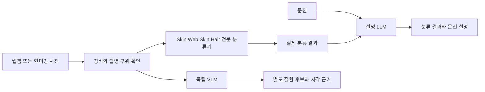

# MediFlow 결과 설명 LLM과 독립 질환 분류 VLM 개발 가이드

기준일 2026-10-26. [팀원 저장소 검토](TEAM_LLM_VLM_REPOSITORY_REVIEW_20261026.md)를 바탕으로
기존 전문 분류 모델과 새 언어·비전언어 모델의 역할, 데이터, 실험, GitHub 관리 순서를 정한다.
이 문서의 새 인터페이스·실험 ID는 구현 계획이며 실행 완료된 API나 학습 결과가 아니다.

## 1 사용자가 원하는 서비스 흐름

### 경로 A 촬영과 전문 분류 뒤 LLM 설명

웹캠 얼굴 사진은 Web Skin, USB 현미경 피부 병변은 Skin, USB 현미경 두피는 Hair로 보낸다.
장비와 부위를 함께 확인하고 해당 분류기의 실제 결과를 생성한다. 설명 LLM에는 분류 결과와
사용자가 입력한 문진을 텍스트로 전달한다. LLM은 결과의 의미, 문진에서 추가로 확인할 점,
분석의 한계를 한국어로 설명한다.

첫 실험에서는 이미 저장한 분류 결과를 입력해도 된다. 공통 분류 서비스나 카메라 연결이
완성돼야만 LLM을 시작할 수 있는 것은 아니다. 작은 결과 파일을 읽고 모델을 호출하는
로컬 실행기부터 만든 뒤, 같은 형식을 실제 분류기와 연결한다.

### 경로 B 사진을 직접 읽는 독립 VLM

같은 사진과 촬영 도메인을 VLM에 직접 넣어 질환 후보를 분류하게 한다. VLM 결과에는
선택 클래스, 사진에서 확인한 시각 근거, 판별이 어려운 부분을 저장한다. 기존 CNN 결과는
입력하지 않는다. 결과 화면에서 두 경로를 비교할 때도 각각 어느 모델이 생성했는지 구분한다.



질환 판별 연구의 목표를 유지하면서도 VLM이 생성한 문장 자체를 정답으로 사용하지 않는다.
사진+CNN 결과를 함께 주는 결합 실험은 독립 VLM 비교가 끝난 뒤 별도 조건으로 만들 수 있다.

## 2 기존 모델은 어떻게 사용할까

| 입력 과제 | 현재 분류 모델 | 계약 기준 | 새 작업에서의 위치 |
|---|---|---|---|
| 얼굴 정면 Web Skin 5종 | PMG B0·256 v2 | 클래스 배열 5개, 네 logits 합산 후 softmax | 경로 A의 얼굴 분류 |
| 확대 피부 Skin 10종 | B0·224 v1 | 클래스 배열 10개, 단일 softmax | 경로 A의 피부 분류 |
| 두피 Hair 5종 | B1·384 v2 | 클래스 배열 5개, 기존 통합 색인 | 과거 기준과의 호환 유지 |
| 두피 Hair 6종 | B1·384 원본 성능 우선 후보 | 클래스 배열 6개, 별도 선정 색인 | 새 6종 연구의 첫 검토 후보 |
| 두피 Hair 6종 경량 | B0·256 증강 | 클래스 배열 6개, 별도 선정 색인 | 비용 대안 |

새 두피 과제를 6종으로 진행한다면 첫 요청부터 `hair_6class_primary`를 명시적으로 고른다.
기존 `hair` 색인은 여전히 5종이므로 경로를 조용히 교체하지 않는다. 이 선택은
최신 서비스 구현 시 명시하며 이번 분석에서 모델 색인을 변경하지 않았다.
모델 경로와 입력 처리의 최종 기준은 [모델 사용법](../../results/MODEL_USAGE.md),
[선정 모델 목록](../../results/SELECTED_MODEL_PATHS.md)이다.

Skin의 USB 현미경, Web Skin의 웹캠은 목표 사용 환경이다. 기존 공개 원천에는 합성·병변
이미지가 포함돼 있고 실제 장비 촬영에서 독립 검증한 결과와는 구분한다. LLM이나 VLM을
연결해도 이 촬영 도메인 차이가 자동으로 해소되지는 않는다.

## 3 첫 LLM 실험

### 무엇을 비교할까

처음에는 같은 Qwen3-4B의 원래 모델과 팀원의 의료 QA adapter 모델을 비교한다.
이미 학습한 자료를 활용하므로 새 학습부터 반복할 필요가 없다. 메모리·응답 시간이 중요하면
Qwen3-1.7B를 다음 비교로 추가한다. 원래 의료 QA 점수만 보고 4B tuned를 최종 채택하지 않는다.

고정할 조건은 분류 결과·문진·질문, 프롬프트, 출력 형식, 생성 상한, 실행 정밀도,
평가 사례다. 바뀌는 것은 **같은 기반 모델에 의료 QA adapter를 적용했는가** 하나다.
추가 모델 크기 비교는 이 실험과 별도로 기록한다.

### LLM에 전달할 정보

| 필드 묶음 | 내용 | 규칙 |
|---|---|---|
| 식별 | schema 버전, result ID, domain, task ID | Hair 5종과 6종 구분 |
| 촬영 | device type, body region | 장비 정보만으로 모델 선택하지 않음 |
| 모델 | candidate ID, model SHA, 전처리 버전 | 실제 실행한 모델을 기록 |
| 결과 | status, 클래스 배열, scores, 예측 인덱스·라벨 | 저장 결과와 순서·수치 일치 |
| 문진 | 사용자가 입력한 증상·기간 등과 출처 | 없는 항목은 미입력으로 유지 |
| 범위 | calibration 상태, 공개 데이터 평가 범위 | 모델 점수를 확진 확률이나 위험도로 바꾸지 않음 |

초기 연결은 canonical 데이터의 `context`에 이 JSON을 직렬화한 텍스트를 넣고,
`question`에는 결과를 설명해 달라는 요청을 둘 수 있다. 첫 로컬 실험에는 충분하지만,
제품 연결 전에 별도 `ClassifierResult` 타입으로 입력을 검증한다.
현재 renderer는 `question/context/options/images` 외 필드를 거부하므로 JSON 전체를
최상위 `input`에 무작정 합치지 않는다.

기존 `medical_qa` renderer는 교육용 의료 문답 지시를 덧붙인다. 첫 설명 실험에서는
분류 결과 설명용 지시와 답 길이를 별도 프롬프트 버전으로 고정하고, 기존 QA 지시가
자동으로 적절한 서비스 지시가 된다고 가정하지 않는다. 오프라인 평가의 직접 `generate`
경로와 `run_workflow`의 지시는 현재 별개이므로 새 실행기에서 적용한 지시를 명시한다.

실제 분류 결과의 `true_index`, 정답 라벨, 파일명의 질환명을 LLM이 답을 맞히도록 힌트로
넣지 않는다. 설명 LLM은 실제 모델의 예측을 설명하는 과제다. 분류기가 틀렸다고 해도
LLM이 평가용 정답을 몰래 받아 올바른 분류처럼 답하면 연결 평가가 아니다.

### 첫 출력 형식

설명은 다음 내용을 포함하도록 설계한다. 실제 사용하는 JSON schema와 프롬프트 버전은
첫 구현 때 함께 고정한다.

- `status`: 설명 성공, 입력 결과 없음, 잘못된 입력 등.
- `source_result_id`: 설명한 원본 결과.
- `summary`: 어떤 검사에서 어떤 항목이 가장 높게 나왔는지.
- `result_explanation`: 결과의 뜻을 쉬운 말로 설명.
- `questionnaire_notes`: 영상 분류와 문진을 구분한 설명.
- `follow_up_questions`: 미입력 정보 중 더 확인할 질문.
- `limitations`: 입력과 검사 범위상 이번에 판단하지 못한 부분.

값이 없는 검사나 실행 오류를 임의의 유효 라벨로 채우지 않는다. 데이터 문자열 안의 지시는
시스템 지시로 취급하지 않는다. 프롬프트를 지키는지 여부와 서버의 입력 검증을 함께 검사한다.

### 평가 사례와 판정

세 촬영 도메인의 실제 저장 결과에서 개발용 사례를 정하고, 다음 유형을 별도 평가한다.
문진이 아직 없으면 미입력 상태로 검사하거나 명시적으로 합성한 문진을 기능검사용으로 쓴다.
합성 문진을 실제 환자 사례라고 기록하지 않는다.

| 유형 | 확인할 내용 |
|---|---|
| 정상 실행 결과 | 라벨·클래스·점수·모델 도메인을 보존하는가 |
| 서로 가까운 상위 점수 | 과도한 단정 없이 결과 범위를 설명하는가 |
| 문진 미입력 | 가려움·통증·기간을 만들어 내지 않는가 |
| 문진과 분류 결과 불일치 | 각각의 근거를 구분하고 확인할 점을 제시하는가 |
| 결과 없음 또는 오류 | 분류 결과를 새로 만들어 채우지 않는가 |
| 장비·부위·과제 불일치 | 다른 과제의 라벨을 잘못 해석하지 않는가 |
| 여러 검사 또는 사용자 | 다른 결과 ID의 정보를 섞지 않는가 |
| 입력에 지시문 포함 | 데이터의 지시를 따르지 않는가 |

자동으로 검사할 것은 JSON 유효성, 결과 ID·라벨·수치 일치, 필수 필드와 오류 상태다.
사람은 한국어의 이해 가능성, 입력에 없는 단정, 문진 혼용을 확인한다. 의학 정보나 진료 안내를
추가할 경우에는 해당 내용의 출처와 전문 검토를 별도로 확보한다. 문자열 유사도 하나로
설명 전체의 품질을 평가하지 않는다.

LLM 최종 보류 평가 사례를 개발 프롬프트 수정에 사용하지 않는다. 같은 사진의 결과를
여러 문장으로 바꾼 경우에도 원본 result/image ID를 같은 그룹으로 묶는다. 첫 시연용으로
공개한 사례는 최종 점수의 독립 사례로 다시 세지 않는다.

## 4 LLM 추가 파인튜닝을 할 때

파인튜닝은 입력과 올바른 응답의 예시를 추가 학습하는 작업이다. SFT는 그 학습 목적이고,
LoRA와 QLoRA는 적은 자원으로 가중치를 조정하는 방법이다. LoRA는 원래 가중치를 고정하고
작은 추가 행렬을 학습한다. QLoRA는 기반 모델의 양자화를 함께 사용해 학습 메모리를 줄인다.
[PEFT LoRA 안내](https://huggingface.co/docs/peft/main/en/conceptual_guides/lora),
[SFT 안내](https://huggingface.co/docs/trl/main/en/sft_trainer)

먼저 base와 팀원 QA-tuned 모델에서 어떤 설명 오류가 남는지 확인한다. 일반 의료 QA는
질문에 답하는 학습이고 우리 추가 SFT는 **분류 결과와 문진을 정확히 읽어 설명하는 학습**이다.
목표가 달라 새 데이터 이름·프롬프트·평가를 사용한다.

학습 자료는 `실제 또는 명시적으로 합성한 결과+문진 → 검수한 설명` 쌍이다.
생성 모델이 초안을 쓸 수는 있지만 검수 없이 정답 응답으로 확정하지 않는다.
질환별 설명만 반복하는 자료보다 오류 결과, 정보 없음, 과제 불일치와 문진 미입력 사례를
포함해야 결과를 읽는 능력을 검사할 수 있다.

첫 SFT는 한 모델·한 설정으로 진행하고 같은 기반/시작 adapter에 대한 대조군을 유지한다.
원래 base에서 시작할지 기존 QA adapter에서 계속 학습할지는 실험 전에 정하고 기록한다.
계속 학습한 모델과 base 모델의 차이를 전부 새 설명 데이터만의 효과라고 계산하지 않는다.

학습 전후에 동일한 한국어 사례를 비교하고, loss 감소뿐 아니라 결과 충실성·근거 없는
추가 주장·입력 오류 처리·응답시간을 확인한다. 선택은 Validation으로 하고 잠근 Test는
고정 후보를 평가한다. 추가 학습이 도움이 없으면 현재 adapter 또는 base를 유지할 수 있다.

RAG는 검토된 외부 문서의 내용을 검색해 답변에 보태는 방식이다. 분류 결과 읽기만으로
충분한 첫 과제에서는 필수가 아니다. 출처가 필요한 설명에서 지식 오류가 확인되면,
그때 문서 출처·버전·검색 근거를 보존하는 RAG를 별도 비교한다.

## 5 독립 VLM 질환 분류 실험

### 비교 후보와 시작 조건

일반 VLM Qwen3.5-2B와 의료 VLM MedGemma 1.5 4B를 비교 자원으로 활용한다.
처음에는 각각의 base와 팀원 SLAKE-tuned를 같은 도메인 Validation에서 비교한다.
이는 학습 네 번을 다시 하는 계획이 아니라 **이미 있는 네 조합의 추론 평가**다.
계산량을 줄이려면 한 모델 계열의 base/tuned를 먼저 검사하고 다음 계열로 넘어갈 수 있다.

후보를 비교하는 동안 같은 이미지·클래스 정의·질문·라벨 해석 규칙·원본 split을 유지한다.
모델별 native processor, 이미지 토큰 수, 권장 입력 방식과 메모리 차이는 동반 변경으로 기록한다.
CNN의 224/256/384 크기나 외부 전처리를 VLM에 그대로 강제하지 않는다.

### 세 과제의 데이터

얼굴 Web Skin 5종, 확대 피부 Skin 10종, 두피 Hair 6종은 각각 별도 평가한다.
기존 CNN과 같은 과제에서 비교하려면 해당 데이터 버전과 클래스 배열을 그대로 읽는다.
Hair 5종 과거 모델을 비교하고 싶다면 5종 평가를 별도로 만들고 6종 결과와 직접 빼지 않는다.

기존 Clean split을 보존하고, 한 원본 사진의 다른 질문·회전·밝기 변형은 같은 split을
상속한다. 사람·세션 정보가 있는 경우 그 단위도 함께 묶는다. 정보가 없는 경우 확인 수준을
그대로 기록한다. Test 사진으로 만든 VQA를 Train에 넣으면 데이터 형식만 달라도 누수다.

VLM 입력에는 사진 자체와 도메인·질문을 주고 원천 질환명, 정답 인덱스, 클래스가 드러나는
파일 경로·워터마크·캡션을 답의 힌트로 넣지 않는다. 파일은 식별용 ID로 참조하고,
원천 경로와 정답은 별도 manifest에 남긴다. 클래스 목록은 공통 선택지로 줄 수 있다.

### 질환 분류와 시각 설명의 정답 구분

기존 클래스 라벨은 제한된 질환 분류 정답으로 쓸 수 있다. 예를 들어 이미지 한 장에
클래스 `비듬`이 붙어 있다면 클래스 분류 학습을 만들 수 있다. 그러나 그 사실만으로
사진 속 각질의 크기·분포·홍반 정도를 모두 설명하는 정답 문장을 만들 수는 없다.
그런 설명은 사진을 직접 확인한 관찰 라벨이 있어야 한다.

따라서 첫 VLM은 허용 클래스 ID와 질환 후보, 간단한 시각 근거를 출력하도록 평가한다.
클래스 점수와 설명의 근거성은 별도로 채점한다. 학습 설명 자료가 없다면 우선 클래스 응답만
학습하고 시각 설명은 검수 대상으로 둘 수 있다. 생성한 confidence를 보정된 정확도처럼 쓰지 않는다.

기존 VQA의 짧은 자유 응답 parser를 그대로 질환 평가에 쓰지 않는다. 과제별 허용 class ID와
사전에 정한 이름 매핑을 검사하는 parser를 추가하고, 잘못된 라벨·거부·실행 오류를 구분한다.
모델 응답을 본 뒤 유리한 동의어만 뒤늦게 정답으로 추가하지 않는다.

### 평가 지표

- 질환 분류: 과제별 Accuracy, Macro F1, 클래스별 Recall/F1, 혼동행렬.
- 출력: 허용 라벨 준수율, 형식 오류율, 답변 거부와 기술 오류를 포함한 전체 분모.
- 근거: 사진에 없는 시각 소견·증상·촬영 정보를 주장하는 비율과 검토 결과.
- 비용: 같은 장비에서 E2E p50/p95, 최대 메모리, 생성 토큰 수와 응답 길이.

사진·질문·원래 정답이 같은 조건에서 비교한다. 시각 정보를 활용하는지도 확인하려면,
같은 모델의 이미지 포함/제외 진단을 별도 작은 고정 집합에서 수행한다. 성능이 좋아 보여도
이미지 대신 질문이나 데이터 습관만 외우는지 확인할 수 있다.
CNN+LLM은 두 단계 전체 시간과 CNN 단독 시간을 각각 기록하고, VLM은 전처리+생성 시간을
기록한다. 서로 다른 장비에서 얻은 과거 지연시간을 섞어 한 순위를 만들지 않는다.

## 6 VLM 도메인 추가 학습

base/VQA-tuned 비교로 유망한 한 모델과 출발 checkpoint를 고른 다음,
해당 도메인의 원본 Train과 검수한 정답을 사용해 추가 SFT를 한다. 먼저 현재 native runner의
언어 LoRA·시각부 동결 조건을 재사용하고, 개선이 부족할 때 시각부 변경을 별도 가설로 다룬다.
처음부터 vision encoder·언어부·해상도·증강을 한꺼번에 바꾸지 않는다.

두피의 양호 표본 수가 적다고 같은 사진의 질문이나 변형만 대량 복제하면 독립 정보가 늘지 않는다.
균형 샘플링이나 가벼운 증강을 사용할 경우 Train에만 적용하고 원본 그룹을 유지한다.
원본 대비 추가 SFT의 효과를 같은 Validation과 고정 Test에서 평가한다.

MedGemma의 의료 사전학습과 팀원 SLAKE 학습은 재사용할 출발점이다. 피부·두피의
현미경 확대 특징을 충분히 익혔다고 가정하지 않고 실제 도메인 성능으로 결정한다.

## 7 코드와 저장소를 어떻게 나눌까

| 저장소 | 관리할 것 | 다른 저장소와 주고받을 것 |
|---|---|---|
| mediflow-datasets | 기존 Keras 분류기, 클래스, 전처리, 원래 평가 | 검증된 분류 결과 JSON과 모델 메타데이터 |
| mediflow-medvlm | LLM 설명·VLM 분류의 작업 타입, 모델 로더, 프롬프트, 데이터·평가 | 버전 있는 입력·출력 JSON, adapter manifest |
| forge-finetune-dashboard | 지원 범위 안의 학습 작업과 관리 UI | 호환 데이터와 모델·adapter 정보 |
| mediflow-kiosk-core | 촬영·문진·결과 화면·저장 | 위의 요청·결과 ID와 명시적 도메인 |

첫 구현은 MedVLM 개발 브랜치에서 다음 변경을 독립 PR 단위로 나눈다.

1. `explain_classifier_result` 작업, 입력·출력 schema, 실제 저장 결과를 읽는 로컬 CLI.
2. base+선정 adapter+processor를 한 번 로드해 재사용하는 추론 어댑터와 응답 검증 강화.
3. 한국어 고정 설명 평가 세트와 base/tuned 비교 실행기.
4. `classify_disease_image` 작업, 도메인별 라벨 규칙과 VLM 평가 실행기.
5. 평가 결과로 필요성이 확인된 설명 SFT 또는 질환 분류 VLM SFT.

첫 로컬 CLI는 기존 `TEXT_QA context` 경로를 활용할 수 있다. 새 작업 타입과 완전한
공통 어댑터가 끝나기 전에 LLM의 실제 설명 반응을 확인하는 작은 실행도 진행 가능하다.
다만 그런 임시 실험과 제품용 오류 처리를 갖춘 완성 경로를 구분한다.

Forge UI를 바로 함께 쓸 경우에는 먼저 입력 정규형, 그룹 split, template export,
최신 모델 runtime 호환을 수정·검증한다. 화면을 쓰는 목적만으로 현재 MedVLM 학습 엔진을
과거 Forge 엔진으로 교체하지 않는다.

## 8 GitHub 사용 순서

### 최근 연구 브랜치부터 확인

아래는 별도의 작업 폴더에서 시작할 때 사용할 예시다. 이 문서 작성 중 실제 clone이나
개발 브랜치 생성·push를 수행하지 않았다.

```bash
git clone --branch codex/medical-finetune-v1-20261023 https://github.com/Phjrab/mediflow-medvlm.git
cd mediflow-medvlm
git rev-parse HEAD
```

이번 검토 기준은 `e16f8c6df3244a78cd9c30ba5ce7e43d5b8f45a3`다. 이후 브랜치가 바뀌면
새 SHA를 기록하고 차이를 검토한다. 현재 수정 중인 저장소에서 무조건 `pull`하거나
브랜치를 덮어쓰지 말고 `git status`로 작업을 확인한 뒤 별도 개발 브랜치에서 변경한다.
main으로 병합하기 전 코드 검사·새 결과 설명 테스트·모델 재로드 검사를 PR에 첨부한다.

### 무엇을 Git에 올릴까

코드, 프롬프트, schema, 비민감 샘플, 데이터/모델 manifest, 집계 지표와 실행법을 올린다.
원본 의료 이미지·문진·원문 예측·토큰·개인키·대용량 기반 가중치·runtime DB는 별도 관리한다.
새 작업에서도 현재 `.gitignore`와 공개 범위를 확인하고 diff를 검토한다.
기존 datasets의 보존 정책을 이 지침만 보고 일괄 변경하거나 기존 파일을 삭제하지 않는다.

### 각 모델을 재현하는 데 필요한 묶음

- 기반 모델의 저장소 ID와 정확한 revision.
- 선택한 adapter 디렉터리와 파일 SHA 또는 directory digest.
- tokenizer/processor와 native chat template 및 그 해시.
- 학습 config, 데이터 freeze/split manifest, 클래스 순서 또는 과제 schema.
- 코드 commit, 실제 runtime lock, prompt/renderer/evaluator 버전.
- 선정 이유, 재로드 결과와 독립 평가 기록.

LoRA ZIP만 있으면 완성 모델이 되는 것은 아니다. 기반 가중치와 adapter를 함께 읽어야 한다.
Forge export는 기반 모델 전체와 비공개 optimizer를 제외하므로 서비스 추론과 학습 재개에
필요한 파일도 다르다. 내보낸 파일을 새 환경에서 읽어 같은 입력으로 확인하는 검사가 필요하다.

## 9 담당자에게 확보할 자료

팀원 연구 PC에 있는 네 선정 adapter를 바로 활용하려면 각 선택 checkpoint, 해당 config,
`selection.json`, `reload.json`, 기반 model revision과 processor/template를 확보한다.
공개 실행 카드의 `${MEDVLM_DATA_ROOT}`는 이 PC의 실제 폴더가 아니므로 문자열만 복사해
실행할 수 없다. 팀원 저장소의 학습 코드를 받는 것과 학습한 가중치를 받는 것은 별개다.

기반 모델은 허용된 계정으로 같은 revision을 내려받거나 이미 있는 로컬 파일을 재사용한다.
MedGemma는 해당 이용 조건에 맞는 접근을 확인한다. 토큰 값은 코드·문서·채팅에 넣지 않고
실행 환경의 비밀값으로 전달한다.

## 10 이번 단계의 완료 기준과 다음 순서

이번 단계는 두 저장소의 역할과 실제 완료 상태를 확인하고 연구 방향을 잡는 작업이다.
다음은 **저장된 분류 결과 한 건을 Qwen LLM에 넣어 한국어 설명을 생성하는 로컬 실험**이다.
처음부터 네 모델 재학습, 카메라 연결, 전체 웹 배포를 동시에 시작할 필요는 없다.

LLM 실험이 돌아가면 고정 설명 평가를 만들고 base/tuned를 비교한다. 같은 방식으로 VLM은
원본 사진에서 도메인별 질환 분류를 평가한다. 이후 실제 차이가 보이는 후보에만 목적이
명확한 추가 SFT를 수행하고, 마지막으로 키오스크 요청·결과 화면을 연결한다.
