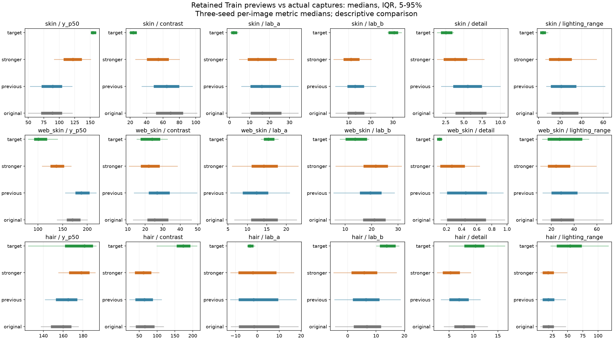

# 실제 장비 사진과 후속 변환의 유사성 재점검 · 2026-11-10

> 2026-11-11 정리 상태: **분석·검토 또는 과정 기록, 후속 학습 상태는 최신 로드맵 참조**. [현재 작업 안내](../../README.md) · [전체 문서 대조표](../../DOCUMENT_INDEX.md). 아래 본문은 작성 시점 기록이며, 본문·원본 JSON의 이전 경로는 정리 대조표로 추적한다.

## 1. 결론

**현재 새 변환을 실제 장비 사진과 거의 동일하다고 표현할 수 없다.** 밝기는 세 분야 모두 이전 2차보다 가까워졌지만, 색·구도·미세 경계까지 맞아진 것은 아니다. 특히 두피의 새 흐림 설정과 세 분야의 노랑·파랑 색상 지표는 실제 촬영 분포와의 차이를 늘렸다.

이는 분류 성능의 측정 결과가 아니다. 새 학습은 실행하지 않았으며, 이번 점검으로 기존 선정 모델·학습 결과·후속 노트북·변환 설정을 변경하지 않았다. 후속 노트북은 이 재점검 내용을 반영해 조건을 다시 검토한 후 실행하는 것을 권한다.

## 2. 실제 사용한 자료

| 분야 | 유지된 Train 검토용 PNG | 관심 영역 측정 가능 | 실제 촬영 | 제외한 기존 표본 |
| --- | ---: | ---: | ---: | ---: |
| skin | 223 | 223 | 42 | 17 |
| web_skin | 118 | 104 | 42 | 2 |
| hair | 120 | 120 | 40 | 0 |

기존에 클래스당 24장씩 고정 난수로 선택해 내보낸 검토용 PNG에서, 현재 유지한 원본 Train 목록에 있는 사진만 사용했다. 총 461장이다. 피부 17장·얼굴 2장은 현재 유지 목록에서 제외돼 이번 측정에서도 제외했다. 전체 Source Train을 새로 변환해 분석한 것은 아니다. PNG는 모델 입력 크기로 내보낸 8비트 사본이다.

실제 촬영은 4명·한 세션의 124장을 모두 사용했다. 원본 파일들의 fingerprint와 사전 보관한 모델 입력 배열의 SHA-256을 검증했다. 얼굴은 기존 중앙 정사각형 입력 정책을 유지했다. Source와 Target 모두 같은 8비트 PNG 측정 경로를 사용했고, 얼굴은 원래 확인된 얼굴 위치의 같은 볼 영역을 전후에 고정했다. 원본에서 얼굴 위치가 없는 14장은 모든 변환에서도 볼 측정을 제외했다.

각 Train 사진에 seed 42·707·1707에서 원본 경로로 파생한 난수를 사용해 기존 2차와 새 변환을 각각 적용했다. 변환은 적용 여부를 100%로 강제해 조사했다. 실제 학습의 50% 적용 혼합분포와는 구분한다. 사진별 세 번의 측정값의 중앙값을 한 장의 대표값으로 사용했다. 파생된 사진 세 장을 독립 표본 세 명처럼 세지 않았다.

바꾼 비교 조건은 기존 2차 변환과 새 후속 변환 설정이다. 원본 사진·관심 영역·입력 크기·시드·측정 방식은 고정했다. 새 설정에는 밝기·대비 방향 및 기준 변경과 색·미세 대비·흐림 강도 변경이 함께 포함돼 있다.

## 3. 관심 영역 측정의 중앙값

아래 값은 이번 표본에서 새로 측정한 사진 지표이며 모델 Accuracy가 아니다. 밝기는 0–255 휘도, 대비는 관심 영역 휘도 90분위수−10분위수, 미세 경계는 64×64 비교 영역의 고주파 잔차 크기다. 질감·질환·머리카락·배율에도 영향을 받으므로 카메라 초점만의 수치로 해석하지 않는다. Lab a는 빨강·초록 축, b는 노랑·파랑 축이다.

| 분야 | 지표 | 원본 | 기존 2차 | 새 후속 변환 | 실제 촬영 |
| --- | --- | ---: | ---: | ---: | ---: |
| skin | 밝기 | 89.18349838256836 | 89.58000183105469 | 122.25200271606445 | 154.22899627685547 |
| skin | 대비 | 69.20500946044922 | 64.59030151367188 | 54.17011260986328 | 23.69690704345703 |
| skin | Lab a | 16.34375 | 16.21875 | 14.28125 | 2.125 |
| skin | Lab b | 13.09375 | 12.90625 | 11.0234375 | 30.6015625 |
| skin | 미세 경계 | 5.8889265060424805 | 5.5171685218811035 | 3.773195743560791 | 2.549651026725769 |
| web_skin | 밝기 | 170.16424942016602 | 188.04899978637695 | 137.3247528076172 | 100.9482536315918 |
| web_skin | 대비 | 25.401947021484375 | 26.809661865234375 | 22.039142608642578 | 23.932373046875 |
| web_skin | Lab a | 14.234375 | 12.34765625 | 14.24609375 | 15.37890625 |
| web_skin | Lab b | 21.04296875 | 19.46875 | 21.56640625 | 13.79296875 |
| web_skin | 미세 경계 | 0.44444984197616577 | 0.4538573920726776 | 0.27053283900022507 | 0.106520039960742 |
| web_skin | 얼굴 가로 비율 | 0.734375 | 0.734375 | 0.734375 | 0.484375 |
| hair | 밝기 | 160.00749969482422 | 164.99599838256836 | 178.37449645996094 | 181.48350524902344 |
| hair | 대비 | 66.10476303100586 | 64.66109848022461 | 61.923500061035156 | 173.05695343017578 |
| hair | Lab a | -1.4765625 | -1.703125 | -2.0 | -3.34765625 |
| hair | Lab b | 6.796875 | 6.421875 | 5.7890625 | 13.78125 |
| hair | 미세 경계 | 7.997047424316406 | 7.02614951133728 | 5.260003328323364 | 10.387306690216064 |
| hair | 어두운 가는 구조 비율 | 0.13321940104166666 | 0.1000705295138889 | 0.07737901475694445 | 0.1380343967013889 |

중앙값만으로 판정하지 않도록 평균·분산·5/25/50/75/95분위수와 지표별 분포 거리도 함께 저장했다.

## 4. 분포 차이 비교

Wasserstein-1 거리는 같은 단위에서 분포를 옮기는 데 필요한 평균 이동량에 해당한다. 낮을수록 해당 지표의 분포가 가깝다. Source는 클래스별, Target은 참여자·촬영 조건별 비중을 같게 했다. 서로 단위가 다른 거리를 더해 종합 유사도나 유사성 백분율을 만들지 않았다. 거의 동일하다고 판정할 검증된 허용 기준도 없다.

| 분야 | 지표 | 원본→실제 거리 | 기존 2차→실제 거리 | 새 변환→실제 거리 | 새 변환 대 기존 |
| --- | --- | ---: | ---: | ---: | --- |
| skin | 밝기 | 68.00235648972958 | 67.54463261688372 | 33.6876816996053 | 감소 |
| skin | 대비 | 44.71368223607271 | 40.87712052835953 | 30.497675122846303 | 감소 |
| skin | Lab a | 15.812114564462654 | 15.675141059027869 | 13.91495697463777 | 감소 |
| skin | Lab b | 16.692388945501154 | 16.84898428064608 | 18.72769191576081 | 증가 |
| skin | 미세 경계 | 3.4312986543213437 | 3.001825708215681 | 1.4608195499125847 | 감소 |
| web_skin | 밝기 | 61.9108728235419 | 79.91501584310629 | 29.96670418175163 | 감소 |
| web_skin | 대비 | 4.647723632367797 | 6.112204885482906 | 2.8345035902911175 | 감소 |
| web_skin | Lab a | 3.0731718080945614 | 3.921312093420643 | 3.215274132287579 | 감소 |
| web_skin | Lab b | 6.488106266469065 | 5.241061944169985 | 6.935661128952596 | 증가 |
| web_skin | 미세 경계 | 0.3812156505602994 | 0.3773564447597917 | 0.20001745245263713 | 감소 |
| hair | 밝기 | 19.99060440063474 | 15.544132423400868 | 8.226354090372737 | 감소 |
| hair | 대비 | 101.19656829833973 | 103.47720712025946 | 107.17739849090563 | 증가 |
| hair | Lab a | 7.9084635416667 | 7.727083333333367 | 7.3234375000000345 | 감소 |
| hair | Lab b | 7.33326822916667 | 7.6683593750000005 | 8.20455729166666 | 증가 |
| hair | 미세 경계 | 2.4789892176786865 | 3.571062552928904 | 5.046722493569033 | 증가 |



점은 중앙값, 굵은 선은 25–75분위수, 가는 선은 5–95분위수다. 그림은 사진별 분포를 보여주며 위 거리 계산에는 클래스·사람/조건별 가중치를 적용했다.

## 5. 분야별 판단

- **피부** — 밝기·대비·미세 경계 분포는 기존보다 가까워졌다. 그러나 밝기는 여전히 실제보다 낮고 대비는 높다. 실제 촬영의 노란 색감과 Source 병변의 붉은 색감 차이가 남는다. 특히 Lab b는 새 변환에서 더 멀어졌다. 병변과 팔 피부의 색 차이를 모두 카메라 차이로 볼 수 없다.

- **얼굴** — 밝기를 낮추는 방향은 실제 촬영에 가까워졌다. 대비와 좌우 조명 차이도 이전보다 가까워졌다. 그러나 밝기와 미세 경계 차이가 남으며 얼굴 가로 비율은 원본·기존·새 변환에서 모두 같아 실제 촬영보다 크다. 중앙 정사각형 입력 정책은 유지했지만 얼굴 크기까지 맞추는 변환은 포함하지 않았다. Lab b는 기존 2차보다 멀어졌다.

- **두피** — 밝기는 실제에 가까워졌다. 반면 흐림과 미세 대비 감소로 미세 경계와 어두운 가는 구조 지표가 더 낮아져, 실제 촬영과의 차이가 증가했다. 실제 사진의 높은 대비에는 모발 가림·굵기·촬영 배율이 섞여 있다. 대비나 선명도를 자동으로 높여 전체 외형을 맞추는 것으로 해결할 근거는 없다.

새 설정에서 부동소수점 단계의 신규 0/255 채널 끝점 발생은 세 분야 최대값 모두 0.0이었다. 이 결과는 새로 완전히 잘린 채널이 없다는 점검이며, 질환 특징이 보존됐다는 검증은 아니다.

## 6. 실제 사진과 나란히 확인


왼쪽부터 유지된 Train 원본·기존 2차·새 후속 변환·실제 P01 기준·실제 P01 변경이다. Source는 각 분야의 첫 관심 영역 측정 가능 표본이며 Target은 해당 사람/조건의 밝기 중앙값에 가장 가까운 사진이다. 실제 사진에 질환명이나 정상 여부의 정답을 새로 부여하지 않았다. 실제 촬영 사진을 포함하므로 이 그림은 기존 사진 공유 동의 범위 안에서 취급한다.

## 7. 다음 조정 전에 확인할 것

1. 현재 후속 설정을 실제 촬영을 거의 그대로 재현한 설정으로 보고 학습하지 않는다. 먼저 두피 흐림·미세 대비 감소와 색 변화의 방향을 재검토한다.
2. 참여자 내 기준/변경 차이를 확대하는 목표와 Source를 Target의 절대 분포에 맞추는 목표를 구분한다. 현재 색·초점 범위는 전자를 반영하며 후자의 일치를 보장하지 않는다.
3. Source 병변 특징과 촬영 특성을 분리하기 어려운 색·질감·모발 가림은 전체 Target 분포로 강제 정렬하지 않는다. 밝기 등 관찰된 차이도 질환·사람·구도의 영향을 함께 기록한다.
4. 조정 후보는 유지된 Train 표본에서 먼저 확인하고 모델 선택은 Validation으로 한다. 이미 확인한 Source Test로 반복 조정하지 않는다.
5. 실제 환자 사진의 분류 개선은 정답이 있는 별도 장비 촬영 평가가 있어야 확인할 수 있다. 이번 124장은 독립 Target Test가 아니다.

## 8. 코드·검증·재현

[분석 코드](../../../src/mediflow_datasets/camera_similarity.py) · [검사 코드](../../../tests/test_camera_similarity.py) · [전체 측정값](../../../presentation/report_assets/camera_similarity_check_20261110/measurements.json) · [분포 요약](../../../presentation/report_assets/camera_similarity_check_20261110/summary.json) · [환경·파일 검증](../../../presentation/report_assets/camera_similarity_check_20261110/verification.json)

`ruff check src tests` 통과. pytest 전체 187개 통과·3개 건너뜀. 기본 환경에 matplotlib이 없어 기존 관련 검사 3개를 건너뛰었다. 이번 분포 그림은 별도로 준비된 matplotlib을 사용해 실제 생성하고 확인했다. 분석 코드의 두 검사는 Test·제외 사진·잘못된 클래스의 진입 방지와 클래스/참여자별 장수 차이에 흔들리지 않는 거리 계산을 검증한다.

새 빈 출력 경로를 지정해 다음과 같이 실행한다. numpy·Pillow·OpenCV·matplotlib이 필요하다. 로컬 이번 실행은 `.tmp/final-test-report-libraries`를 기존 Python 패키지 경로 뒤에 추가해 그림 라이브러리를 불러왔다. 환경 버전은 검증 JSON에 보관한다.

```powershell
.venv/Scripts/python.exe -X utf8 -B -m mediflow_datasets.camera_similarity --output presentation/report_assets/NEW_EMPTY_DIRECTORY
```

현재 단계는 후속 학습 전 변환 검증이다. 이번에 새로 한 일은 위 분석 코드·검사·그림·보고서 생성이다. 실제 새 학습이나 기존 설정 변경은 하지 않았다. 사용자 추가 작업은 현재 없다.
