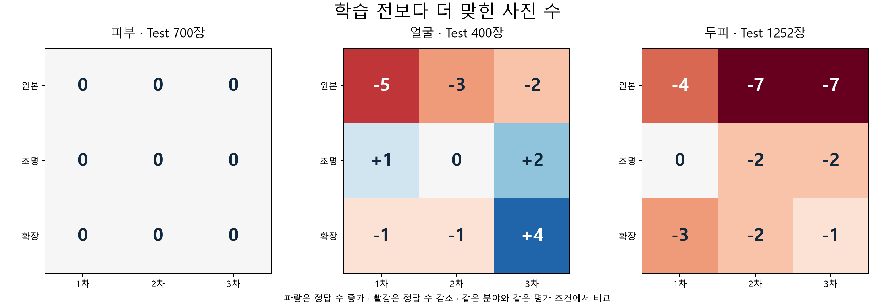

# MediFlow 카메라 적응 최종 Source Test 결과 분석

> 2026-11-11 정리 상태: **최종 Source Test 실행·결과 확인 완료**. [현재 작업 안내](../../README.md) · [전체 문서 대조표](../../DOCUMENT_INDEX.md). 아래 본문은 작성 시점 기록이며, 본문·원본 JSON의 이전 경로는 정리 대조표로 추적한다.

2026-11-10 · 로드맵 7단계 기존 데이터 최종 비교 · 기존 장비 촬영 적응 1·2·3차 결과

## 1. 확인 결과와 현재 판단

피부 700장, 얼굴 400장, 두피 1,252장으로 총 2,352장의 원본 Test를 평가했다. 학습 전·1차·2차·3차 모델과 원본·조명·확장 조건을 교차해 36개 비교를 완료했다. 결과 ZIP의 압축 무결성, 고정 계획, CSV·JSON·혼동행렬을 대조했다.

- 피부는 모든 모델·조건이 699/700장으로 같았다.
- 얼굴 3차는 학습 전보다 조명 Test에서 2장, 확장 Test에서 4장을 더 맞혔다. 원본에서는 2장을 덜 맞혔다. 사전 후보 2차는 원본에서 3장, 확장에서 1장을 덜 맞혔다.
- 두피는 학습 전 모델이 세 Test 조건 모두에서 적응 모델보다 정답 수가 높거나 같았다. 3차 확장은 2차보다 1장 높았지만 학습 전보다 1장 낮았다.
- 현재 약한 변환 조건에서 일관된 전체 성능 개선을 확인하지 못했다. 이 결과만으로 변환 강도를 높여야 한다는 원인을 확정할 수는 없다.

[수치 원본 CSV](../../../results/camera_adaptation_final_test_20261110/test_comparison.csv) · [회수 검증 기록](../../../results/camera_adaptation_final_test_20261110/import_verification.json)

## 2. 고정한 비교 조건

- Test는 원본 분할을 보존하고 같은 사진의 조명·확장 변환을 메모리에서 생성했다.
- 동일한 사진·조건은 네 모델에 같은 입력으로 전달했다. 사진별 변환 난수는 seed 1707로 고정했다.
- 피부 초기 B0·224, 얼굴 선정 PMG·B0·256, 두피 5클래스 선정 B1·384가 공통 출발 모델이다. 2차와 3차도 1차 학습 전 상태에서 독립적으로 학습했다.
- 1차는 측정 조명 변환, 2차는 색·미세 대비·약한 흐림 추가, 3차는 2차와 같은 입력 변환에 MMD·CORAL을 함께 학습 손실로 더했다.
- 학습 시 변환 확률은 50%다. 변환 Test는 해당 조건을 전체 Test 사진에 적용했다. 이는 변환 강도와 별도 설정이다.
- 얼굴의 중앙 정사각형 자르기, 현미경의 전체 리사이즈, 클래스 순서와 RGB float32 0–255를 유지했다.

| 분야 | Test 장수 | Validation으로 사전 고정한 후보 |
|---|---:|---|
| 피부 | 700 | 1차 |
| 얼굴 | 400 | 2차 |
| 두피 | 1,252 | 2차 |

후보 선정은 세 Validation 조건 중 가장 낮은 Macro-F1, 원본 Macro-F1, 앞 단계 순으로 결정했다. Test를 확인한 뒤 후보를 변경하지 않았다. 아래에서 Test의 관찰상 높은 모델을 설명하는 것과 최종 후보를 다시 선정하는 것을 구분한다.

[사전 고정 계획](../../../configs/adaptation_final_test_20261110.json) · [실행 계획 사본](../../../results/camera_adaptation_final_test_20261110/evaluation_plan.json)

실행 환경은 Python 3.13.16, TensorFlow 2.20.0, Keras 3.13.2, NumPy 2.5.4, OpenCV 4.14.0, Matplotlib 3.11.2, NVIDIA L4다. 과거 Colab 학습·검증 결과와 이번 Test 측정을 구분한다.

## 3. 전체 정답 수 비교

| 분야·조건 | 학습 전 | 1차 | 2차 | 3차 |
|---|---:|---:|---:|---:|
| 피부 · 원본 | 699/700 | 699/700 | 699/700 | 699/700 |
| 피부 · 조명 | 699/700 | 699/700 | 699/700 | 699/700 |
| 피부 · 확장 | 699/700 | 699/700 | 699/700 | 699/700 |
| 얼굴 · 원본 | 366/400 | 361/400 | 363/400 | 364/400 |
| 얼굴 · 조명 | 359/400 | 360/400 | 359/400 | 361/400 |
| 얼굴 · 확장 | 359/400 | 358/400 | 358/400 | 363/400 |
| 두피 · 원본 | 1002/1252 | 998/1252 | 995/1252 | 995/1252 |
| 두피 · 조명 | 997/1252 | 997/1252 | 995/1252 | 995/1252 |
| 두피 · 확장 | 994/1252 | 991/1252 | 992/1252 | 993/1252 |

## 4. 정확도와 Macro-F1 원본 수치

정확도는 맞힌 사진 수를 전체 사진 수로 나눈 비율이다. Macro-F1은 클래스별 F1을 같은 비중으로 평균한다. 아래 수치는 원본 CSV의 값을 유지했다.

### 피부

| 모델 | 조건 | 정답 수 | Accuracy | Macro-F1 |
|---|---|---:|---:|---:|
| 학습 전 | 원본 | 699/700 | 0.9985714285714286 | 0.9985713556814122 |
| 학습 전 | 조명 | 699/700 | 0.9985714285714286 | 0.9985713556814122 |
| 학습 전 | 확장 | 699/700 | 0.9985714285714286 | 0.9985713556814122 |
| 1차 · 사전 후보 | 원본 | 699/700 | 0.9985714285714286 | 0.9985713556814122 |
| 1차 · 사전 후보 | 조명 | 699/700 | 0.9985714285714286 | 0.9985713556814122 |
| 1차 · 사전 후보 | 확장 | 699/700 | 0.9985714285714286 | 0.9985713556814122 |
| 2차 | 원본 | 699/700 | 0.9985714285714286 | 0.9985713556814122 |
| 2차 | 조명 | 699/700 | 0.9985714285714286 | 0.9985713556814122 |
| 2차 | 확장 | 699/700 | 0.9985714285714286 | 0.9985713556814122 |
| 3차 | 원본 | 699/700 | 0.9985714285714286 | 0.9985713556814122 |
| 3차 | 조명 | 699/700 | 0.9985714285714286 | 0.9985713556814122 |
| 3차 | 확장 | 699/700 | 0.9985714285714286 | 0.9985713556814122 |

### 얼굴

| 모델 | 조건 | 정답 수 | Accuracy | Macro-F1 |
|---|---|---:|---:|---:|
| 학습 전 | 원본 | 366/400 | 0.915 | 0.9141049081029712 |
| 학습 전 | 조명 | 359/400 | 0.8975 | 0.8962809484925597 |
| 학습 전 | 확장 | 359/400 | 0.8975 | 0.8963901626478314 |
| 1차 | 원본 | 361/400 | 0.9025 | 0.902391120932396 |
| 1차 | 조명 | 360/400 | 0.9 | 0.8999783814868859 |
| 1차 | 확장 | 358/400 | 0.895 | 0.8952042407093288 |
| 2차 · 사전 후보 | 원본 | 363/400 | 0.9075 | 0.9074049501223416 |
| 2차 · 사전 후보 | 조명 | 359/400 | 0.8975 | 0.8975250542584641 |
| 2차 · 사전 후보 | 확장 | 358/400 | 0.895 | 0.8950348370179594 |
| 3차 | 원본 | 364/400 | 0.91 | 0.9095171874784814 |
| 3차 | 조명 | 361/400 | 0.9025 | 0.9014455597953545 |
| 3차 | 확장 | 363/400 | 0.9075 | 0.9066525239267813 |

### 두피

| 모델 | 조건 | 정답 수 | Accuracy | Macro-F1 |
|---|---|---:|---:|---:|
| 학습 전 | 원본 | 1002/1252 | 0.8003194888178914 | 0.8002222282821301 |
| 학습 전 | 조명 | 997/1252 | 0.7963258785942492 | 0.7960594412980679 |
| 학습 전 | 확장 | 994/1252 | 0.7939297124600639 | 0.794078156187424 |
| 1차 | 원본 | 998/1252 | 0.7971246006389776 | 0.7971826536894018 |
| 1차 | 조명 | 997/1252 | 0.7963258785942492 | 0.7961773287158287 |
| 1차 | 확장 | 991/1252 | 0.7915335463258786 | 0.7915936209173309 |
| 2차 · 사전 후보 | 원본 | 995/1252 | 0.7947284345047924 | 0.7951323060366875 |
| 2차 · 사전 후보 | 조명 | 995/1252 | 0.7947284345047924 | 0.7947964808800927 |
| 2차 · 사전 후보 | 확장 | 992/1252 | 0.792332268370607 | 0.7924369913269433 |
| 3차 | 원본 | 995/1252 | 0.7947284345047924 | 0.795185171769517 |
| 3차 | 조명 | 995/1252 | 0.7947284345047924 | 0.7947652590801082 |
| 3차 | 확장 | 993/1252 | 0.7931309904153354 | 0.7932563613616767 |

## 5. 분야별 해석과 클래스 변화

### 피부

모든 12개 조합의 Accuracy는 0.9985714285714286, Macro-F1은 0.9985713556814122다. 각 클래스 70장 중 사마귀가 69장이고 다른 클래스는 70장이다. 모든 혼동행렬에서 사마귀 1장이 편평세포암으로 분류됐다.

현재 Test와 약한 변환 범위에서는 추가 학습의 이득이나 손실이 드러나지 않았다. 학습 전부터 거의 모두 맞히는 상태라 현재 자료의 구분력이 제한적이다. 원본 Test와 과거 체크포인트 학습 이력의 독립성은 미확인이다. 사진별 예측 목록이 없어 그 1장이 모델마다 같은 사진인지는 확인하지 않았다.

### 얼굴

3차는 2차 대비 원본 1장, 조명 2장, 확장 5장을 더 맞혔다. 학습 전과 비교하면 원본은 366→364장, 조명은 359→361장, 확장은 359→363장이다. 확장 Macro-F1은 0.8963901626478314에서 0.9066525239267813으로 높아졌고, 원본 Macro-F1은 0.9141049081029712에서 0.9095171874784814로 낮아졌다.

확장 조건에서 클래스별로 맞힌 수는 다음과 같다. 각 클래스 분모 80장으로 재현율을 확인할 수 있다.

| 클래스 | 학습 전 | 1차 | 2차 | 3차 |
|---|---:|---:|---:|---:|
| 건선 | 67/80 | 67/80 | 67/80 | 70/80 |
| 아토피 | 63/80 | 67/80 | 67/80 | 65/80 |
| 여드름 | 72/80 | 72/80 | 71/80 | 71/80 |
| 정상 | 80/80 | 80/80 | 80/80 | 80/80 |
| 주사 | 77/80 | 72/80 | 73/80 | 77/80 |

3차의 학습 전 대비 확장 정답 수 변화는 건선 +3장, 아토피 +2장, 여드름 −1장, 정상·주사 동률이다. 모든 모델·조건에서 Source 정상 클래스는 80/80장이다. 이는 별도 촬영 참여자의 정상 여부를 검증한 수치가 아니다.

학습 전 확장에서 아토피→여드름 혼동은 8장, 건선→여드름은 7장이었다. 3차에서는 각각 6장, 5장이다. 여드름→건선은 4장에서 5장으로 늘었다. 일부 혼동 개선과 악화가 함께 있었다.

Validation 확장에서는 2차가 0.8297960345454877, 3차가 0.8261149876826673이었다. 따라서 이번 Test에서 3차가 높았다는 이유로 사전 후보 2차를 교체하지 않는다.

### 두피

학습 전은 원본 1002장, 조명 997장, 확장 994장을 맞혔다. 사전 후보 2차는 각각 995장, 995장, 992장이다. 3차는 995장, 995장, 993장으로 원본·조명에서 2차와 같고 확장에서 1장 높았다. 학습 전 대비로는 원본 7장, 조명 2장, 확장 1장 낮다.

확장 Macro-F1은 학습 전 0.794078156187424, 2차 0.7924369913269433, 3차 0.7932563613616767이다. 이번 Test에서는 적응에 따른 전체 이득을 확인하지 못했다.

| 클래스 | 학습 전 | 1차 | 2차 | 3차 |
|---|---:|---:|---:|---:|
| 모낭사이홍반 | 197/248 | 200/248 | 198/248 | 199/248 |
| 미세각질 | 215/256 | 212/256 | 210/256 | 210/256 |
| 비듬 | 174/241 | 182/241 | 177/241 | 178/241 |
| 탈모 | 203/245 | 204/245 | 201/245 | 200/245 |
| 피지과다 | 205/262 | 193/262 | 206/262 | 206/262 |

1차 확장에서 비듬은 학습 전보다 8장을 더 맞혔고, 피지과다는 12장을 덜 맞혔다. 3차에서는 모낭사이홍반 +2장, 미세각질 −5장, 비듬 +4장, 탈모 −3장, 피지과다 +1장으로 클래스별 변화가 상쇄됐다.

큰 혼동은 비듬→미세각질이다. 확장 조건에서 학습 전 45장, 2차 43장, 3차 42장이다. 반대 방향인 미세각질→비듬은 21장, 25장, 25장이어서 두 클래스의 구분 문제는 남았다.

Validation 확장에서는 2차가 988/1,252장으로 학습 전 978장보다 높았지만, Test에서는 2차가 992장으로 학습 전 994장보다 낮았다. Validation에서 관찰한 이득이 이번 Test에서 재현되지 않았다.

[클래스별 전체 지표 CSV](../../../results/camera_adaptation_final_test_20261110/class_metrics.csv) · [사전 후보 혼동행렬 그림](../../../results/camera_adaptation_final_test_20261110/plots/selected_confusion_matrices.png)

## 6. 특징 거리와 분류 성능의 관계

아래는 3차 학습 결과에서 이미 측정한 진단 값이다. 확장 Source Validation의 클래스별 최대 8장과 정렬에 사용한 비라벨 Target 사진을 비교했다. 이번 Source Test의 특징을 새로 추출한 값은 아니다.

| 분야 | 2차 MMD | 3차 MMD | 2차 CORAL | 3차 CORAL |
|---|---:|---:|---:|---:|
| 피부 | 0.2598424553871155 | 0.22636711597442627 | 0.8401726484298706 | 0.35027027130126953 |
| 얼굴 | 0.2405034303665161 | 0.21141201257705688 | 0.11883683502674103 | 0.07790988683700562 |
| 두피 | 0.21444439888000488 | 0.14654260873794556 | 0.23160523176193237 | 0.07997066527605057 |

3차에서 2차보다 두 거리는 세 분야 모두 낮아졌다. Test에서 얼굴은 3차가 2차보다 높았고 두피는 확장에서만 1장 높았으며 피부는 같았다. 특징 거리를 줄인 것만으로 모든 분야의 분류 성능 개선을 보장하지 않는다. MMD·CORAL은 함께 적용했으므로 두 손실 각각의 기여는 분리하지 않았다.

## 7. 이 결과의 범위와 한계

1. 변환 Test는 기존 공개 데이터 사진에 현재 변환 범위를 적용한 평가다. 정답이 있는 실제 장비 질환 사진의 성능은 아직 측정하지 않았다.
2. 실제 촬영은 4명·124장이고 질환 정답이 없다. 같은 사진을 측정·정렬·진단에 사용한 범위를 독립적인 Target Test로 해석하지 않는다.
3. 체크포인트의 과거 학습과 현재 Test의 독립성은 완전히 확인되지 않았다. 피부·얼굴 유사 후보 제외와 원본 Test 보존 이력 및 확인하지 못한 사람·병변·세션 식별 정보를 함께 보고한다.
4. 이번 결과는 고정한 seed와 한 번의 학습 구성에 대한 비교다. 원본/변환 정답 수의 차이는 관찰 결과이며 반복 실행에서 안정적인 향상이나 통계적 유의성을 입증한 값이 아니다.
5. 원본 결과에는 사진별 예측·모델 점수 목록이 없다. 같은 사진에서 어느 모델이 개선/퇴행했는지 짝을 맞춘 검정이나 사진 단위 사례 분석은 이 ZIP만으로 수행할 수 없다.
6. 입력 변환의 색·미세 대비·흐림은 묶음으로, 특징 손실도 MMD·CORAL 묶음으로 실험했다. 밝기·색·초점 또는 두 정렬 손실 각각의 효과를 따로 측정한 결과는 없다.
7. 실제 환자 사진이 부족한 상태에서 Source와 Target의 모든 색·질감 차이를 카메라 차이로 가정하지 않는다. 피부 병변 사진과 팔 피부, 얼굴 크기, 두피 모발 구성 차이가 섞여 있다.

## 8. 후속 실험 방향

사용자는 이번 Test 분석 후 실제 장비 특성을 더 반영하는 강한 변환의 학습을 제안했다. 현재 결과를 보존한 뒤 새 실험으로 진행한다. 구현과 새 학습은 이 보고서 작성 시점에 시작하지 않았다.

- 먼저 원본 Source Train·Target 측정을 이용해 변환 방향과 강도를 재검토한다. 현재의 측정 변화 절반은 주로 같은 사람의 기준/변경 조건 차이다. 얼굴은 Source 전체보다 실제 촬영의 볼이 어두웠지만 현재 조명 변환은 기준→변경의 밝아진 정도를 반영한다. 현재 값을 일괄 확대하면 Target에 가까워지는지 별도 확인이 필요하다.
- 강도 후보는 변환 전후 예시와 밝기·색·미세 경계 등의 측정값으로 확인하고, Source의 질환 특징을 보존하는지 검토한다. 사진이 더 달라 보이는 정도를 성능 개선의 기준으로 사용하지 않는다.
- 세 분야는 기존 1차에서 고른 학습 전 출발 모델과 데이터 분할·학습량·시드·학습률·변환 확률을 유지해 기존 2차와 비교하는 구성을 우선 검토한다. 변환의 방향과 종류까지 바꾸면 강도만 바꾼 실험과 구분하고 이유를 기록한다.
- 새 강도와 회차는 Validation으로 결정한다. 이번에 열어 본 Test를 후속 모델에서 재사용할 경우 독립적인 새 최종 평가로 표현하지 않는다.
- 구도·배율·모발 가림·센서 노이즈·국소 반사를 자동으로 새 변환에 넣지 않는다. 실제로 분리 측정할 근거가 확보된 항목부터 실험 조건을 정한다.

## 9. 보관한 자료

ZIP에서 분석에 필요한 원본 파일 11개를 새 로컬 결과 폴더로 바이트 그대로 보관했다. CSV 2개, JSON 5개, 실행 코드 사본 2개, 원래 그림 2개다. 이전 설치·실패 로그는 분석용 로컬 폴더에 추가하지 않았다. 원본 ZIP은 다운로드 폴더에 있다.

[로컬 결과 폴더](../../../results/camera_adaptation_final_test_20261110) · [실행 완료 기록](../../../results/camera_adaptation_final_test_20261110/summary.json) · [정답 수 변화 그림](../../../results/camera_adaptation_final_test_20261110/plots/correct_count_changes.png)

코드 변경이나 재학습은 수행하지 않았다. 수치 검증은 36개 비교와 240개 클래스별 행을 혼동행렬·원본 JSON·CSV 사이에서 대조했다. 얼굴과 두피의 학습 전 원본 Test Accuracy·Macro-F1은 기존 선정 모델 보고서의 수치와 일치했다. 사용자 추가 작업은 없다.
