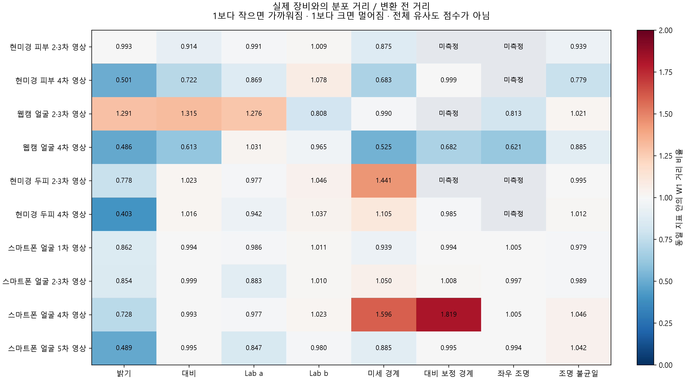
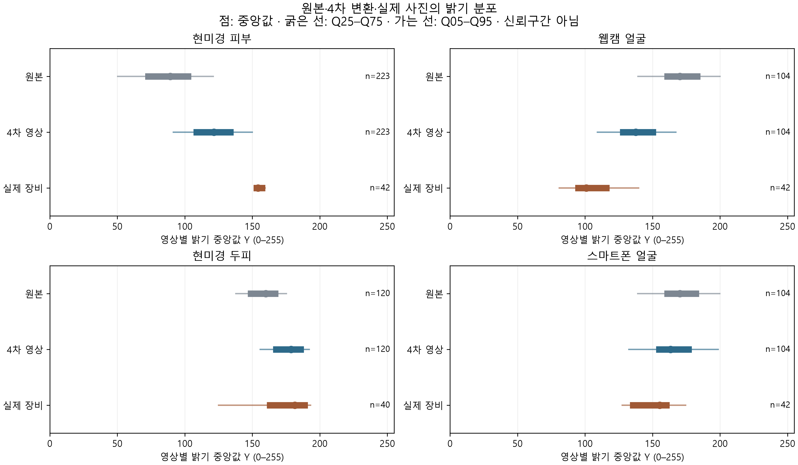
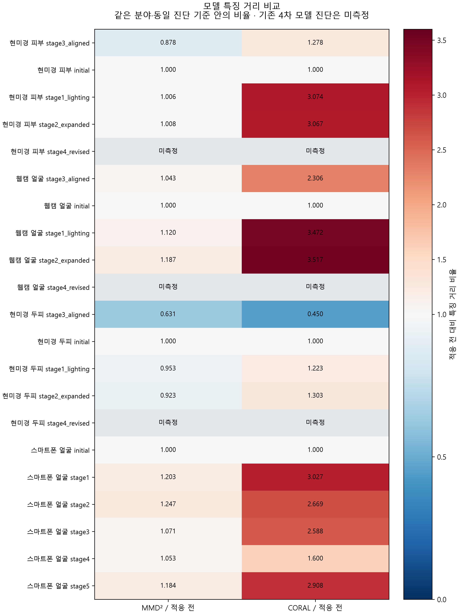

# 어댑테이션 조절값과 실제 장비 유사성 수치 비교

2026-11-12 · 완료한 21회 학습·17개 변환 묶음의 수치 정리.
기존에 저장한 측정·설정·예측을 대조한 보고서이며 새 사진 분석·학습·Test 추론은 하지 않았다.

## 먼저 읽을 핵심

“몇 % 비슷하다”라는 전체 이미지 유사도는 측정하지 않았다.
대신 **밝기·대비·색·경계·조명 등 각 항목의 분포 거리 W1**이 원본보다 얼마나 줄었는지를 비교했다.
0에 가까울수록 그 항목의 분포가 가깝지만 질환 특징·장비 동등성·분류 정확도를 뜻하지 않는다.
MMD/CORAL은 모델 특징 공간, Accuracy/Macro-F1은 정답이 있는 Source Test의 별도 지표다.

엑셀: [전체 수치와 계산표](../../../presentation/report_assets/adaptation_numeric_review_20261112/MediFlow_Adaptation_Numeric_Review_20261112.xlsx) ·
[정밀도 원문 JSON](../../../presentation/report_assets/adaptation_numeric_review_20261112/numeric_review.json).

| 분야 | 영상 변환 | 밝기 원본 W1 | 변환 W1 | 거리 감소율 | 가까워진 주요 항목 / 측정 항목 |
| --- | --- | --- | --- | --- | --- |
| 현미경 피부 | 4차 영상 | 68.00235648972958 | 34.054261613813495 | 49.92% | 6/7 |
| 웹캠 얼굴 | 4차 영상 | 61.9108728235419 | 30.09893235418958 | 51.38% | 7/8 |
| 현미경 두피 | 2·3차 영상 | 19.99060440063474 | 15.544132423400868 | 22.24% | 3/6 |
| 스마트폰 얼굴 | 4차 영상 | 19.59136385980494 | 14.26628842554866 | 27.18% | 3/8 |
| 스마트폰 얼굴 | 5차 영상 | 19.59136385980494 | 9.5751122147356 | 51.13% | 7/8 |

항목 수는 주요 8개 중 측정 가능한 항목의 **수치상 감소 개수**다. 통계적 유의성이나 종합 점수로 해석하지 않는다.
두피 패키지는 2차 모델이며 2·3차 영상 변환은 같다. 추가 5차는 비교 실험으로 완료했지만 패키징 후보는 4차를 유지했다.
분포 거리는 검토 표본에 변환을 100% 적용한 세 시드 재생의 결과다. 실제 학습의 50% 변환 혼합분포를 새로 측정한 값은 아니다.

## 1. 숫자를 읽는 단위

| 변수 | 뜻 | 0 또는 1의 의미 |
| --- | --- | --- |
| brightness_offset | RGB 밝기 가산 제안값, 퍼센트 아님 | 0은 추가 이동 없음 |
| contrast | 대비 제안 배율 | 1은 유지 |
| left_light | 좌우 밝기 차의 RGB 가산 제안값 | 0은 방향 조명 추가 없음 |
| color_a / color_b | Lab a 빨강–초록 / b 노랑–파랑 축 이동 | 0은 이동 없음 |
| texture_gain | 회색조 고주파 잔차 배율, 미세 대비 조절 | 1은 유지 |
| blur σ | 가우시안 흐림의 표준편차, 입력 픽셀 단위 | 0은 추가 흐림 없음 |
| MMD·CORAL λ | 분류 손실에 더하는 각 특징 정렬 손실 계수 | 0은 해당 손실 사용 안 함 |

밝기·대비·방향 조명은 `bounded_additive_v3`의 RGB 범위 보호를 거친다.
제안값과 최종 픽셀 변화량이 항상 같지는 않다. 여러 변환을 합쳤으므로 Lab a/b 제안 방향과
전체 변환 후 분포 이동 방향도 다를 수 있다. 모델 입력은 float32 RGB 0–255이며 외부 `/255`는 없다.
학습은 모두 5 epoch·seed 42·Adam 0.00001·변환 확률 0.5였고, Test 변환은 조건별 100% 적용·seed 1707이다.
x·y 기하 배율은 모든 완료 변환에서 1이다. 얼굴 크기·위치 교정, 잡음·JPEG 압축 증강을 추가했다고 쓰지 않는다.

## 2. 실제 적용한 밝기·대비·방향 조명

이 두 설정 표에서만 보기 편하게 소수점 6자리까지 표시했다. 원래 자릿수는 JSON/CSV에 보존했다.
1차의 초기·선정 두 모델은 같은 조명 범위를 썼다. 3차는 2차와 같은 사진 변환에 특징 손실을 추가했다.

| 분야 | 차수 | 밝기 가산 범위 | 대비 배율 | 좌우 조명차 |
| --- | --- | --- | --- | --- |
| 현미경 피부 | 1 | [-1.349252, -0.729245] | [0.93997, 0.95735] | [0, 0] |
| 현미경 피부 | 2 | [-1.349252, -0.729245] | [0.93997, 0.95735] | [0, 0] |
| 현미경 피부 | 3 | [-1.349252, -0.729245] | [0.93997, 0.95735] | [0, 0] |
| 현미경 피부 | 4 | [32, 32] | [0.8, 0.8] | [0, 0] |
| 웹캠 얼굴 | 1 | [13.485409, 17.610365] | [1.15, 1.15] | [13.776814, 15.418357] |
| 웹캠 얼굴 | 2 | [13.485409, 17.610365] | [1.15, 1.15] | [13.776814, 15.418357] |
| 웹캠 얼굴 | 3 | [13.485409, 17.610365] | [1.15, 1.15] | [13.776814, 15.418357] |
| 웹캠 얼굴 | 4 | [-32, -32] | [0.8, 1.015297] | [24, 24] |
| 현미경 두피 | 1 | [-0.636374, 12.45062] | [1, 1] | [0, 0] |
| 현미경 두피 | 2 | [-0.636374, 12.45062] | [1, 1] | [0, 0] |
| 현미경 두피 | 3 | [-0.636374, 12.45062] | [1, 1] | [0, 0] |
| 현미경 두피 | 4 | [15.043114, 26.260809] | [1, 1] | [0, 0] |
| 스마트폰 얼굴 | 1 | [-9.812065, 0] | [1, 1.090439] | [-0.211193, 0] |
| 스마트폰 얼굴 | 2 | [-9.812065, 0] | [1, 1.090439] | [-0.211193, 0] |
| 스마트폰 얼굴 | 3 | [-9.812065, 0] | [1, 1.090439] | [-0.211193, 0] |
| 스마트폰 얼굴 | 4 | [-19.62413, 0] | [1, 1.180879] | [-0.422386, 0] |
| 스마트폰 얼굴 | 5 | [-19.62413, -10.181201] | [1, 1.180879] | [-0.422386, 0] |

기존 웹캠 1~3차는 참여자 내 조건 변화를 기준으로 밝게 했으나 전체 Source와 Target의 절대 밝기 거리는 커졌다.
4차의 −32는 Source를 어둡게 하는 쪽으로 바뀐 값이다. 피부는 4차에서 +32로 방향이 바뀌었다.
따라서 “모두 강도를 두 배 올렸다”로 설명하지 않는다.

## 3. 실제 적용한 색·질감·초점

| 분야 | 차수 | Lab a 이동 | Lab b 이동 | 미세 질감 배율 | 입력 흐림 σ 범위 (px) |
| --- | --- | --- | --- | --- | --- |
| 현미경 피부 | 1 | [0, 0] | [0, 0] | [1, 1] | [0, 0] |
| 현미경 피부 | 2 | [-0.416016, 0.144531] | [-0.375, 0.128906] | [0.961915, 1.047943] | [0, 0.525] |
| 현미경 피부 | 3 | [-0.416016, 0.144531] | [-0.375, 0.128906] | [0.961915, 1.047943] | [0, 0.525] |
| 현미경 피부 | 4 | [-0.960938, 0] | [0, 0.925781] | [1, 1] | [0, 0] |
| 웹캠 얼굴 | 1 | [0, 0] | [0, 0] | [1, 1] | [0, 0] |
| 웹캠 얼굴 | 2 | [-0.648926, -0.219727] | [-0.4375, 0.326172] | [0.921506, 0.957291] | [0, 0.3875] |
| 웹캠 얼굴 | 3 | [-0.648926, -0.219727] | [-0.4375, 0.326172] | [0.921506, 0.957291] | [0, 0.3875] |
| 웹캠 얼굴 | 4 | [0, 0] | [-1.90332, 0] | [0.85, 0.914582] | [0, 0.775] |
| 현미경 두피 | 1 | [0, 0] | [0, 0] | [1, 1] | [0, 0] |
| 현미경 두피 | 2 | [-0.585938, -0.230469] | [-0.517578, -0.085938] | [0.906141, 0.964494] | [0, 1.06875] |
| 현미경 두피 | 3 | [-0.585938, -0.230469] | [-0.517578, -0.085938] | [0.906141, 0.964494] | [0, 1.06875] |
| 현미경 두피 | 4 | [0, 0] | [0, 0] | [1, 1] | [0, 0] |
| 스마트폰 얼굴 | 1 | [0, 0] | [0, 0] | [1, 1] | [0, 0] |
| 스마트폰 얼굴 | 2 | [0, 1.011719] | [0, 0] | [0.95, 1.05] | [0, 0.5] |
| 스마트폰 얼굴 | 3 | [0, 1.011719] | [0, 0] | [0.95, 1.05] | [0, 0.5] |
| 스마트폰 얼굴 | 4 | [0, 0] | [0, 0] | [0.85, 1.15] | [0, 1] |
| 스마트폰 얼굴 | 5 | [0, 1.011719] | [-1.212695, 0] | [1, 1] | [0, 0] |

입력 σ는 기록된 `ROI64 σ × blur_input_scale`에서 추출했다. 두피 4차의 흐림 0은 새 흐림을 추가하지 않았다는 뜻이다.
원래 이미지에 있는 흐림이 제거됐다는 뜻은 아니다. 별도 디블러링·복원 모델은 없다.
스마트폰 2·4차의 추가 질감·흐림은 사용자 요청 탐색이며 모든 기기의 실측 공통 이동을 재현했다는 뜻은 아니다.

### 3차 특징 정렬 손실의 실제 계수

| 분야 | MMD 계수 λ | CORAL 계수 λ |
| --- | --- | --- |
| 현미경 피부 | 0.009276486496767843 | 0.00921319341745932 |
| 웹캠 얼굴 | 0.01068621196402111 | 0.044213753365170944 |
| 현미경 두피 | 0.10659643952049762 | 0.16272447754974867 |
| 스마트폰 얼굴 | 0.01811730210852143 | 0.057266924535746916 |

MMD·CORAL을 동시에 추가한 실험이며 각 손실 하나만의 효과를 분리한 실험은 아니다.
추가 5차는 MMD/CORAL 학습 손실을 쓰지 않았다. 학습 후 진단 숫자가 있다는 것과 손실로 학습했다는 것은 다르다.

## 4. 실제 장비와의 분포 거리가 얼마나 바뀌었는가

W1은 같은 항목의 값 분포를 옮기는 데 필요한 차이를 원래 단위로 표현한 Wasserstein-1 거리다.
`거리 감소율 = 100 × (원본 W1 − 변환 W1) / 원본 W1`로 계산했다.
양수는 가까워짐, 음수는 멀어짐이다. 감소율만 표시용 소수점 2자리이며 원래 W1은 기록 자릿수 그대로다.
기준 거리 0의 감소율은 정의하지 않으며 미측정을 0으로 채우지 않았다.

기존 장비는 Source 클래스·Target 사람/조건을 균등 가중하고 고정 ROI·uint8 측정을 사용했다.
스마트폰은 EXIF·ICC 보정 후 고정 ROI의 float 측정·그룹 균등 가중이다. 서로 다른 측정 체계의 W1 원값을
직접 더하거나 전체 평균 내어 장비 유사도 순위를 만들지 않았다. 전후 비교는 동일 분석 안에서 한다.
기존 표본은 피부 223장·웹캠 118장(유효 얼굴 ROI 104장)·두피 120장, 실제 사진은 42·42·40장이다.
스마트폰은 Source 118장(유효 ROI104)·설정용 42장, P05 10장은 이 재생에 포함하지 않았다.

### 현미경 피부 · 4차 영상

| 항목 | 원본 W1 | 변환 W1 | 거리 감소율 |
| --- | --- | --- | --- |
| 밝기 | 68.00235648972958 | 34.054261613813495 | 49.92% |
| 대비 | 44.71368223607271 | 32.27153314876111 | 27.83% |
| Lab a | 15.812114564462654 | 13.738697586428227 | 13.11% |
| Lab b | 16.692388945501154 | 17.99167091259052 | -7.78% |
| 미세 경계 | 3.4312986543213437 | 2.3426686764987457 | 31.73% |
| 대비 보정 경계 | 0.01807147503008481 | 0.01805824493704202 | 0.07% |
| 좌우 조명 | 미측정 | 미측정 | 미측정 |
| 조명 불균일 | 22.212219229412757 | 17.305270797849452 | 22.09% |
### 웹캠 얼굴 · 4차 영상

| 항목 | 원본 W1 | 변환 W1 | 거리 감소율 |
| --- | --- | --- | --- |
| 밝기 | 61.9108728235419 | 30.09893235418958 | 51.38% |
| 대비 | 4.647723632367797 | 2.8508463784797824 | 38.66% |
| Lab a | 3.0731718080945614 | 3.1670041532856024 | -3.05% |
| Lab b | 6.488106266469065 | 6.262208961215439 | 3.48% |
| 미세 경계 | 0.3812156505602994 | 0.20009771130963216 | 47.51% |
| 대비 보정 경계 | 0.014392767675236518 | 0.009809927354870136 | 31.84% |
| 좌우 조명 | 15.745186572897925 | 9.776329859129248 | 37.91% |
| 조명 불균일 | 6.4384170787294 | 5.700720161694318 | 11.46% |
### 현미경 두피 · 2·3차 영상

| 항목 | 원본 W1 | 변환 W1 | 거리 감소율 |
| --- | --- | --- | --- |
| 밝기 | 19.99060440063474 | 15.544132423400868 | 22.24% |
| 대비 | 101.19656829833973 | 103.47720712025946 | -2.25% |
| Lab a | 7.9084635416667 | 7.727083333333367 | 2.29% |
| Lab b | 7.33326822916667 | 7.6683593750000005 | -4.57% |
| 미세 경계 | 2.4789892176786865 | 3.571062552928904 | -44.05% |
| 대비 보정 경계 | 미측정 | 미측정 | 미측정 |
| 좌우 조명 | 미측정 | 미측정 | 미측정 |
| 조명 불균일 | 36.25356969833361 | 36.066488615671666 | 0.52% |
### 스마트폰 얼굴 · 4차 영상

| 항목 | 원본 W1 | 변환 W1 | 거리 감소율 |
| --- | --- | --- | --- |
| 밝기 | 19.59136385980494 | 14.26628842554866 | 27.18% |
| 대비 | 6.151448596858905 | 6.107409350956919 | 0.72% |
| Lab a | 4.365609174283588 | 4.263297590373839 | 2.34% |
| Lab b | 2.7215111371870826 | 2.784271811182471 | -2.31% |
| 미세 경계 | 0.14857599940273566 | 0.23714479976953198 | -59.61% |
| 대비 보정 경계 | 0.0035760892196840034 | 0.006503996167214983 | -81.87% |
| 좌우 조명 | 6.134571837750734 | 6.166555512595482 | -0.52% |
| 조명 불균일 | 5.180339020765414 | 5.419347050255919 | -4.61% |
### 스마트폰 얼굴 · 5차 영상

| 항목 | 원본 W1 | 변환 W1 | 거리 감소율 |
| --- | --- | --- | --- |
| 밝기 | 19.59136385980494 | 9.5751122147356 | 51.13% |
| 대비 | 6.151448596858905 | 6.121784599213804 | 0.48% |
| Lab a | 4.365609174283588 | 3.69880818202404 | 15.27% |
| Lab b | 2.7215111371870826 | 2.666033638010531 | 2.04% |
| 미세 경계 | 0.14857599940273566 | 0.1315412272888135 | 11.47% |
| 대비 보정 경계 | 0.0035760892196840034 | 0.0035589463828795916 | 0.48% |
| 좌우 조명 | 6.134571837750734 | 6.09777283938671 | 0.60% |
| 조명 불균일 | 5.180339020765414 | 5.39645999574218 | -4.17% |

기존 1차 단독 W1 재생 값은 저장되어 있지 않아 새로 만들어 채우지 않았다.
기존 2차의 `previous`와 실제 2차 reference, 4차의 `revised`와 실제 완료 4차 profile,
스마트폰 각 후보와 실제 학습 profile이 일치하는지 대조했다. 미실행 재설정 4차나 거절한 확대 후보를 완료 4차로 쓰지 않았다.

## 5. 실제 분포의 값과 남은 차이

엑셀 `실제분포`에는 평균·분산·Q05·Q25·Q50·Q75·Q95와 사진 수를 담았다.
Q05~Q95는 사진 값의 분포 구간이며 신뢰구간이 아니다. 기존 장비의 저장 표본 통계와
스마트폰의 그룹 가중 통계를 각각 표시했으며 서로 다른 가중 방식의 중앙값을 같은 계산으로 취급하지 않는다.

밝기가 가까워져도 색·질감·촬영 범위 차이가 모두 해결된 것은 아니다.
두피는 모발 가림·두피 노출과 초점이 대비·미세 경계 값에 함께 영향을 준다.
스마트폰 추가 5차는 7개 항목이 가까워졌지만 조명 불균일은 악화됐고 참여자 4명 중 2명만 평균 비용이 감소했다.
원래 유사성 보호 기준을 모두 통과한 후보는 없었다. 영상 통계의 일치를 질환 특징 보존 검증으로 대체하지 않는다.

## 6. 웹캠과 스마트폰의 실제 차이

아래는 같은 256px 입력·고정 볼 ROI에서 클래스/사람별 중앙값을 먼저 계산한 뒤 그룹 중앙값을 낸 비교다.
모델 입력과 실제 장면·사람 차이가 섞여 있어 센서 자체의 우열이나 같은 장면의 카메라 짝 비교가 아니다.
얼굴 크기·위치 등 저장된 항목도 함께 보존했다.

| 실측 항목 | Source Train | 웹캠 | 휴대폰 | 휴대폰−웹캠 |
| --- | --- | --- | --- | --- |
| 밝기 중앙값 | 168.30550384521484 | 99.92862606048584 | 155.33774948120117 | 55.40912342071533 |
| 대비 P90−P10 | 25.39599609375 | 23.500749588012695 | 29.989588737487793 | 6.488839149475098 |
| Lab a 색상 | 15.8828125 | 15.8671875 | 16.447265625 | 0.580078125 |
| Lab b 색상 | 20.015625 | 14.10546875 | 18.265625 | 4.16015625 |
| 미세 경계 | 0.45439691841602325 | 0.1053407397121191 | 0.5923888050019741 | 0.487048065289855 |
| 대비 보정 미세 경계 | 0.019645489129725323 | 0.004606477745937259 | 0.021243221123748504 | 0.016636743377811243 |
| 좌우 조명 | -2.1494903564453125 | 12.499250411987305 | -2.5718765258789062 | -15.071126937866211 |
| 조명 불균일 | 29.138519287109375 | 28.161378860473633 | 30.044998168945312 | 1.8836193084716797 |
| 얼굴 폭 비율 | 0.75 | 0.4833984375 | 0.626953125 | 0.1435546875 |

스마트폰이 웹캠보다 밝기 중앙값과 미세 경계가 높았다는 관찰이다.
스마트폰에도 웹캠과 같은 방향의 추가 흐림이 필요한지를 이 값만으로 확정하지 않는다.
기하 배율을 1로 유지했으므로 얼굴 크기 차이는 이번 조명·색 변환으로 직접 교정하지 않았다.

## 7. MMD·CORAL 특징 거리 변화

MMD는 구현상 RBF 커널의 biased MMD²이며 제곱근 MMD를 별도로 계산하지 않았다.
CORAL은 특징 공분산 차이를 정규화한 손실이다. 둘 다 이 코드에서는 작을수록 특징 분포 차이가 작다.
기존 장비는 확장 Source Validation 표본 대 설정용 Target, 스마트폰은 Source Train40장 대 설정용 Target42장이다.
진단의 표본·고정 기준이 달라 서로 다른 분야 숫자의 절대 순위를 직접 비교하지 않는다.

### 2차와 3차 비교

| 분야 | 2차 MMD | 3차 MMD | 2차 CORAL | 3차 CORAL |
| --- | --- | --- | --- | --- |
| 현미경 피부 | 0.2598424553871155 | 0.22636711597442627 | 0.8401726484298706 | 0.35027027130126953 |
| 웹캠 얼굴 | 0.2405034303665161 | 0.21141201257705688 | 0.11883683502674103 | 0.07790988683700562 |
| 현미경 두피 | 0.21444439888000488 | 0.14654260873794556 | 0.23160523176193237 | 0.07997066527605057 |
| 스마트폰 얼굴 | 0.17212897539138794 | 0.14776241779327393 | 0.1165110245347023 | 0.1129620373249054 |

네 분야 모두 3차가 2차보다 두 지표가 낮다. 그러나 적응 전과 비교하면 이야기가 다르다.
예를 들어 웹캠의 적응 전 MMD `0.20260989665985107`·CORAL `0.03378517925739288`보다
3차 값이 높다. “2차 대비 감소”를 “원래 모델보다 실제 장비에 더 가까워짐”으로 바꿔 쓰지 않는다.

### 적응 전부터 각 모델의 원문 값

| 분야 | 모델 | Source / Target 수 | MMD 원문 | CORAL 원문 |
| --- | --- | --- | --- | --- |
| 현미경 피부 | stage3_aligned | 80 / 42 | 0.22636711597442627 | 0.35027027130126953 |
| 현미경 피부 | initial | 80 / 42 | 0.257715106010437 | 0.2739834785461426 |
| 현미경 피부 | stage1_lighting | 80 / 42 | 0.25922340154647827 | 0.8421478271484375 |
| 현미경 피부 | stage2_expanded | 80 / 42 | 0.2598424553871155 | 0.8401726484298706 |
| 현미경 피부 | stage4_revised | 미측정 | 미측정 | 미측정 |
| 웹캠 얼굴 | stage3_aligned | 40 / 42 | 0.21141201257705688 | 0.07790988683700562 |
| 웹캠 얼굴 | initial | 40 / 42 | 0.20260989665985107 | 0.03378517925739288 |
| 웹캠 얼굴 | stage1_lighting | 40 / 42 | 0.2268836498260498 | 0.11731623858213425 |
| 웹캠 얼굴 | stage2_expanded | 40 / 42 | 0.2405034303665161 | 0.11883683502674103 |
| 웹캠 얼굴 | stage4_revised | 미측정 | 미측정 | 미측정 |
| 현미경 두피 | stage3_aligned | 40 / 40 | 0.14654260873794556 | 0.07997066527605057 |
| 현미경 두피 | initial | 40 / 40 | 0.2323296070098877 | 0.1777438521385193 |
| 현미경 두피 | stage1_lighting | 40 / 40 | 0.221396803855896 | 0.21734537184238434 |
| 현미경 두피 | stage2_expanded | 40 / 40 | 0.21444439888000488 | 0.23160523176193237 |
| 현미경 두피 | stage4_revised | 미측정 | 미측정 | 미측정 |
| 스마트폰 얼굴 | initial | 40 / 42 | 0.13798964023590088 | 0.043655216693878174 |
| 스마트폰 얼굴 | stage1 | 40 / 42 | 0.16595947742462158 | 0.13216158747673035 |
| 스마트폰 얼굴 | stage2 | 40 / 42 | 0.17212897539138794 | 0.1165110245347023 |
| 스마트폰 얼굴 | stage3 | 40 / 42 | 0.14776241779327393 | 0.1129620373249054 |
| 스마트폰 얼굴 | stage4 | 40 / 42 | 0.14532285928726196 | 0.06983822584152222 |
| 스마트폰 얼굴 | stage5 | 40 / 42 | 0.16332203149795532 | 0.12693342566490173 |

기존 장비 4차 모델의 MMD/CORAL 사후 진단은 미측정이다.
스마트폰 4차·5차는 측정했지만 적응 전보다 둘 다 낮아진 결과는 아니다.
MMD/CORAL 감소나 예측 확신도 증가 자체로 정확도 개선을 결론 내리지 않는다.

## 8. 분류 성능은 얼마나 바뀌었는가

이 표는 미리 선정한 후보의 **원본 Source Test**다. 실제 장비의 질환 정확도가 아니다.

| 분야 | 고정 후보 | 적응 전 정답 | 후보 정답 | 정답 증감 | 후보 Accuracy | 후보 Macro-F1 |
| --- | --- | --- | --- | --- | --- | --- |
| 현미경 피부 | stage4_revised | 699/700 | 699/700 | 0 | 0.9985714285714286 | 0.9985713556814122 |
| 웹캠 얼굴 | stage4_revised | 366/400 | 368/400 | 2 | 0.92 | 0.9195416007010457 |
| 현미경 두피 | stage2_expanded | 1002/1252 | 995/1252 | -7 | 0.7947284345047924 | 0.7951323060366875 |
| 스마트폰 얼굴 | stage4 | 366/400 | 367/400 | 1 | 0.9175 | 0.9172235025222394 |

### 스마트폰 조건별 비교

| 모델 | 원본 정답 /400 | 강한 변환 정답 /400 | 새 근접 변환 정답 /400 |
| --- | --- | --- | --- |
| initial | 366 | 327 | 365 |
| stage1 | 363 | 327 | 362 |
| stage2 | 365 | 332 | 369 |
| stage3 | 362 | 330 | 363 |
| stage4 | 367 | 355 | 366 |
| stage5 | 362 | 328 | 361 |

스마트폰 4차는 밝기 거리 감소 27.18%·주요 3/8 항목 근접이었지만 강한 변환 정답은 327→355장으로 늘었다.
추가5차는 밝기 거리 감소 51.13%·주요 7/8 항목 근접이었으나 원본 정답 362장·새 근접 변환 361장으로
적응 전의 366장·365장보다 각각 4장 적었다. 장비 통계 근접과 분류 성능은 별도로 비교해야 한다.
세부 81개 비교 기록은 엑셀 `Test비교`에 담았다. 클래스 Recall·혼동행렬은 기존 Test 원본 결과에 보존되어 있다.
원본/F1 수치는 반올림하지 않았고 Excel 15자리 제한을 피하는 원문 텍스트와 정답 수를 함께 넣었다.

## 9. 발표·보고서에 사용할 설명

> 기존 데이터와 실제 촬영 사진의 분포 차이를 바탕으로 밝기·대비·방향 조명·색·미세 대비·흐림 범위를 설정했다.
> 완료한 21회 학습은 분야·출발 역할별 기존 저장본에서 독립적으로 수행했으며 3차에만 MMD·CORAL 결합 손실을 추가했다.
> 영상 변환의 장비 근접성은 항목별 W1 전후 거리로, 학습된 특징은 MMD/CORAL로, 분류 성능은 고정 Source Test로 구분했다.
> 피부·웹캠 4차와 두피 2차 영상의 밝기 분포 거리는 각각 49.92%·51.38%·22.24% 감소했다.
> 스마트폰 4차와 추가5차의 밝기 거리 감소는 27.18%·51.13%였으나 일부 색·질감·조명 항목은 악화됐고
> 실제 장비 질환 정답이 없어 실제 장비 분류 성능 개선이나 전체 이미지 유사도는 확정하지 않았다.

## 자료와 재현

엑셀 7개 시트는 핵심 비교·적용값·장비거리·실제분포·특징거리·Test비교·웹캠과 휴대폰이다.
[원문 JSON과 CSV·그림 안내](../../../presentation/report_assets/adaptation_numeric_review_20261112/README.md)에
정밀도 보존, 출처 해시, 누락 측정과 검사 결과를 연결했다.
기존 원본 이미지·모델·측정 JSON/CSV·노트북·연구 결과 본문은 보존했다. 안내 색인에는 이 보고서 링크만 추가했다.
이 작업은 기존 수치를 추출하고 거리 증감/비율을 계산한 것이다. 변환 강도·학습·패키징 후보를 변경하지 않았다.

검사 결과: `ruff check src tests` 통과, 전체 `pytest` 273개 통과·3개 건너뜀이다.
건너뛴 항목은 선택 설치 패키지 pandas가 없는 기존 노트북 검사다.
출처 37개 해시·107개 거리 계산·81쌍의 정확도/F1 원문·특징 거리·웹캠/휴대폰 차이와 엑셀 7개 시트를 대조했다.
[검증 기록](../../../presentation/report_assets/adaptation_numeric_review_20261112/verification.json)을 함께 보관했다.
