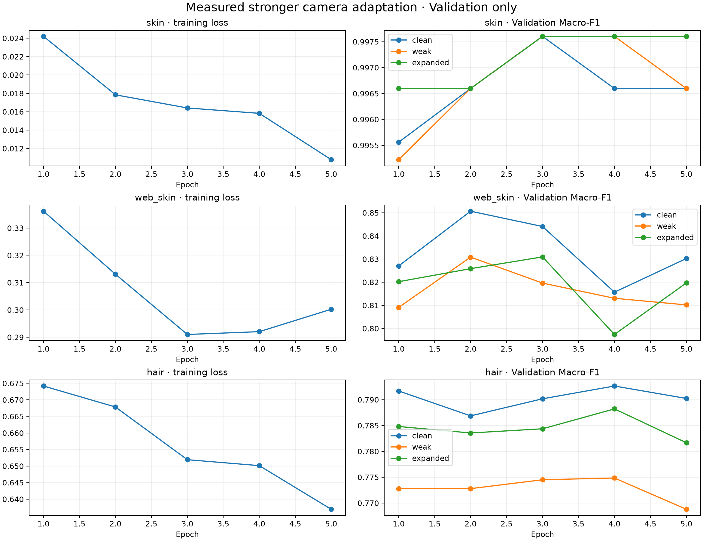

# 조정 전 4차 학습 결과 분석 · 2026-11-11

## 결론과 실행 구분

사용자가 전달한 `MediFlow_Revised_Camera_Results_20261111.zip`은 **조정 전 4차** 결과다. 설정 식별값 `492ee01afb45`가 보존된 이전 설정과 일치하고 세 분야 모두 5 epoch 완료했다. 재설정본 `e6bc85bc0a7d`의 학습 결과가 아니며, 현재 로컬 재설정 노트북·설정은 유지했다.

이번 ZIP의 공통 Validation 선정 기준에서는 **피부·얼굴은 조정 전 4차, 두피는 기존 2차**가 선택됐다. 공식 배포 후보 색인을 변경하지 않았다. Test나 실제 장비 질환 Accuracy를 새로 측정한 결과가 아니다.

## 확인한 실행 조건

세 분야 모두 1차에서 선택한 방식의 1차 학습 전 저장본에서 시작했다. 피부는 초기 B0·224, 얼굴은 선정 PMG·B0·256, 두피는 선정 B1·384 5클래스다. 모델당 5 epoch, seed 42, Adam 학습률 0.00001, 배치 16/8/8, 변환 적용 확률 0.5를 사용했다. 같은 출발점·분할에서 촬영 변환 묶음이 달라진 비교다. 개별 색·흐림 요소 하나의 효과를 분리한 결과는 아니다.

입력은 RGB float32 0~255이고 모델 내부 Rescaling을 사용한다. PMG는 네 logit 출력을 합한 뒤 softmax를 적용한다. 기록된 학습 환경은 TensorFlow 2.20.0·Keras 3.13.2·NVIDIA L4다. 원본 JSON의 나머지 환경·코드·데이터 식별값을 보존했다.

| 분야 | Train 원본 수 | Validation 수 | 기록된 Test 수 · 이번 미평가 | 저장한 최적 epoch |
| --- | ---: | ---: | ---: | ---: |
| skin | 6753 | 900 | 700 | 3 |
| web_skin | 3535 | 499 | 400 | 3 |
| hair | 10032 | 1252 | 1252 | 4 |

최적 epoch는 **원본·조정 전 4차 확장 Validation 중 낮은 Macro-F1**이 가장 높은 회차를 고르고 원본 점수와 이전 회차로 동점을 판정했다. 피부·얼굴은 3회차, 두피는 4회차 선택을 재계산해 확인했다. Loss가 더 낮아진 마지막 5회차가 자동으로 선택된 것은 아니다.

## 비교 조건의 뜻

- `initial`: 이 분야의 선택된 학습 전 저장본.
- `previous_expanded`: 이미 완료한 2차 모델.
- `stronger_expanded`: 이번 조정 전 4차 모델.
- `clean`: 원본 Source Validation.
- `weak`: 기존 2차의 조명·색·미세 대비·흐림을 적용한 Validation.
- `lighting`: 조정 전 4차의 조명만 적용한 Validation.
- `expanded`: 조정 전 4차의 조명·선택된 확장 변환을 적용한 Validation. 두피는 추가 색·질감·흐림이 없어 lighting과 같다.

세 모델은 **같은 사진·정답·변환 조건**에서 재평가됐다. 이전 2차 보고서의 다른 조건 점수와 섞지 않고 이번 ZIP의 공통 재평가 표를 비교한다. 이번 ZIP은 1차·3차 모델을 새 4차 조건으로 재평가한 자료까지 담고 있지는 않다.

## 맞힌 이미지 수 비교

아래는 각 조건에서 총 정답 수를 센 값이다. 이미지별 예측 목록은 ZIP에 없어 어떤 개별 사진이 고쳐지거나 틀렸는지까지 특정하지 않는다.

| 분야 | 모델 | 원본 | 기존 2차 변환 | 조정 전 4차 확장 변환 |
| --- | --- | ---: | ---: | ---: |
| skin | 학습 전 | 897/900 | 898/900 | 895/900 |
| skin | 2차 | 898/900 | 898/900 | 895/900 |
| skin | 조정 전 4차 | 898/900 | 898/900 | 898/900 |
| web_skin | 학습 전 | 424/499 | 417/499 | 398/499 |
| web_skin | 2차 | 422/499 | 414/499 | 401/499 |
| web_skin | 조정 전 4차 | 422/499 | 410/499 | 415/499 |
| hair | 학습 전 | 997/1252 | 978/1252 | 984/1252 |
| hair | 2차 | 992/1252 | 989/1252 | 980/1252 |
| hair | 조정 전 4차 | 992/1252 | 968/1252 | 987/1252 |

피부는 이번 확장 조건에서 2차보다 정답이 3장 늘었고 원본 정답 수는 같았다. 차이가 적고 기존 점수가 높은 영역이므로 작은 검증 차이를 일반적인 성능 향상으로 확대 해석하지 않는다.

얼굴은 이번 확장 조건에서 2차보다 14장, 학습 전보다 17장 더 맞혔다. 원본은 2차와 같고 학습 전보다는 2장 적다. 기존 2차 변환에서는 2차보다 4장 적게 맞혔다. 새로운 변환 대응과 기존 조건 유지 사이의 교환이 있다.

두피는 이번 변환에서 2차보다 7장 더 맞혔지만 기존 2차 변환에서 21장 덜 맞혔다. 원본은 2차와 같은 정답 수이고 학습 전보다 5장 적다. 이번 변환 한 조건만 보고 두피 4차가 우수하다고 판단하지 않는다.

## 저장된 Macro-F1과 Accuracy

수치는 원본 기록값을 반올림하지 않고 적었다. Macro-F1은 각 클래스의 F1을 같은 비중으로 평균한 값이다. 같은 정답 수여도 클래스별 오답 구성이 다르면 달라진다.

| 분야 | 모델 | 평가 조건 | Accuracy | Macro-F1 |
| --- | --- | --- | ---: | ---: |
| skin | 학습 전 | clean | 0.9966666666666667 | 0.9965963674000184 |
| skin | 학습 전 | lighting | 0.9933333333333333 | 0.992117503988746 |
| skin | 학습 전 | expanded | 0.9944444444444445 | 0.9935152536910259 |
| skin | 학습 전 | weak | 0.9977777777777778 | 0.9976017479221756 |
| skin | 2차 | clean | 0.9977777777777778 | 0.9976017479221756 |
| skin | 2차 | lighting | 0.9944444444444445 | 0.993168147190449 |
| skin | 2차 | expanded | 0.9944444444444445 | 0.993168147190449 |
| skin | 2차 | weak | 0.9977777777777778 | 0.9976017479221756 |
| skin | 조정 전 4차 | clean | 0.9977777777777778 | 0.9976017479221756 |
| skin | 조정 전 4차 | lighting | 0.9977777777777778 | 0.9976017479221756 |
| skin | 조정 전 4차 | expanded | 0.9977777777777778 | 0.9976017479221756 |
| skin | 조정 전 4차 | weak | 0.9977777777777778 | 0.9976017479221756 |
| web_skin | 학습 전 | clean | 0.8496993987975952 | 0.8471375958306038 |
| web_skin | 학습 전 | lighting | 0.8416833667334669 | 0.8400442327129337 |
| web_skin | 학습 전 | expanded | 0.7975951903807615 | 0.7951552177660287 |
| web_skin | 학습 전 | weak | 0.8356713426853707 | 0.8330199818760329 |
| web_skin | 2차 | clean | 0.845691382765531 | 0.8452139236284577 |
| web_skin | 2차 | lighting | 0.8316633266533067 | 0.8323272183186724 |
| web_skin | 2차 | expanded | 0.8036072144288577 | 0.8041675654309934 |
| web_skin | 2차 | weak | 0.8296593186372746 | 0.8297960345454877 |
| web_skin | 조정 전 4차 | clean | 0.845691382765531 | 0.8440681425959449 |
| web_skin | 조정 전 4차 | lighting | 0.8336673346693386 | 0.832568791097863 |
| web_skin | 조정 전 4차 | expanded | 0.8316633266533067 | 0.8309329752560016 |
| web_skin | 조정 전 4차 | weak | 0.8216432865731463 | 0.8196219458629163 |
| hair | 학습 전 | clean | 0.7963258785942492 | 0.7957429931637543 |
| hair | 학습 전 | lighting | 0.7859424920127795 | 0.7846213015924425 |
| hair | 학습 전 | expanded | 0.7859424920127795 | 0.7846213015924425 |
| hair | 학습 전 | weak | 0.7811501597444089 | 0.7812966127563242 |
| hair | 2차 | clean | 0.792332268370607 | 0.7924812646314018 |
| hair | 2차 | lighting | 0.7827476038338658 | 0.7820517795657131 |
| hair | 2차 | expanded | 0.7827476038338658 | 0.7820517795657131 |
| hair | 2차 | weak | 0.7899361022364217 | 0.7900578506535009 |
| hair | 조정 전 4차 | clean | 0.792332268370607 | 0.7926449140430689 |
| hair | 조정 전 4차 | lighting | 0.7883386581469649 | 0.7882173427367334 |
| hair | 조정 전 4차 | expanded | 0.7883386581469649 | 0.7882173427367334 |
| hair | 조정 전 4차 | weak | 0.7731629392971247 | 0.774844874001947 |

## 왜 피부·얼굴은 4차, 두피는 2차인가

최종 공통 선정은 원본·2차 변환·이번 확장 변환의 세 Macro-F1 중 **가장 낮은 값**을 최대화하고, 동점이면 원본·앞선 모델 순으로 판정했다. 최적 epoch를 고르는 앞 절의 두 조건 기준과 구분한다. 저장된 `selection.json`의 선택을 같은 규칙으로 다시 계산해 확인했다.

| 분야 | 학습 전 최저 F1 | 2차 최저 F1 | 조정 전 4차 최저 F1 | 이 비교의 선택 |
| --- | ---: | ---: | ---: | --- |
| skin | 0.9935152536910259 | 0.993168147190449 | 0.9976017479221756 | 조정 전 4차 |
| web_skin | 0.7951552177660287 | 0.8041675654309934 | 0.8196219458629163 | 조정 전 4차 |
| hair | 0.7812966127563242 | 0.7820517795657131 | 0.774844874001947 | 2차 |

얼굴은 원본 Accuracy가 2차와 같아도 원본 Macro-F1은 조금 낮다. 반면 새 변환의 취약 조건이 개선돼 세 조건의 최저 점수가 올라 선택됐다. 두피는 기존 변환에서 낮아진 점수가 전체 선택을 제한했다. ‘학습을 수행한 모델’과 ‘최종 비교에서 선택한 모델’을 구분해서 보관한다.

## 클래스별 Recall 점검

아래는 2차와 이번 모델의 해당 조건 Recall이다. 실제 환자에서 측정한 진단 민감도가 아니라 Source Validation의 클래스별 정답 비율이다.

| 분야 | 조건 | 클래스 | 2차 Recall | 조정 전 4차 Recall |
| --- | --- | --- | ---: | ---: |
| web_skin | clean | 건선 | 0.86 | 0.93 |
| web_skin | clean | 아토피 | 0.82 | 0.73 |
| web_skin | clean | 여드름 | 0.7 | 0.67 |
| web_skin | clean | 정상 | 1.0 | 1.0 |
| web_skin | clean | 주사 | 0.8484848484848485 | 0.898989898989899 |
| web_skin | weak | 건선 | 0.87 | 0.91 |
| web_skin | weak | 아토피 | 0.77 | 0.64 |
| web_skin | weak | 여드름 | 0.71 | 0.69 |
| web_skin | weak | 정상 | 1.0 | 1.0 |
| web_skin | weak | 주사 | 0.797979797979798 | 0.8686868686868687 |
| web_skin | expanded | 건선 | 0.67 | 0.86 |
| web_skin | expanded | 아토피 | 0.83 | 0.71 |
| web_skin | expanded | 여드름 | 0.74 | 0.74 |
| web_skin | expanded | 정상 | 0.98 | 1.0 |
| web_skin | expanded | 주사 | 0.797979797979798 | 0.8484848484848485 |
| hair | clean | 모낭사이홍반 | 0.8548387096774194 | 0.8669354838709677 |
| hair | clean | 미세각질 | 0.73828125 | 0.73046875 |
| hair | clean | 비듬 | 0.7468879668049793 | 0.7551867219917012 |
| hair | clean | 탈모 | 0.8326530612244898 | 0.8163265306122449 |
| hair | clean | 피지과다 | 0.7900763358778626 | 0.7938931297709924 |
| hair | weak | 모낭사이홍반 | 0.842741935483871 | 0.8064516129032258 |
| hair | weak | 미세각질 | 0.765625 | 0.76953125 |
| hair | weak | 비듬 | 0.7095435684647303 | 0.7302904564315352 |
| hair | weak | 탈모 | 0.8408163265306122 | 0.8244897959183674 |
| hair | weak | 피지과다 | 0.7900763358778626 | 0.7366412213740458 |
| hair | expanded | 모낭사이홍반 | 0.8185483870967742 | 0.8225806451612904 |
| hair | expanded | 미세각질 | 0.7578125 | 0.7578125 |
| hair | expanded | 비듬 | 0.6804979253112033 | 0.7095435684647303 |
| hair | expanded | 탈모 | 0.8938775510204081 | 0.8734693877551021 |
| hair | expanded | 피지과다 | 0.7633587786259542 | 0.7786259541984732 |

얼굴 새 변환의 건선 Recall은 개선됐지만 아토피는 낮아졌다. 두피의 기존 변환에서는 피지과다 정답 수가 14장, 모낭사이홍반이 9장, 탈모가 4장 감소했고 다른 클래스의 증가를 합하면 전체 정답 수는 21장 감소했다. 전체 F1 상승만으로 모든 클래스가 개선됐다고 쓰지 않는다. 피부는 이번 모델의 모든 조건에서 사마귀·지루각화증에 각 한 건의 오류가 남았으며 자세한 혼동행렬은 `skin/complete.json`을 따른다.

## 학습곡선과 측정 범위

피부는 3회차 이후 새 변환 F1은 유지됐지만 원본에서 떨어진 회차가 있다. 얼굴은 4회차에 검증 점수가 내려갔다가 5회차에 일부 회복했고 3회차가 선택됐다. 두피는 Loss가 계속 낮아져도 마지막 검증 점수가 4회차보다 낮았다. 5회차보다 최적 회차를 저장하는 동작이 실제 기록과 일치한다. 이 곡선 하나로 원인을 과적합·데이터 문제 중 하나로 확정하지 않는다.

실제 질환 정답이 확인된 Target 자료가 없어 Target Accuracy·F1은 계산하지 않았다. 이번 Source Test도 실행하지 않았다. 과거 저장 모델과 현재 검증 자료의 독립성은 미확인이고, 사람·병변·세션 식별자도 없어 해당 수준 누수가 없다고 결론내리지 않는다. 원본과 증강 출처의 확인 가능 범위는 분야별 `data_audit.json`에 있다. 단일 seed의 탐색적 Validation 결과이며 임상 성능·통계적 유의성을 입증한 결과가 아니다.

## 로컬 보존과 확인

[결과 폴더](../../../results/camera_adaptation_stage4_before_refit_20261111/README.md)에 선정 여부와 무관하게 학습한 최적 모델 3개, 원본 보고서·표·5회차 이력·곡선·실행 당시 코드 3개를 보존했다. ZIP 자체를 프로젝트에 다시 복사하지 않았다. 3개 분할 목록은 기존 1차 파일과 바이트가 같아 중복 저장하지 않고 파일별 경로·해시를 import 기록에 연결했다. ZIP의 30개 항목 모두 보존 사본 또는 동일 파일 참조로 대응된다.

ZIP CRC·모델 해시·설정·출발 모델·클래스 순서·분할을 확인했다. 36개 비교와 60개 회차 기록의 총 96개 혼동행렬에서 Accuracy·Macro-F1·Precision·Recall·Support를 다시 계산해 일치를 확인했다. 최적 epoch와 최종 모델 선택도 기록과 일치했다. 저장 모델 3개는 로컬 CPU에서 실제 로드하고 합성 RGB 0~255 입력으로 출력 형태와 유한값을 확인했다. 실제 Validation 사진의 추론을 로컬에서 다시 실행한 것은 아니다.

[import 검증](../../../results/camera_adaptation_stage4_before_refit_20261111/import_verification.json) · [모델 로드 검사](../../../results/camera_adaptation_stage4_before_refit_20261111/model_load_verification.json) · [원본 비교표](../../../results/camera_adaptation_stage4_before_refit_20261111/validation_comparison.csv).

프로젝트 검사에서 `ruff check src tests`는 통과했고 `pytest`는 195개 통과·3개 건너뜀이다. 건너뛴 항목은 로컬 matplotlib 미설치로 인한 그래프 관련 검사다. 가져온 원본 파일 27개와 기존 분할 목록 3개의 해시를 다시 확인했고, 안내 문서의 로컬 링크 313개도 모두 연결됐다. [최종 검증 기록](../../../results/camera_adaptation_stage4_before_refit_20261111/verification_summary.json)을 보존했다.

## 다음 단계 · 사용자 결정 반영

사용자는 조정 전 4차만 진행하고 재설정 4차는 학습하지 않기로 했다. 재설정본은 미실행 보관 자료로 분리했다. 완료한 모델과 수치 결과는 그대로 유지했다.

[4차 추가 Test](ADAPTATION_STAGE4_FINAL_TEST_20261111.md)까지 완료했다. 4차 모델만 원본·기존 조명·기존 확장·완료한 4차 조명·완료한 4차 확장으로 새로 평가하고 기본~3차의 기존 Test 결과를 재사용했다. [최종 비교 분석](ADAPTATION_STAGE4_TEST_RESULT_REVIEW_20261111.md)을 확인한다. 이전 점수가 없는 새 4차 변환에서는 4차 점수만 기록했고 Test로 모델이나 강도를 다시 정하지 않았다. 공식 후보 색인은 유지했다.
