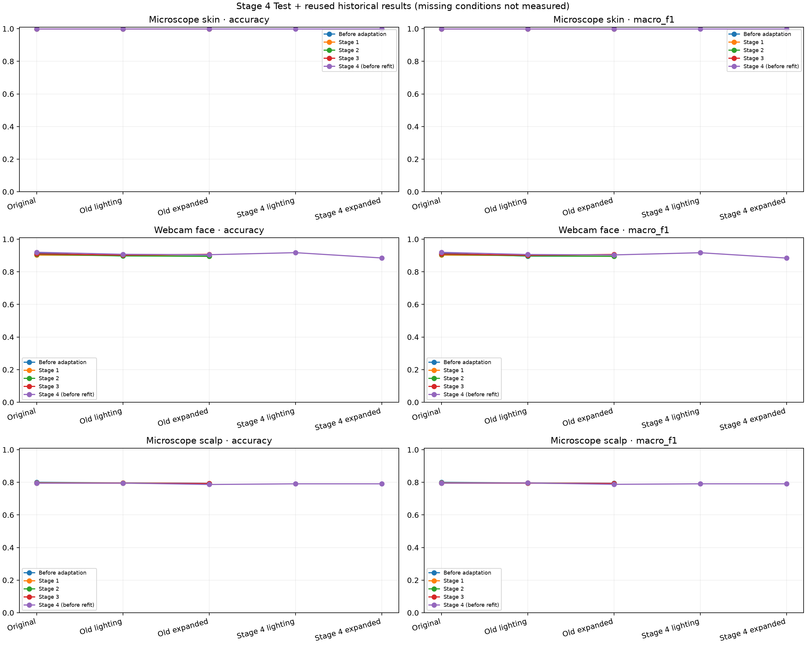

# 조정 전 4차 Source Test 결과 분석 · 2026-11-11

## 결론과 완료 범위

완료한 조정 전 4차 모델 3개를 피부 700장·얼굴 400장·두피 1,252장의 원본 Test와 네 변환 조건으로 평가했다. 신규 15개 평가와 기존 기본~3차의 36개 결과를 합친 **51개 비교**를 확인했다. 재설정 4차는 사용자 결정대로 학습하거나 평가하지 않았다.

피부는 기존 조건에서 기본~4차 모두 699/700장으로 같았다. 얼굴 4차는 기본보다 원본에서 2장, 기존 조명에서 4장, 기존 확장에서 3장을 더 맞혔다. 두피 4차는 기본보다 원본에서 7장, 기존 조명에서 1장, 기존 확장에서 9장 덜 맞혔다. **세 분야의 일관된 개선을 확인한 결과는 아니다.**

처음 지정된 `MediFlow_Revised_Camera_Results_20261111.zip`은 이미 보관한 4차 학습 결과와 SHA-256이 같은 파일이었다. Downloads에 별도로 있던 실제 `MediFlow_Stage4_Test_Results_20261111.zip`을 확인해 가져왔다. 원래 학습 ZIP과 기존 결과는 중복 저장하거나 삭제하지 않았다.

## 고정한 모델과 평가 조건

평가 계획 `dda96d8dc716`이 현재 고정 파일과 일치했다. 학습은 추가하지 않았으며 새로 추론한 모델은 조정 전 4차 `492ee01afb45`의 분야별 저장 모델 3개다. 기본~3차 모델은 다시 추론하지 않고 이전 원본 JSON을 재사용했다. 원본·기존 조명·기존 확장의 Test 목록·클래스 순서·전처리·변환·seed 1707·예측 코드가 동일하다.

피부는 초기 EfficientNet-B0·224, 얼굴은 선정 PMG·B0·256, 두피는 선정 B1·384 5클래스에서 각각 독립적으로 적응한 모델이다. float32 RGB 0~255, 내부 Rescaling, 얼굴 중앙 정사각형 자르기·현미경 전체 리사이즈를 유지했다. PMG의 네 logit 합산 후 softmax 경로도 고정했다.

기록된 실행 환경은 Python 3.13.16·TensorFlow 2.20.0·Keras 3.13.2·NumPy 2.5.4·OpenCV 4.14.0·Matplotlib 3.11.2·NVIDIA L4다. GPU가 붙은 Colab에서의 평가이며 실제 배포 장비의 실행 시간이나 질환 정확도 측정은 아니다.

## 같은 조건에서 기본~4차 비교

아래는 맞힌 사진 수다. 기본은 해당 분야의 적응 전 공통 출발 저장본이며, 세 분야 모두 초기 B0라는 뜻은 아니다.

| 분야·조건 | 기본 | 1차 | 2차 | 3차 | 4차 |
| --- | ---: | ---: | ---: | ---: | ---: |
| 피부·원본 | 699/700 | 699/700 | 699/700 | 699/700 | 699/700 |
| 피부·기존 조명 | 699/700 | 699/700 | 699/700 | 699/700 | 699/700 |
| 피부·기존 확장 | 699/700 | 699/700 | 699/700 | 699/700 | 699/700 |
| 얼굴·원본 | 366/400 | 361/400 | 363/400 | 364/400 | 368/400 |
| 얼굴·기존 조명 | 359/400 | 360/400 | 359/400 | 361/400 | 363/400 |
| 얼굴·기존 확장 | 359/400 | 358/400 | 358/400 | 363/400 | 362/400 |
| 두피·원본 | 1002/1252 | 998/1252 | 995/1252 | 995/1252 | 995/1252 |
| 두피·기존 조명 | 997/1252 | 997/1252 | 995/1252 | 995/1252 | 996/1252 |
| 두피·기존 확장 | 994/1252 | 991/1252 | 992/1252 | 993/1252 | 985/1252 |

피부는 기존 조건에서 4차를 추가해도 차이가 없었다. 얼굴은 원본·기존 조명에서 이번 표의 정답 수가 가장 높았지만 기존 확장에서는 3차의 363장보다 1장 적은 362장이었다. 2차와 비교하면 얼굴의 정답은 원본 +5장·기존 조명 +4장·기존 확장 +4장이다. 작은 단일 실행 차이이며 통계적 유의성이나 반복 안정성을 검증하지 않았다.

두피는 원본에서 2·3차와 995장으로 같고 기존 조명에서는 각각보다 1장 더 맞혔다. 기존 확장에서는 2차보다 7장, 3차보다 8장 적었다. 기본 모델은 원본 1002장·기존 조명 997장·기존 확장 994장으로 이번 4차보다 모두 높았다. 두피의 적응 이득은 이번 공통 Source Test에서 확인되지 않았다.

## 새 4차 조건의 점수

새 조명·확장 변환은 기본~3차에서 평가하지 않았으므로 아래 4차 점수만 있다. 원본 또는 다른 변환의 기본 점수를 가져와 같은 조건의 개선 폭으로 사용하지 않는다. CSV에서도 해당 기본 대비 변화량은 빈칸이다.

| 분야 | 4차 모델·4차 조명 | 4차 모델·4차 확장 |
| --- | ---: | ---: |
| 피부 | 699/700 | 699/700 |
| 얼굴 | 367/400 | 354/400 |
| 두피 | 990/1252 | 990/1252 |

두피는 4차에 추가 색·미세 대비·흐림이 없어 두 조건의 변환과 저장된 예측 배열이 완전히 같았다. 두 개의 독립된 평가 근거로 세지 않는다.

## 4차의 Accuracy·Macro-F1 원본 기록

아래 값은 원본 JSON의 수치를 반올림하지 않고 옮겼다. Macro-F1은 각 클래스 F1의 같은 비중 평균이다.

| 분야 | 조건 | Accuracy | Macro-F1 |
| --- | --- | ---: | ---: |
| 피부 | 원본 | 0.9985714285714286 | 0.9985713556814122 |
| 피부 | 기존 조명 | 0.9985714285714286 | 0.9985713556814122 |
| 피부 | 기존 확장 | 0.9985714285714286 | 0.9985713556814122 |
| 피부 | 4차 조명 | 0.9985714285714286 | 0.9985713556814122 |
| 피부 | 4차 확장 | 0.9985714285714286 | 0.9985713556814122 |
| 얼굴 | 원본 | 0.92 | 0.9195416007010457 |
| 얼굴 | 기존 조명 | 0.9075 | 0.9061870148799984 |
| 얼굴 | 기존 확장 | 0.905 | 0.9037641986192284 |
| 얼굴 | 4차 조명 | 0.9175 | 0.9171455978683116 |
| 얼굴 | 4차 확장 | 0.885 | 0.8843588684429587 |
| 두피 | 원본 | 0.7947284345047924 | 0.7954413015850953 |
| 두피 | 기존 조명 | 0.7955271565495208 | 0.7960505680181962 |
| 두피 | 기존 확장 | 0.786741214057508 | 0.7876604660812354 |
| 두피 | 4차 조명 | 0.7907348242811502 | 0.7908039223463554 |
| 두피 | 4차 확장 | 0.7907348242811502 | 0.7908039223463554 |

## 같은 4차 모델에서 사진별 예측 변화

이번 ZIP에는 같은 Test 순서의 점수 배열과 정답이 있어 4차 모델 안에서는 사진별 비교가 가능하다. 아래 변화는 서로 다른 모델의 비교가 아니라 **같은 모델의 입력 조건 변화**다. 이전 기본~3차에는 같은 사진별 점수 배열이 없어 모델 간 짝 비교를 추가로 계산한 것은 아니다.

| 분야·조건 변경 | 예측 클래스가 바뀐 사진 | 오답→정답 | 정답→오답 |
| --- | ---: | ---: | ---: |
| 피부·원본→4차 확장 | 2 | 1 | 1 |
| 피부·4차 조명→4차 확장 | 0 | 0 | 0 |
| 얼굴·원본→4차 확장 | 16 | 0 | 14 |
| 얼굴·4차 조명→4차 확장 | 15 | 0 | 13 |
| 두피·원본→4차 확장 | 60 | 26 | 31 |
| 두피·4차 조명→4차 확장 | 0 | 0 | 0 |

피부는 모든 조건에서 정답 수가 같아도 오답 사진이 바뀌었다. 원본의 사마귀→편평세포암 한 건은 4차 조명·확장에서 맞혔고, 광선각화증→사마귀 한 건이 새로 생겼다. 원본 대비 두 사진의 예측이 바뀌고 정답 수는 상쇄됐다.

얼굴은 4차 조명에서 367장, 여기에 확장 변환을 더하면 354장이었다. 같은 Test에서 예측 클래스가 15장 바뀌었고 그중 정답→오답이 13장, 오답→정답은 0장이었다. 현재 모델에서 이 확장 묶음에 대한 취약성이 관찰됐다. 이 결과만으로 색·미세 대비·흐림 중 어느 하나를 원인으로 특정하거나 Test를 보고 강도를 다시 맞추지 않는다.

두피는 원본→4차 확장에서 예측 클래스가 60장 바뀌었다. 오답→정답 26장과 정답→오답 31장이 함께 있어 정답 수는 5장 감소했다. 점수 또는 확신도 상승 자체를 실제 장비 성능 향상으로 해석하지 않는다.

## 얼굴·두피의 클래스별 정답 수

같은 4차 모델의 클래스별 Recall 분자를 제시한다. 클래스 전체 장수로 나누면 Recall이며 실제 환자에서 측정한 진단 민감도가 아니다.

| 분야·클래스 | 원본 | 기존 확장 | 4차 조명 | 4차 확장 |
| --- | ---: | ---: | ---: | ---: |
| 얼굴·건선 | 74/80 | 73/80 | 70/80 | 65/80 |
| 얼굴·아토피 | 66/80 | 61/80 | 69/80 | 63/80 |
| 얼굴·여드름 | 71/80 | 71/80 | 71/80 | 71/80 |
| 얼굴·정상 | 80/80 | 80/80 | 80/80 | 80/80 |
| 얼굴·주사 | 77/80 | 77/80 | 77/80 | 75/80 |
| 두피·모낭사이홍반 | 201/248 | 195/248 | 191/248 | 191/248 |
| 두피·미세각질 | 203/256 | 214/256 | 209/256 | 209/256 |
| 두피·비듬 | 188/241 | 185/241 | 176/241 | 176/241 |
| 두피·탈모 | 197/245 | 197/245 | 211/245 | 211/245 |
| 두피·피지과다 | 206/262 | 194/262 | 203/262 | 203/262 |

얼굴 4차 조명→확장에서 건선은 70→65장, 아토피는 69→63장, 주사는 77→75장으로 감소했고 여드름·정상 정답 수는 같았다. Source 정상 80/80은 실제 촬영 참여자들의 정상 여부를 검증한 수치가 아니다. 피부·두피 5클래스에는 정상 클래스가 없다.

## 그래프와 원본 자료

그래프에서 기본~3차의 새 4차 조건이 끊겨 있는 부분은 미측정 값이다. 0점이나 실패 결과가 아니다. [4차 혼동행렬 그림](../../../results/camera_adaptation_stage4_test_20261111/plots/stage4_confusion_matrices.png)과 [클래스별 원본 CSV](../../../results/camera_adaptation_stage4_test_20261111/class_metrics.csv)를 함께 확인한다.

## 보존·검증·한계

실제 결과 ZIP의 압축 무결성·안전한 경로·평가 계획·실행 코드 5개 해시를 확인했다. 사진별 점수 배열 15개에서 예측을 다시 구해 혼동행렬과 대조했고 Test 경로·정답 순서도 기존 manifest와 일치했다. 신규·재사용 51개 혼동행렬의 Accuracy·Macro-F1·클래스 지표, 비교 CSV 51행과 클래스 CSV 340행을 재검산했다. 이는 저장된 예측 결과의 검증이며 로컬에서 실제 Test 사진을 다시 추론한 작업은 아니다.

원본 결과·코드·예측·평가 그래프·환경 로그 25개 파일을 원래 바이트로 보존했다. 이전 결과 JSON 5개는 이미 보관한 원본과 바이트가 같아 중복 저장하지 않고 경로·해시 참조를 남겼다. 원래 ZIP 30개 파일은 새 사본 또는 기존 동일 파일 참조로 모두 대응된다. Download의 원래 두 ZIP은 변경하지 않았고 프로젝트에 ZIP 자체를 다시 복사하지 않았다.

프로젝트 검사는 Ruff 통과, pytest 200개 통과·3개 건너뜀이다. 건너뛴 항목은 기본 로컬 환경의 matplotlib 부재에 따른 기존 검사이며 실제 Colab의 평가 그래프 두 장은 생성된 원본을 열어 확인했다. 보존한 25개·기존 참조 5개 파일 해시, CSV 후보 표시 51행과 로컬 링크 337개도 확인했다. [최종 검증 기록](../../../results/camera_adaptation_stage4_test_20261111/verification_summary.json)을 보관한다.

이번 자료는 기존 공개 데이터에 촬영 변화를 모사한 Source Test다. 이미 확인한 Test를 다시 쓰는 후속 실험이며 완전히 새로운 독립 검증으로 표현하지 않는다. 실제 촬영 4명·124장은 질환 정답이 없는 calibration 자료이고 실제 장비 Accuracy·Macro-F1은 미측정이다. 과거 모델 학습과 현재 Test의 독립성 및 사람·병변·세션 수준 누수는 완전히 검증되지 않았다. 단일 seed의 관찰 결과이며 임상 성능이나 통계적 유의성을 입증한 결과가 아니다. MMD·CORAL이나 실제 사진 예측을 이 Test에서 다시 측정한 결과는 없다.

## 현재 판단과 다음 단계

계획한 4차 추가 Source Test는 완료했다. Validation에서 미리 고정한 후속 후보 **피부 4차·얼굴 4차·두피 2차**를 유지하며 Test 순위로 후보를 다시 고르지 않았다. 공식 배포 후보 색인은 변경하지 않았다. 재설정 4차는 계속 미실행 보관한다.

다음은 기본~4차의 실험 조건과 근거·한계를 최종 보고서 및 후속 후보의 사용 계약에 연결하는 일이다. 성능 개선을 확인할 추가 평가는 설정을 고정한 뒤 정답이 확인된 별도 실제 장비 질환 사진에서 진행해야 한다. 현재 Test를 반복해서 보면서 색·흐림 강도를 맞추는 작업은 다음 단계로 삼지 않는다.

[결과 폴더](../../../results/camera_adaptation_stage4_test_20261111/README.md) · [가져오기 검증](../../../results/camera_adaptation_stage4_test_20261111/import_verification.json) · [평가 계획과 파일 위치](ADAPTATION_STAGE4_FINAL_TEST_20261111.md).
