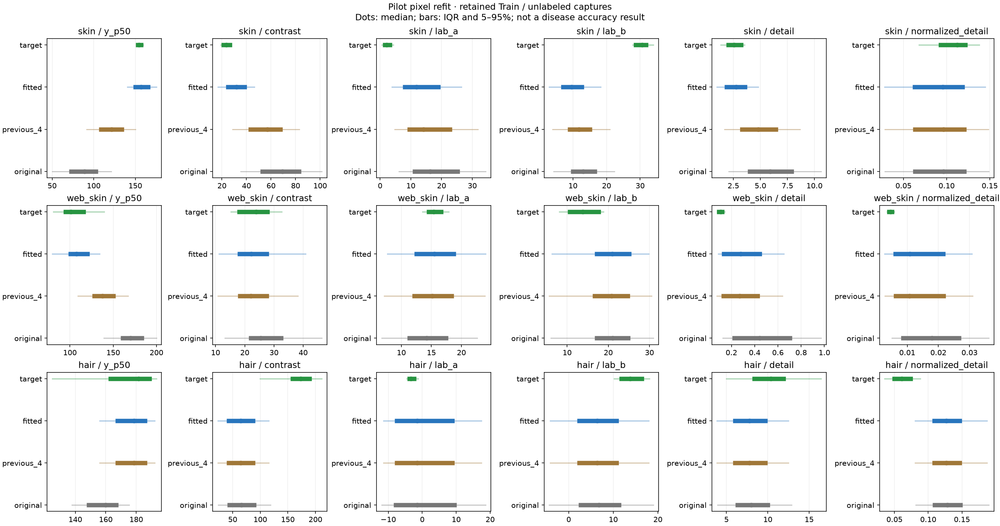

# 실제 촬영 원본 재대조와 4차 강도 재설정 · 2026-11-11

> 2026-11-11 사용자 결정: 재설정 4차는 실행하지 않고 보관한다. 아래 본문은 분석·로컬 검사 당시 기록이며 학습 실행 지시가 아니다. [현재 공통 Test 계획](ADAPTATION_STAGE4_FINAL_TEST_20261111.md)을 따른다.

## 결론과 현재 단계

4차 학습 직전에 실제 촬영 원본 124장과 보존된 원본 Train 검토 표본 461장을 다시 읽어 대조했다. 조정 전 4차보다 피부·얼굴의 밝기 변화 범위를 넓히고 색·미세 대비·흐림을 새 조명에서 다시 판단했다. 현재 설정·노트북에 반영했고 정식 5 epoch 학습은 아직 실행하지 않았다.

이 작업의 목표는 **정해진 변환·후보·품질 제한 안에서 관찰한 촬영 지표를 가깝게 하는 것**이다. 촬영 장비와 물리적으로 동일해졌다는 의미나 실제 환자 분류 정확도 개선을 뜻하지 않는다. 질환·부위·인물·모발 구성은 그대로 차이로 남는다.

## 자료와 측정 방법

- Source는 피부 223장·얼굴 118장·두피 120장의 원본 Train PNG다. 유지된 Train 목록·라벨·PNG 해시를 확인했고 Validation/Test는 강도 결정에 사용하지 않았다. 전체 Source 원본 ZIP을 새로 내려받아 전부 분석한 작업은 아니다.
- Target은 피부 42장·얼굴 42장·두피 40장이다. 실제 촬영 원본의 fingerprint를 확인하고, 원본을 기존 입력 정책으로 다시 변환한 배열이 보존된 입력 캐시와 정확히 같은지 확인했다. 질환 정답은 만들지 않았다.
- 얼굴의 Source 관심 영역은 104장에서 측정 가능했고 14장은 동일한 원본 영역 정책에 따라 제외됐다. 변환 후 얼굴을 다시 검출해 비교 대상을 바꾸지 않았다.
- Source 클래스별, Target의 사람/조건별 비중을 같게 한 Wasserstein-1 분포 거리를 사용했다. 거리가 작을수록 해당 지표의 차이가 작다. 거리들을 실제 유사도 백분율이나 Accuracy로 바꾸지 않았다.
- 경계 보호 처리 때문에 밝기 파라미터와 실제 픽셀 이동량이 같지 않다. 기존 변환의 역관계를 이용한 관측 기반 후보를 만들고 실제 RGB 픽셀을 변환해 확인했다.

## 후보 선택과 제한

조명 후보는 피부 20개·얼굴 40개·두피 4개다. 먼저 클래스별 최대 4장의 고정 Train 표본으로 비교하고 분야별 상위 3개를 해당 Train 표본 전체에서 seed 42·707·1707로 다시 대조했다. 반복 난수 세 개는 새 모델의 세 seed 학습을 뜻하지 않는다.

피부는 밝기·대비, 얼굴은 밝기·대비·좌우 조명, 두피는 밝기의 기존 4차 대비 잔여 분포 거리 중 가장 큰 비율을 먼저 줄이도록 선택했다. 각 반복에서 선택한 조명 지표가 악화되지 않는지 확인했다. 이는 정한 후보 집합의 선택 기준이며 모든 가능한 변환의 최적해를 증명한 것은 아니다.

검색의 공학적 상한은 밝기 이동 절댓값 160, 대비 파라미터 0.25~1.5, 좌우 조명 절댓값 64다. 실제 채택 범위는 아래 표다. 피부 대비는 이 공학적 하한에 걸려 있어 더 낮추면 무조건 좋다고 해석하지 않는다. 두피의 전체 대비는 모발 가림·굵기·부위 차이를 카메라 효과로 강제 맞출 수 없어 1로 유지했다.

공간 배치의 큰 손상을 거르는 보조 검사로 원본과 변환의 회색조 공간 상관계수 하위 5분위가 0.95 이상인지 확인했다. 이 기준은 임상적 병변 보존 검증이 아니며 작은 색·미세 병변 변화에 둔감할 수 있다. 신규 부동소수점 0/255 끝점 비율도 기록했다. 이 값만으로 반올림 뒤 포화나 질환 정보 손실이 전혀 없다고 주장하지 않는다.

조명 결정 후 색 방향을 다시 계산했다. 색 변화는 사람 한 명씩 제외해도 방향이 같은 경우에만 참여자 내 조건 변화 절댓값 75분위와 Lab 3 단위 중 작은 폭을 사용했다. 흐림·미세 대비는 두 경계 지표가 함께 악화되지 않는 경우만 유지하고, 두피는 어두운 가는 구조 지표도 함께 확인했다. Source 병변의 전체 색·질감을 일반 참여자의 피부로 강제로 맞추지 않았다.

## 현재 채택한 실제 설정

| 분야 | 조정 전 밝기 이동 | 새 밝기 이동 | 새 대비 | 새 좌우 조명 |
| --- | --- | --- | --- | --- |
| skin | `[32.0, 32.0]` | `[67.47361687519953, 71.01787172836876]` | `[0.25, 0.26459406014955544]` | `[0.0, 0.0]` |
| web_skin | `[-32.0, -32.0]` | `[-99.7760789846667, -56.06404023208951]` | `[1.0, 1.0]` | `[3.5654401022290427, 64.0]` |
| hair | `[15.043113708496094, 26.26080894470215]` | `[15.043113708496094, 26.26080894470215]` | `[1.0, 1.0]` | `[0.0, 0.0]` |

밝기 숫자는 0~255 입력에 대한 이동 파라미터다. 대비 파라미터도 경계 보호 처리 전 값이므로 사진의 실제 대비가 그 배율과 정확히 같지는 않다.

| 분야 | Lab a | Lab b | 미세 대비 | 흐림 sigma · ROI 64 기준 |
| --- | --- | --- | --- | --- |
| skin | `[-0.9609375, 0.0]` | `[0.0, 0.92578125]` | `[1, 1]` | `[0, 0]` |
| web_skin | `[0, 0]` | `[0, 0]` | `[0.85, 0.9145815899839365]` | `[0, 0.4]` |
| hair | `[0, 0]` | `[0, 0]` | `[1, 1]` | `[0, 0]` |

## 실제 측정값과 남은 차이

다음 중앙값은 사진별 측정값의 요약이며, 아래의 분포 거리는 클래스·사람/조건 가중치를 별도로 적용한 값이다.

| 분야 | 지표 | 조정 전 4차 중앙값 | 재설정 중앙값 | 실제 촬영 중앙값 |
| --- | --- | ---: | ---: | ---: |
| skin | y_p50 | 121.52649688720703 | 157.00350189208984 | 154.22899627685547 |
| skin | contrast | 56.98230743408203 | 31.894699096679688 | 23.69690704345703 |
| web_skin | y_p50 | 137.5050048828125 | 107.5250015258789 | 100.9482536315918 |
| web_skin | contrast | 22.06980323791504 | 22.19745445251465 | 23.932373046875 |
| hair | y_p50 | 178.61499786376953 | 178.61499786376953 | 181.48350524902344 |
| hair | contrast | 64.38433837890625 | 64.38433837890625 | 173.05695343017578 |

| 분야 | 지표의 분포 거리 | 조정 전 4차 | 재설정 | 변화 |
| --- | --- | ---: | ---: | --- |
| skin | y_p50 | 34.054261613813495 | 7.536051459704119 | 감소 |
| skin | contrast | 32.27153314876111 | 8.704324971996144 | 감소 |
| skin | lab_a | 13.738697586428227 | 11.009665374018786 | 감소 |
| skin | lab_b | 17.99167091259052 | 20.05936179045887 | 증가 |
| skin | detail | 2.3426686764987457 | 0.4079518317564522 | 감소 |
| skin | normalized_detail | 0.01805824493704202 | 0.018530701302162805 | 증가 |
| web_skin | y_p50 | 30.09893235418958 | 6.877563122735478 | 감소 |
| web_skin | contrast | 2.8508463784797824 | 2.625282016384814 | 감소 |
| web_skin | lab_a | 3.1670041532856024 | 3.149282953516166 | 감소 |
| web_skin | lab_b | 6.262208961215439 | 6.5047562067688 | 증가 |
| web_skin | detail | 0.20009771130963216 | 0.2050144779684871 | 증가 |
| web_skin | normalized_detail | 0.009809927354870136 | 0.00978133565579228 | 감소 |
| hair | y_p50 | 8.06363264719647 | 8.06363264719647 | 같음 |
| hair | contrast | 102.84678020477283 | 102.84678020477283 | 같음 |
| hair | lab_a | 7.449218750000032 | 7.449218750000032 | 같음 |
| hair | lab_b | 7.606510416666664 | 7.606510416666664 | 같음 |
| hair | detail | 2.738410005966802 | 2.738410005966802 | 같음 |
| hair | normalized_detail | 0.06624834115643602 | 0.06624834115643602 | 같음 |

피부는 밝기·대비·원래 경계 지표의 거리가 줄었지만 노란색 축과 대비 보정 경계의 거리는 증가했다. 얼굴은 밝기·대비·좌우 조명 거리가 줄었지만 노란색 축·원래 경계 거리는 조금 증가했다. 두피는 재검사에서 기존 값이 유지됐다. 색을 더 움직여 Source 병변과 일반 촬영 부위의 차이를 강제로 없애지 않았다.

색·경계 등 모든 지표가 함께 좋아진 설정이라고 설명하지 않는다. 선택한 조명 지표의 근접성과 남은 색·질감 차이는 구분한다. 영상 지표 거리 감소는 질환 분류 성능 개선의 증거가 아니다.




분포 그림은 점이 중앙값, 굵은 선이 25~75분위, 가는 선이 5~95분위다. 실제 촬영 사진을 포함한 그림과 Train 검토 사진은 로컬 전용으로 두었다.

## 눈으로 확인한 범위

클래스별로 밝기 양끝의 Source 표본 40개를 원본·조정 전·재설정 순으로 나란히 확인했다. 8개 접촉 시트를 확인한 범위이며 461개 전부를 육안 검토했다고 뜻하지 않는다. 피부의 밝은 표본에서는 붉거나 갈색인 영역의 대비가 약해졌고, 얼굴은 어두운 쪽의 세부가 덜 보이는 경우가 있었다. 구조 위치는 그대로였지만 임상적인 병변 정보 보존을 확인한 것은 아니다. 이후 Validation의 클래스별 Recall도 함께 확인한다. 선택한 사진·페이지·관찰은 `train_review_manifest.json`과 `visual_review.json`에 기록했다.

## 고정 조건과 실행

바꾼 조건은 촬영 변환 설정 묶음이다. 출발 모델·데이터 분할·클래스 순서·5 epoch·seed 42·Adam 0.00001·배치 16/8/8·변환 적용 확률 0.5는 기존과 같다. 피부 초기 B0·224, 얼굴 선정 PMG·B0·256, 두피 선정 B1·384 5클래스의 1차 학습 전 상태에서 시작한다. 입력은 RGB float32 0~255이며 저장 모델 내부의 Rescaling을 사용하고 외부 `/255`를 추가하지 않는다. 이번 비교에서 개별 색/초점 요소 하나의 효과를 따로 입증하지 않는다.

[현재 4차 노트북](../../../notebooks/camera_adaptation/archive/MediFlow_Camera_Refit_Not_Run_20261111.ipynb)과 [실제 설정](../../../configs/archive/camera_refit_not_run_20261111.json)을 갱신했다. 기존 Drive의 공통 ZIP v3·원본 데이터 ZIP·1차와 2차 결과를 그대로 사용하며 새 ZIP 업로드나 Target 복호화 키 입력은 필요 없다. 새 설정이 들어 있는 현재 로컬 노트북을 다시 열어 GPU 선택 → 모두 실행 → Drive 연결로 시작한다. 이전에 열어 둔 Colab 사본은 자동 갱신되지 않는다.

이번에는 MMD·CORAL 학습 손실을 추가하지 않는다. Source Test를 다시 추론하지 않고, 원본·기존 변환·새 변환 Validation에서 비교한다. 실제 촬영 네 사람은 설정 결정에 사용한 calibration 자료이며 독립 Target Test가 아니다.

Drive 결과 위치:

```text
MediFlow_adaptation_runs/4ae6e07eb4af1225/measured_strength_e6bc85bc0a7d
```

완료 결과 ZIP은 `MediFlow_Revised_Camera_Results_20261111.zip`이다. 현재 이 정식 학습 결과 ZIP을 생성한 것은 아니다.

## 검증과 재현

전체 검사는 195개 통과·3개 건너뜀이다. 건너뛴 3개는 기본 환경의 matplotlib 부재로 실행하지 않은 기존 그래프 검사다. 새 비교 그림은 보존된 선택 라이브러리로 실제 생성·확인했다. Ruff 검사와 노트북 문법·내장 코드 4개·내장 설정의 바이트 대조를 통과했다.

새 설정으로 실제 저장 모델 세 개를 CPU의 임시 배치에서 검사했다. 배치 입력·손실·가중치 갱신·체크포인트 복원·모델 저장/재로드를 통과했고 원본 모델 해시는 유지됐다. 이는 기능 검사이며 정식 5 epoch 학습이나 GPU 성능 측정이 아니다. 새 분류 Accuracy를 측정하지 않았다.

재현 코드는 [픽셀 재대조](../../../src/mediflow_datasets/camera_refit.py), [그림 생성](../../../src/mediflow_datasets/camera_refit_figures.py), [노트북 생성기](../../../scripts/build_adaptation_revised.py), [검사](../../../tests/test_camera_refit.py)다. 분석 출력 폴더는 존재하지 않는 새 경로를 지정해야 하며 자동 삭제하지 않는다. 기존 설정·노트북 사본은 이전 학습 직전 점검의 `checked_inputs`에 남겼다.

[전체 측정값](../../../presentation/report_assets/camera_refit_20261111/measurements.json) · [후보·판정 근거](../../../presentation/report_assets/camera_refit_20261111/decisions.json) · [통계·거리](../../../presentation/report_assets/camera_refit_20261111/summary.json) · [설정·입력·환경 검증](../../../presentation/report_assets/camera_refit_20261111/verification.json).

기준 commit·현재 미커밋 코드·모델·데이터 분할·환경·seed·모든 변환 파라미터는 설정·검증 JSON과 코드 사본에 기록했다. 실제 계산에 사용한 모듈·생성기·검사 코드 11개는 출력 폴더의 `code`와 파일별 해시 목록에 보존했다. 이번 작업은 commit·push하지 않았다.

현재 단계는 재설정과 로컬 점검 완료다. 다음은 이 설정의 학습과 Validation 비교이며, 실제 장비 질환 성능은 정답이 확인된 별도 촬영 자료로 검증해야 한다.
