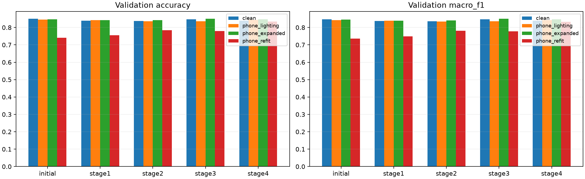

# 휴대폰 얼굴 적응 학습 결과 회수·분석 · 2026-11-12

## 결론과 현재 단계

사용자가 전달한 `MediFlow_Smartphone_WebSkin_Results_20261111.zip`은 최신 질감·흐림 추가 설정으로 수행한
**실제 5회 학습 결과**다. 1차 초기/선정 각 1회, 2·3·4차 각 1회가 모두 5 epoch 완료됐다.
1차에서 선정 저장본 PMG·B0·256이 선택됐고, 저장된 최종 Source Validation 기준에서는 **4차**가 선택됐다.

이것은 **강한 가상 촬영 변환까지 포함한 Validation에서 가장 낮은 Macro-F1을 높인 결과**다.
실제 휴대폰과 가장 유사한 조건 또는 실제 환자 분류 성능이 가장 좋은 모델을 입증한 결과는 아니다.
원본 Validation은 적응 전 424/499에서 4차 419/499로 5장 감소했고, 강한 4차 변환에서는 370/499에서
416/499로 46장 증가했다. 정상 포함 5클래스의 실제 휴대폰 질환 정답과 새 Source Test 결과는 없다.

[원본 결과 폴더](../../../results/smartphone_web_skin_adaptation_20261112/README.md) ·
[저장된 자동 선정 기록](../../../results/smartphone_web_skin_adaptation_20261112/selection.json) ·
[수신·수치 대조 검사](../../../results/smartphone_web_skin_adaptation_20261112/receipt_verification.json) ·
[실제 모델 로드 확인](../../../results/smartphone_web_skin_adaptation_20261112/model_load_verification.json).

## 1. 어떤 설정으로 실행했는가

입력 ZIP의 runtime/study 해시가 로컬에서 준비한 설정과 일치했다. [11월 12일 사용자 요청 강도](SMARTPHONE_APPEARANCE_STRENGTH_20261112.md)가 실제로 적용됐다.
실행 ZIP SHA-256은 `edc193fee3c25254ce947b1a9613ad8ec2cc4d0f90f3c4f283eff5d415ea3ad9`, study SHA-256은 `639593f6cf8d3efcdea42c3f05f7d20a6775aeb1d4f7ec4504abc042b2437e80`다.
출발 모델은 초기 B0·224와 선정 PMG·B0·256이며 2·3·4차는 PMG의 **적응 전 원래 저장본**에서 독립적으로 시작했다.

| 실행 | 구조 | 입력 px | 완료 epoch | 선택 epoch | 미세 질감 배율 | 최대 흐림 σ · 입력 px |
| --- | --- | --- | --- | --- | --- | --- |
| stage1_basic | b0 | 224 | 5 | 4 | [1.0, 1.0] | 0.0 |
| stage1_selected | pmg | 256 | 5 | 3 | [1.0, 1.0] | 0.0 |
| stage2 | pmg | 256 | 5 | 2 | [0.95, 1.05] | 0.49999999999999994 |
| stage3 | pmg | 256 | 5 | 4 | [0.95, 1.05] | 0.49999999999999994 |
| stage4 | pmg | 256 | 5 | 1 | [0.85, 1.15] | 0.9999999999999999 |

공통 조건은 Source Train 3535 / Validation 499 / Test 400, 건선·아토피·여드름·정상·주사 순서,
seed 42, Adam 학습률 0.00001, 배치 8, 변환 적용 확률 0.5, 각 5 epoch다.
Source 분류 배치는 epoch당 442개다. B0는 배치당 1회, PMG는 배치당 4회 가중치를 갱신했다.
RGB float32 0–255와 내부 Rescaling을 유지했으며 모델 외부 `/255`는 추가하지 않았다.
휴대폰 Target은 EXIF 방향·ICC→sRGB·중앙 자르기를 적용한 기존 42/10장 입력이다.

실제 Colab 기록은 TensorFlow 2.20.0 / Keras 3.13.2 / NumPy 2.5.4 / NVIDIA L4다.
로컬 CPU 모델 로드 환경은 별도 확인 JSON에 기록했다. 학습 이력의 `train_seconds`는 훈련 루프 시간으로,
입력 복사·캐시 준비·Validation·Drive 저장·최종 진단을 포함한 전체 Colab 소요 시간이 아니다.

## 2. 1차 출발 모델 비교

| 역할 | 구조 | 입력 px | 선택 epoch | 원본 정답 /499 | 조명 정답 /499 | 두 조건 중 낮은 Macro-F1 |
| --- | --- | --- | --- | --- | --- | --- |
| basic | b0 | 224 | 4 | 360 | 361 | 0.7146770758075857 |
| selected | pmg | 256 | 3 | 419 | 420 | 0.8371428800526196 |

최저 Macro-F1, 원본 Macro-F1, 초기 역할 우선 순서로 재계산해 `selected` 선택을 확인했다.
초기/선정 저장본의 구조·입력 크기·기존 학습 이력이 다르므로 입력 크기 또는 PMG 하나의 효과로 분리할 수 없다.
이후 공통 비교의 `initial`은 적응 전 **선정 PMG 저장본**이다. 초기 B0 저장본을 뜻하지 않는다.

## 3. 공통 Source Validation 결과

다음 표는 모두 같은 Validation 원본 499장으로 계산했다. 원본 파일은 바꾸지 않고 평가 시 조건별 변환을 적용했다.
`phone_lighting`은 1차 조명, `phone_expanded`는 2차 조명·색·약한 질감/흐림,
`phone_refit`은 기존 4차 조명과 강한 질감/흐림이다. 실제 휴대폰 질환 사진의 정확도가 아니다.

### 정답 이미지 수 · 각 조건 499장

| 모델 | 원본 | 휴대폰 조명 | 2차 조명·색·약한 질감/흐림 | 4차 조명·강한 질감/흐림 |
| --- | --- | --- | --- | --- |
| 적응 전 선정 저장본 | 424 | 422 | 423 | 370 |
| 1차 · 선정 모델 | 419 | 420 | 420 | 377 |
| 2차 · 약한 질감/흐림 | 418 | 417 | 420 | 391 |
| 3차 · 2차 + 정렬 | 423 | 417 | 424 | 389 |
| 4차 · 강한 질감/흐림 | 419 | 421 | 423 | 416 |

4차 대 적응 전 차이는 원본 −5장, 조명 −1장, 2차 변환 0장, 4차 변환 +46장이다.
3차는 원본 정답 수가 적응 전보다 1장 적지만 원본 Macro-F1은 조금 높다. 정확도와 클래스 균형 지표가 다를 수 있다.
4차가 모든 조건에서 가장 좋은 것은 아니다.

### Macro-F1 · 원본 기록 자릿수 유지

| 모델 | 원본 | 휴대폰 조명 | 2차 조명·색·약한 질감/흐림 | 4차 조명·강한 질감/흐림 |
| --- | --- | --- | --- | --- |
| 적응 전 선정 저장본 | 0.8471375958306038 | 0.8427999522421222 | 0.8457763733808885 | 0.7364265096423025 |
| 1차 · 선정 모델 | 0.8371428800526196 | 0.8390546834569605 | 0.8391229064737524 | 0.7496124932186314 |
| 2차 · 약한 질감/흐림 | 0.8363201034735687 | 0.834788072836461 | 0.8402027333633552 | 0.7805988684565599 |
| 3차 · 2차 + 정렬 | 0.8474660038570427 | 0.8364868959284927 | 0.8496689096326595 | 0.7771311436019821 |
| 4차 · 강한 질감/흐림 | 0.839099751882836 | 0.8430179787423866 | 0.847378001486998 | 0.8324259734962343 |

### Accuracy · 원본 기록 자릿수 유지

| 모델 | 원본 | 휴대폰 조명 | 2차 조명·색·약한 질감/흐림 | 4차 조명·강한 질감/흐림 |
| --- | --- | --- | --- | --- |
| 적응 전 선정 저장본 | 0.8496993987975952 | 0.845691382765531 | 0.8476953907815631 | 0.7414829659318637 |
| 1차 · 선정 모델 | 0.8396793587174348 | 0.8416833667334669 | 0.8416833667334669 | 0.7555110220440882 |
| 2차 · 약한 질감/흐림 | 0.8376753507014028 | 0.8356713426853707 | 0.8416833667334669 | 0.7835671342685371 |
| 3차 · 2차 + 정렬 | 0.8476953907815631 | 0.8356713426853707 | 0.8496993987975952 | 0.779559118236473 |
| 4차 · 강한 질감/흐림 | 0.8396793587174348 | 0.843687374749499 | 0.8476953907815631 | 0.8336673346693386 |

최종 기준은 네 조건 중 낮은 Macro-F1을 가장 높이고, 동점이면 원본 Macro-F1과 앞 단계 순서로 판정한다.
4차의 최저 Macro-F1은 `0.8324259734962343`다.
이 규칙을 다시 계산해 저장된 4차 선택과 일치함을 확인했다. Test나 P05로 다시 고른 것은 아니다.
4차는 1 epoch가 선택됐지만 **전체 5 epoch를 실제 완료**했고 마지막 모델 대신 검증 기준의 최적 모델을 저장했다.

## 4. 클래스별 Recall

| 조건 | 클래스 | 적응 전 | 3차 | 4차 |
| --- | --- | --- | --- | --- |
| 원본 | 건선 | 0.85 | 0.9 | 0.92 |
| 원본 | 아토피 | 0.76 | 0.79 | 0.8 |
| 원본 | 여드름 | 0.71 | 0.7 | 0.63 |
| 원본 | 정상 | 1.0 | 1.0 | 0.98 |
| 원본 | 주사 | 0.9292929292929293 | 0.8484848484848485 | 0.8686868686868687 |
| 4차 조명·강한 질감/흐림 | 건선 | 0.6 | 0.72 | 0.88 |
| 4차 조명·강한 질감/흐림 | 아토피 | 0.51 | 0.65 | 0.82 |
| 4차 조명·강한 질감/흐림 | 여드름 | 0.84 | 0.83 | 0.67 |
| 4차 조명·강한 질감/흐림 | 정상 | 1.0 | 1.0 | 0.98 |
| 4차 조명·강한 질감/흐림 | 주사 | 0.7575757575757576 | 0.696969696969697 | 0.8181818181818182 |

원본에서 4차는 건선·아토피 Recall이 높아졌지만 여드름·정상·주사는 낮아졌다.
강한 변환에서 전체 정답 수가 늘어도 클래스마다 변화가 같지는 않다. 이 Recall은 Source Validation 정답 기준이며
실제 환자의 진단 민감도로 표현하지 않는다. 전체 조건의 클래스별 Precision·Recall·F1·혼동행렬은
[원본 지표](../../../results/smartphone_web_skin_adaptation_20261112/validation_comparison.json)에 보존했다.
[전체 혼동행렬 그림](../../../results/smartphone_web_skin_adaptation_20261112/validation_confusion_matrices.png)의 행은 정답, 열은 예측이다.

## 5. 3차 정렬 손실의 실제 적용

MMD·CORAL 계수는 각각 `0.01811730210852143`, `0.057266924535746916`다.
초기 Source Train 분류 손실 기준 `0.05`의 각 5%를 맞추도록 계산해 고정했다.
Source 기준은 클래스당 8장씩 총 40장, Target은 P01~P04 42장이다.
PMG의 마지막 결합 분류 갱신에서만 두 손실이 추가됐다. 각 epoch 10개 정렬 배치·Target 사용 40회,
5 epoch 합계 **정렬 갱신 50회·Target 사용 200회**를 이력에서 확인했다. 200개의 서로 다른 사진을 뜻하지 않는다.

각 분류 배치에는 분류 손실을 사용하고 정해진 일부 배치에만 정렬 손실을 더했다.
초기 계수는 매 epoch의 손실 비중이 항상 5%라는 뜻이 아니다. Target에는 가짜 질환 라벨을 붙이지 않았다.

[3차 학습곡선](../../../results/smartphone_web_skin_adaptation_20261112/stage3/learning_curves.png) ·
[3차 전체 epoch 기록](../../../results/smartphone_web_skin_adaptation_20261112/stage3/history.json) ·
[기준 특징·정렬 계수](../../../results/smartphone_web_skin_adaptation_20261112/stage3/alignment_setup.json).

## 6. 실제 휴대폰 사진의 특징 거리·예측 변화

초기 모델에서 고정한 같은 기준을 사용해 Source Train 40장의 특징과 실제 촬영 특징을 비교했다.
MMD²·CORAL은 같은 지표 안에서 낮을수록 특징 분포 차이가 작다. 단위가 달라 두 값을 합쳐 유사도 백분율을 만들지 않는다.
이 값에는 촬영 장비뿐 아니라 사람·질환 구성·구도 차이가 섞이며, 가장 작은 값만으로 배포 모델을 고를 수 없다.

### 설정·정렬에 사용한 4명

| 모델 | MMD² | CORAL | 적응 전 대비 예측 변경 수 | 사진 수 |
| --- | --- | --- | --- | --- |
| 적응 전 선정 저장본 | 0.13798964023590088 | 0.043655216693878174 | 0 | 42 |
| 1차 · 선정 모델 | 0.16595947742462158 | 0.13216158747673035 | 3 | 42 |
| 2차 · 약한 질감/흐림 | 0.17212897539138794 | 0.1165110245347023 | 2 | 42 |
| 3차 · 2차 + 정렬 | 0.14776241779327393 | 0.1129620373249054 | 10 | 42 |
| 4차 · 강한 질감/흐림 | 0.14532285928726196 | 0.06983822584152222 | 3 | 42 |
### 선정 후 확인한 P05 한 명

| 모델 | MMD² | CORAL | 적응 전 대비 예측 변경 수 | 사진 수 |
| --- | --- | --- | --- | --- |
| 적응 전 선정 저장본 | 0.28087759017944336 | 0.05766603723168373 | 0 | 10 |
| 1차 · 선정 모델 | 0.36998236179351807 | 0.19013053178787231 | 0 | 10 |
| 2차 · 약한 질감/흐림 | 0.3642579913139343 | 0.1584601104259491 | 1 | 10 |
| 3차 · 2차 + 정렬 | 0.34333616495132446 | 0.1692020148038864 | 5 | 10 |
| 4차 · 강한 질감/흐림 | 0.31602275371551514 | 0.09847360849380493 | 0 | 10 |

주요 해석은 다음과 같다.

- 적응 전 모델보다 MMD·CORAL이 함께 낮아진 후속 모델은 이번 최종 진단에 없었다.
- 3차는 2차보다 설정용 42장에서 두 거리가 줄었다. P05에서는 MMD는 줄고 CORAL은 커졌다.
- 4차는 강한 가상 변환 Validation에서 우세했지만 실제 휴대폰 특징 거리로 적응 전을 앞선 것은 아니다.
- 예측이 바뀐 장수와 확신도 변화에는 질환 정답이 없다. 맞아졌는지·틀려졌는지를 판단할 수 없다.

P05 10장은 최종 Source Validation 선정 기록을 저장한 뒤 확인하도록 실행 코드가 구성되어 있고,
결과에 `holdout_opened_after_selection=true`가 기록됐다. 이미 확인한 이 자료를 이후 강도·모델 선택에 반복 사용하면
새로운 독립 평가로 간주할 수 없다. 동일 P05를 재사용하는 경우 탐색 진단으로 명시한다.

## 7. 장비 유사성과 이번 결과의 관계

이번 결과는 사용자 요청으로 약한/강한 질감·흐림을 추가한 **강도 비교 실험**으로 보존한다.
이전 픽셀 재생에서 추가 질감·흐림은 실제 휴대폰과의 일부 경계 분포 거리를 늘렸고,
이번 특징 진단도 실제 장비와 같아졌다는 결론을 뒷받침하지 않는다.

사용자의 목표인 장비 유사성 우선 판단은 원래 측정한 촬영 관련 차이와 개별 지표의 악화 여부를 다시 기준으로 삼아야 한다.
질환과 장비 차이가 완전히 분리되지 않은 일반 참여자의 색·질감 분포를 Source 질환 이미지에 강제로 일치시키지는 않는다.
이번 결과에서 선정된 4차는 **저장된 Validation 규칙의 후보**이며, 장비 유사성 최적 후보·검증된 스마트폰 진단 모델로
확정하거나 자동 패키징하지 않았다. 기존 웹캠·현미경 패키지와 공식 후보 색인은 유지했다.

## 8. 수신·검사·보관

입력 ZIP `945099999a5dd5d9661e8e7b64d6a15ce6e6823350db3ab682e2a9f48adc6433`의 CRC·경로 안전성을 확인했다.
완료 기록·25개 epoch·5개 모델 해시·최적 epoch·70개 지표 기록의 혼동행렬/Accuracy/Macro-F1을 대조했다.
새 성능을 추론해 다시 측정한 것이 아니라 전달된 수치의 내부 일치 여부를 검사했으며 원본 JSON·PNG·모델 바이트는 유지했다.
모든 Source 분할과 실제 실행 study·코드 식별값을 준비본과 대조했다.

결과 ZIP의 66개 파일은 모델 5개·그림 7개·JSON 54개로 모두 필요한 비교 기록이다. 원본 ZIP을 프로젝트에 중복 복사하지 않았고
중간 optimizer 가중치·사진 원본·복호화 키도 복사하지 않았다. `.keras` 5개와 원본 지표·이력·선정 기록·그림을
`results/smartphone_web_skin_adaptation_20261112`에 보관했다. 실제 실행 코드 72개와 설정·전체 runtime manifest는
`reproduction/`에 보관했다. 초기 출발 모델은 기존 `results/web_skin` 경로를 참조한다.

개별 epoch 기록에 나오는 optimizer snapshot과 `best_epoch_*.keras`는 실행 당시 경로 기록이다.
전달 ZIP에는 회차별 큰 모델이 없고 검증 기준으로 고른 `best.keras`만 있다. 학습 재개용 전체 snapshot 패키지가 아니다.
모델의 실제 로드와 합성 RGB 입력의 실행 검사는 별도 JSON에 기록하며 이 검사를 새 Accuracy 측정으로 해석하지 않는다.

Source 점검에서 확인된 중복·충돌·근접 검토 대기와 원본 픽셀 겹침은 0으로 기록됐다.
그러나 사람·병변·촬영 세션 식별값은 Source 4434장 모두 미확인이고 과거 저장본의 평가 자료 노출 여부도 미확인이다.
누수가 완전히 배제됐거나 독립적인 실제 장비 성능 검증이 끝났다고 주장하지 않는다.

이번 작업은 결과 회수·보관·분석이다. 새 학습·Source Test·업로드·배포 패키징·Git 커밋·푸시는 하지 않았다.
다음은 장비 유사성 우선 조건과 최종 후보를 확정하고, 고정된 조건의 Source Test를 별도로 평가하는 일이다.
