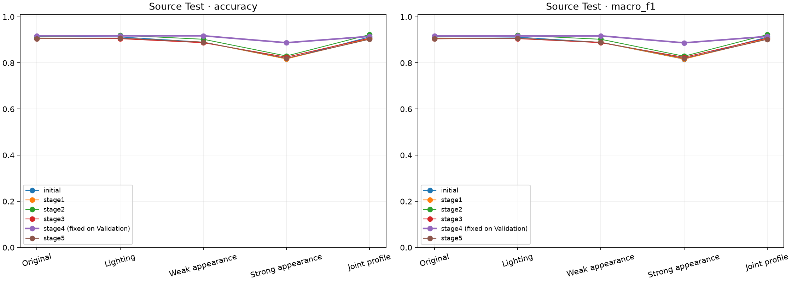
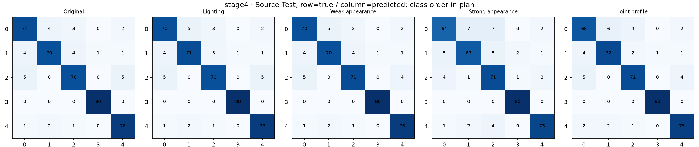

# 스마트폰 얼굴 적응 최종 Source Test 결과 · 2026-11-12

## 결론과 완료 범위

사용자가 전달한 `MediFlow_Smartphone_Final_Test_Results_20261112.zip`에서 원본 Test 400장,
적응 전·1~5차 **6모델 × 5조건 = 30개 비교 완료**를 확인했다. 새 학습은 하지 않았다.
Validation에서 미리 고정한 **4차를 유지해 패키징**한다. Test 순위로 모델을 바꾸지 않는다.

4차는 적응 전보다 원본 정답 수가 366→367장, 1차 조명 365→367장,
2차 약한 확장 356→367장, 4차 강한 변환 327→355장, 새 공동 근접 변환 365→366장으로 늘었다.
각 조건의 이득은 +1·+2·+11·+28·+1장이다. 단일 seed·동일한 400장에 대한 관찰이며
실제 휴대폰 질환 분류 성능 개선이나 통계적 유의성을 입증한 결과는 아니다.
새 공동 근접 변환에서는 2차가 369장으로 4차 366장보다 높았다. 4차가 모든 조건에서 최고였다고 쓰지 않는다.

추가 5차는 원본 362장·새 변환 361장으로 적응 전의 366장·365장보다 각각 4장 적었다.
영상 통계가 가까워진 후보의 추가 학습이 분류 성능 개선으로 이어진다는 가설은 이번 결과에서 지지되지 않았다.

[원본 결과](../../../results/smartphone_final_test_20261112/README.md) ·
[고정 평가 계획](SMARTPHONE_FINAL_TEST_20261112.md) ·
[전체 적응 과정 최종 정리](ADAPTATION_COMPLETION_20261112.md) ·
[스마트폰 사용 패키지](../../../results/smartphone_adaptation_package_20261112/README.md).

## 1. 실제 고정 조건

기존 원본 Test 400장, 클래스당 80장, 순서는 건선·아토피·여드름·정상·주사다.
모두 PMG·EfficientNet-B0·256을 사용했고, 초기 B0·224는 앞선 1차에서 미선정되어 이번 비교에 포함하지 않았다.
입력은 TensorFlow RGB 해독·중앙 정사각형·bilinear·antialias=False·float32 0–255이며 외부 `/255`는 없다.
네 logit 합산 후 softmax, batch 8, 이미지 경로별 seed 1707을 고정했다.
원본과 다르게 각 변환 조건에서는 같은 고정 범위의 변환을 100% 적용했다. 학습 확률 0.5와 구분한다.
사진 원본을 바꾼 것이 아니라 평가 때 변환한 배열을 같은 모델들에 전달했다.

변경 변수는 Validation 대신 기존 **Test 분할로 평가**하는 것이다.
학습·checkpoint·변환 강도·클래스·선정 기준은 고정했고, 비교용 점수 저장과 그래프 생성을 동반했다.
고정 계획 SHA-256은 `81302d9d466bd4631f18f9b859fd18696a05cd30998acd797a9ca45d4d2a15d6`이다.
실제 환경은 TensorFlow 2.20.0·Keras 3.13.2·NumPy 2.5.4·Python 3.13.16·NVIDIA L4다.
실제 휴대폰 사진이나 P05는 읽지 않았다. MMD·CORAL과 실제 사진 예측 진단은 앞선 학습 결과의 기록이다.

## 2. 정답 이미지 수 · 각 조건 400장

| 모델 | 원본 | 1차 조명 | 2차 약한 확장 | 4차 강한 변환 | 새 공동 근접 변환 |
| --- | --- | --- | --- | --- | --- |
| 적응 전 선정 PMG | 366 | 365 | 356 | 327 | 365 |
| 1차 | 363 | 363 | 356 | 327 | 362 |
| 2차 | 365 | 368 | 361 | 332 | 369 |
| 3차 | 362 | 362 | 355 | 330 | 363 |
| 4차 | 367 | 367 | 367 | 355 | 366 |
| 5차 | 362 | 363 | 356 | 328 | 361 |

원본 Test에서 4차는 1장 늘었지만 개별 정오답이 그대로 유지된 것은 아니다.
강한 변환에서도 여전히 45장을 틀렸고 추가 5차가 그 차이를 해결한 결과는 아니다.
모든 모델·조건을 같은 수의 독립 표본으로 합산해 정확도를 확대하지 않는다.

## 3. Accuracy · 원본 기록 자릿수 유지

| 모델 | 원본 | 1차 조명 | 2차 약한 확장 | 4차 강한 변환 | 새 공동 근접 변환 |
| --- | --- | --- | --- | --- | --- |
| 적응 전 선정 PMG | 0.915 | 0.9125 | 0.89 | 0.8175 | 0.9125 |
| 1차 | 0.9075 | 0.9075 | 0.89 | 0.8175 | 0.905 |
| 2차 | 0.9125 | 0.92 | 0.9025 | 0.83 | 0.9225 |
| 3차 | 0.905 | 0.905 | 0.8875 | 0.825 | 0.9075 |
| 4차 | 0.9175 | 0.9175 | 0.9175 | 0.8875 | 0.915 |
| 5차 | 0.905 | 0.9075 | 0.89 | 0.82 | 0.9025 |

## 4. Macro-F1 · 원본 기록 자릿수 유지

| 모델 | 원본 | 1차 조명 | 2차 약한 확장 | 4차 강한 변환 | 새 공동 근접 변환 |
| --- | --- | --- | --- | --- | --- |
| 적응 전 선정 PMG | 0.9141049081029712 | 0.9116741947046236 | 0.8889043879229019 | 0.8163343805112614 | 0.9117240487658815 |
| 1차 | 0.9067040148204463 | 0.9067448637630259 | 0.8891420917061943 | 0.8167826852924864 | 0.904437973253706 |
| 2차 | 0.912153973333686 | 0.9197699017366038 | 0.9023861055617936 | 0.8290170543266235 | 0.9222543737862932 |
| 3차 | 0.9049461388310466 | 0.9052274273729584 | 0.8876449665811605 | 0.8243731005803084 | 0.9074153270540938 |
| 4차 | 0.9172235025222394 | 0.9172144021213157 | 0.9172211327056615 | 0.8869611005630087 | 0.9147589669933156 |
| 5차 | 0.9041454686019252 | 0.9067448637630259 | 0.8895004817201613 | 0.8200199831735787 | 0.9019136937710334 |

Macro-F1은 클래스별 F1을 같은 비중으로 평균한 값이다. 4차는 이번 다섯 조건 모두에서 적응 전보다 높았다.
다만 Test 결과로 재선정하지 않았고 새로운 휴대폰 정확도나 확률 보정 성능을 측정한 것도 아니다.

## 5. 같은 사진별로 본 4차 대 적응 전

| 조건 | 예측 변경 | 오답→정답 | 정답→오답 |
| --- | --- | --- | --- |
| 원본 | 16 | 7 | 6 |
| 1차 조명 | 15 | 7 | 5 |
| 2차 약한 확장 | 23 | 15 | 4 |
| 4차 강한 변환 | 46 | 34 | 6 |
| 새 공동 근접 변환 | 16 | 7 | 6 |

원본에서 7장이 오답→정답, 6장이 정답→오답으로 바뀌어 순증이 1장이다.
강한 변환에서는 34장이 오답→정답, 6장이 정답→오답이어서 순증이 28장이다.
예측 클래스가 바뀐 수에는 오답→다른 오답도 포함된다. 점수 상승이나 예측 변경 자체를 성능 개선으로 세지 않는다.
각 400장의 모델 간 짝 비교가 가능한 Source 예측이며 실제 참여자의 정답은 아니다.
다른 모델의 같은 계산은 [추가 계산 JSON](../../../results/smartphone_final_test_20261112/paired_prediction_changes.json)에 있다.

## 6. 클래스별 Recall

각 클래스의 정답 원본은 80장이다. 정상 포함 클래스의 Source Recall이며 실제 환자의 진단 민감도가 아니다.

| 조건 | 클래스 | 적응 전 | 4차 | 추가 5차 |
| --- | --- | --- | --- | --- |
| 원본 | 건선 | 0.825 | 0.8875 | 0.8625 |
| 원본 | 아토피 | 0.875 | 0.875 | 0.8125 |
| 원본 | 여드름 | 0.9 | 0.875 | 0.8875 |
| 원본 | 정상 | 1.0 | 1.0 | 1.0 |
| 원본 | 주사 | 0.975 | 0.95 | 0.9625 |
| 1차 조명 | 건선 | 0.825 | 0.875 | 0.8625 |
| 1차 조명 | 아토피 | 0.875 | 0.8875 | 0.825 |
| 1차 조명 | 여드름 | 0.9 | 0.875 | 0.8875 |
| 1차 조명 | 정상 | 1.0 | 1.0 | 1.0 |
| 1차 조명 | 주사 | 0.9625 | 0.95 | 0.9625 |
| 2차 약한 확장 | 건선 | 0.7625 | 0.875 | 0.825 |
| 2차 약한 확장 | 아토피 | 0.8375 | 0.875 | 0.7875 |
| 2차 약한 확장 | 여드름 | 0.9 | 0.8875 | 0.8875 |
| 2차 약한 확장 | 정상 | 1.0 | 1.0 | 1.0 |
| 2차 약한 확장 | 주사 | 0.95 | 0.95 | 0.95 |
| 4차 강한 변환 | 건선 | 0.6625 | 0.8 | 0.6875 |
| 4차 강한 변환 | 아토피 | 0.7 | 0.8375 | 0.7 |
| 4차 강한 변환 | 여드름 | 0.9125 | 0.8875 | 0.9 |
| 4차 강한 변환 | 정상 | 1.0 | 1.0 | 1.0 |
| 4차 강한 변환 | 주사 | 0.8125 | 0.9125 | 0.8125 |
| 새 공동 근접 변환 | 건선 | 0.8125 | 0.85 | 0.8375 |
| 새 공동 근접 변환 | 아토피 | 0.8875 | 0.9 | 0.8375 |
| 새 공동 근접 변환 | 여드름 | 0.9125 | 0.8875 | 0.9 |
| 새 공동 근접 변환 | 정상 | 1.0 | 1.0 | 1.0 |
| 새 공동 근접 변환 | 주사 | 0.95 | 0.9375 | 0.9375 |

행은 정답, 열은 예측이고 0~4는 건선·아토피·여드름·정상·주사다.
모델별 그림 6개에 조건별 행렬을 모두 보관했다.

## 7. 결과 수신과 보존 확인

수신 ZIP은 1,590,144 bytes, SHA-256
`5d5bd23e7e01048af0d3ac38d274067a07e10bffd444029f294b5f33ddad904a`다.
CRC·안전한 경로·중복 경로·고정 분할·모델/코드/설정 해시를 확인했다.
평가 계획은 실행 중 JSON 저장 함수가 마지막 줄바꿈을 생략한 것 외에 준비본과 같고,
구조와 내부 계획 해시가 일치했다. 실제 runtime manifest는 원래 바이트가 같았다.

30개 점수 배열의 유한성·형식·합을 확인해 지표·혼동행렬을 다시 계산했다.
예측 CSV 12,000행·비교 CSV 30행·클래스 지표 CSV 150행이 원본 점수와 같았다.
이번 로컬 검사는 저장된 점수의 검산이며 Test 사진을 다시 추론한 작업이 아니다.
JSON 35개·CSV 3개·그림 7개·실행 코드 사본 73개·점수 배열 30개, 총 148개를 원래 바이트로 보존했다.
실행 파일로 함께 전달된 코드 전체를 보관한 것이며 73개 모두 호출됐다는 뜻은 아니다.
기존 보호 대상 691개 파일의 해시가 같았다. 원본 ZIP을 중복 복사하거나 삭제하지 않았다.

## 8. 최종 판단과 한계

사전 고정한 스마트폰 **4차 PMG·B0·256**을 연구용 패키지로 제공한다.
모델 SHA-256은 `f08958c745811dc34d8e876e742f911abc1f6938babdc64bd82a284d7e052c9e`다.
기존 웹캠 4차와 이름이 같아도 다른 촬영 환경으로 적응한 별도 저장 모델이다.

패키지 기본 스마트폰 입력에는 EXIF 방향과 ICC→sRGB를 적용한다. 이 Test는 공개 Source 입력의
고정 TensorFlow 해독 경로였으므로 패키지에 연구용 `source` 경로도 제공하고 두 의미를 구분했다.
입력 계약·원본 가중치·클래스·예측 일치 검사는 실제 장비 질환 성능 검사와 다르다.

실제 휴대폰 52장은 5명·5기기이며 정답 질환 라벨이 없다. 사람과 기기 차이가 얽혀 있고
설정용 P01~P04 42장과 이미 확인했던 P05 10장의 한계가 남는다.
Source의 사람·병변·세션 식별 누락과 과거 checkpoint의 평가 노출 여부도 미확인이다.
완전한 독립 평가·장비 동등성·실제 임상 개선을 주장하지 않는다.
LLM/VLM·UI·물리 장비 통합·정답이 확인된 실제 장비 평가·실기기 속도 측정은 별도 다음 작업이다.
