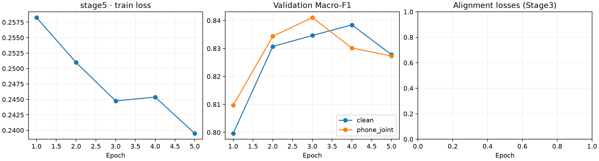
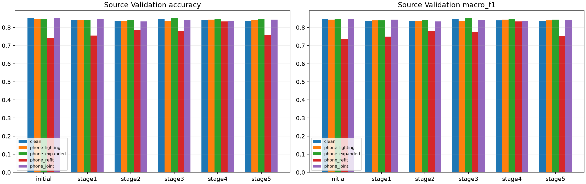
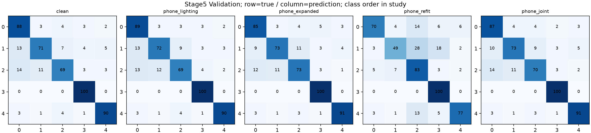

# 휴대폰 공동 근접 후보 추가 학습 결과 · 2026-11-12

## 결론과 현재 단계

사용자가 전달한 `MediFlow_Smartphone_Joint_Results_20261112.zip`에서 **독립 추가 1회, 5 epoch 완료**를 확인했다.
이를 기존 1~4차와 구분해 **추가 5차**로 부른다. 검증 기준의 저장 모델은 **3 epoch**다.
기존 스마트폰 5회와 이번 1회를 합쳐 실제 학습은 총 6회이며, 기존 4차 모델을 이어 학습한 결과가 아니다.

새 공동 근접 변환 Validation 499장에서는 적응 전 424장, 4차 418장, 추가 5차 421장을 맞혔다.
원본에서는 각각 424장, 419장, 418장이었다. 새 5차는 새 변환에서 4차보다 3장 늘었지만
적응 전보다 3장 적고, 원본에서는 적응 전보다 6장 적다. **이번 결과에서 분류 성능 개선을 입증하지 못했다.**
강한 기존 변환까지 포함한 공통 5조건의 사전 Validation 규칙은 여전히 **4차**를 선택한다.
이 규칙은 모든 조건의 낮은 성능을 높이기 위한 기준이며 실제 휴대폰과 가장 비슷한 모델을 고르는 기준은 아니다.
공식 후보·기존 패키지는 바꾸지 않았고 스마트폰용 Source Test와 실제 질환 정답 기반 평가는 미실행이다.

[원본 결과와 새 모델](../../../results/smartphone_joint_adaptation_20261112/README.md) ·
[수신 검사](../../../results/smartphone_joint_adaptation_20261112/receipt_verification.json) ·
[모델 로드 검사](../../../results/smartphone_joint_adaptation_20261112/model_load_verification.json) ·
[이전 1~4차 결과 분석](SMARTPHONE_ADAPTATION_RESULT_REVIEW_20261112.md).

## 1. 어떤 가설과 조건으로 학습했는가

사전 가설은 **실측 영상 통계를 함께 가깝게 한 조명·작은 색 이동 묶음으로, 추가 흐림 없이 촬영 변화에 대응할 수 있는가**다.
[공동 영상 통계 검토](SMARTPHONE_JOINT_SIMILARITY_REVIEW_20261112.md)의 후보 `f10926b662a4a43c`를
사용자가 탐색 학습으로 승인했다. 영상 지표 8개 중 7개가 원본보다 가까웠지만 조명 불균일·개인차·시드별 보호 기준을
모두 통과하지 못한 사실(`accepted=false`, `candidate_all_similarity_guards_passed=false`)은 유지된다.

고정한 조건은 Source Train 3535 / Validation 499 / Test 400, 클래스 순서
**건선 → 아토피 → 여드름 → 정상 → 주사**, seed 42, batch 8, Adam 학습률 0.00001,
Label Smoothing 0, 변환 적용 확률 0.5, 5 epoch, 마지막 30개 backbone 층 위치 중 BatchNormalization 제외 미세조정,
기울기 norm 상한 1이다. 선정 PMG·EfficientNet-B0·256의 **적응 전 저장본**에서 다시 시작했다.
PMG는 Source 배치당 부분 분류 3회와 결합 분류 1회로 갱신해 epoch당 442배치·1768회 갱신했다.

바꾼 변수는 **학습 사진 변환 묶음 전체**다. 개별 밝기·색·대비 각각의 효과로 해석할 수 없다.
동반 변경은 같은 새 변환 `phone_joint`에서 기존 모델도 비교할 수 있도록 Validation 조건을 하나 추가한 것이다.
Source Test나 보류 참여자 P05로 강도·epoch·모델을 고르지 않았다.

| 적용 항목 | 실제 고정 범위 |
| --- | --- |
| 밝기 가산 제안값 | −19.624129908304198 ~ −10.181201425385177 |
| 대비 배율 | 1.0 ~ 1.1808786167229048 |
| 좌우 조명차 | −0.42238616943359375 ~ 0.0 |
| Lab a 이동 | 0.0 ~ 1.0117187500000009 |
| Lab b 이동 | −1.2126953125000002 ~ 0.0 |
| 미세 질감 배율 | 1.0 유지 |
| 추가 흐림 σ | 0.0 |
| 기하 배율 x·y | 각각 1.0 |
| MMD·CORAL 학습 손실 | 사용하지 않음 |

연산은 `bounded_additive_v3`이며 RGB 경계 보호를 포함한다. 밝기 가산값과 좌우 조명차는 퍼센트가 아니며
Lab 이동은 다른 단위다. 0.5는 변환 묶음의 적용 확률이다. 내부 Rescaling을 포함한 RGB float32 0–255 입력을
유지했고 외부 `/255`를 추가하지 않았다. Target은 기존 EXIF 방향·ICC→sRGB·중앙 정사각형 자르기·256px 계약을 따른다.
질감·흐림을 보존한 것은 실측 근거를 검토한 후보의 설정이며 휴대폰 영상 전체를 재현했다는 뜻은 아니다.

## 2. 실제 완료와 저장 epoch

아래는 Colab이 기록한 원래 손실·F1이다. 기록 자릿수를 유지했다.

| epoch | 학습 손실 | 원본 Macro-F1 | 새 변환 Macro-F1 | 두 조건 중 낮은 F1 |
| --- | --- | --- | --- | --- |
| 1 | 0.258254154947717 | 0.799609780006252 | 0.8096612224317928 | 0.799609780006252 |
| 2 | 0.25098560347192295 | 0.8307106886115652 | 0.8343433223397249 | 0.8307106886115652 |
| 3 | 0.24475983409337462 | 0.8346340442799727 | 0.8410393711444757 | 0.8346340442799727 |
| 4 | 0.24537834405427064 | 0.8384278783954395 | 0.8301590589294525 | 0.8301590589294525 |
| 5 | 0.23948805532270698 | 0.8277847224306247 | 0.8273193016380009 | 0.8273193016380009 |

원본과 새 변환 중 **낮은 Macro-F1**을 우선 최대화하고, 동점이면 원본 F1·앞 epoch 순으로 고르는 사전 규칙에서
3 epoch가 선택됐다. 5 epoch까지 학습을 마친 뒤 3 epoch의 최적 가중치를 `stage5/best.keras`로 전달했다.
모든 epoch의 정렬 단계와 Target 학습 사용 수는 0이었다. 실제 Target 사진은 변환 범위를 정하고 사후 진단하는 데 사용했다.

원본 그림의 오른쪽 패널 `Alignment losses (Stage3)`는 공통 그림 양식이 남은 제목이다.
이번 5차에는 정렬 손실을 사용하지 않아 비어 있다. 이 그림을 MMD·CORAL 학습 실행 근거로 쓰지 않는다.

## 3. 동일 Source Validation 499장 비교

평가 조건은 원본 `clean`, 1차 조명 `phone_lighting`, 2차 조명·색·약한 질감/흐림 `phone_expanded`,
기존 4차 조명·강한 질감/흐림 `phone_refit`, 새 공동 근접 변환 `phone_joint`다.
모두 동일한 기존 Validation 이미지에 평가 시 변환을 적용한 결과이며 실제 휴대폰 질환 사진의 정확도가 아니다.
`initial`은 초기 B0가 아니라 **적응 전 선정 PMG 저장본**이다. 1차도 선정 PMG 비교본을 뜻한다.

기존 5모델×4조건의 20개 지표는 이전 결과에서 그대로 재사용했다.
이전 5모델×새 조건 5개와 새 모델×5조건 5개를 추가 측정해 총 30개다. 30개를 모두 새로 실행한 것은 아니다.

### 정답 이미지 수 · 각 조건 499장

| 모델 | 원본 | 1차 조명 | 2차 약한 확장 | 4차 강한 변환 | 새 공동 근접 변환 |
| --- | --- | --- | --- | --- | --- |
| 적응 전 선정 저장본 | 424 | 422 | 423 | 370 | 424 |
| 1차 · 조명 | 419 | 420 | 420 | 377 | 422 |
| 2차 · 약한 질감/흐림 | 418 | 417 | 420 | 391 | 416 |
| 3차 · 2차 + 특징 정렬 | 423 | 417 | 424 | 389 | 420 |
| 4차 · 강한 질감/흐림 | 419 | 421 | 423 | 416 | 418 |
| 추가 5차 · 공동 근접 후보 | 418 | 420 | 422 | 379 | 421 |

### Macro-F1 · 원본 기록 자릿수 유지

| 모델 | 원본 | 1차 조명 | 2차 약한 확장 | 4차 강한 변환 | 새 공동 근접 변환 |
| --- | --- | --- | --- | --- | --- |
| 적응 전 선정 저장본 | 0.8471375958306038 | 0.8427999522421222 | 0.8457763733808885 | 0.7364265096423025 | 0.847379144365863 |
| 1차 · 조명 | 0.8371428800526196 | 0.8390546834569605 | 0.8391229064737524 | 0.7496124932186314 | 0.8435876905935045 |
| 2차 · 약한 질감/흐림 | 0.8363201034735687 | 0.834788072836461 | 0.8402027333633552 | 0.7805988684565599 | 0.8324640976122069 |
| 3차 · 2차 + 특징 정렬 | 0.8474660038570427 | 0.8364868959284927 | 0.8496689096326595 | 0.7771311436019821 | 0.8421558843118296 |
| 4차 · 강한 질감/흐림 | 0.839099751882836 | 0.8430179787423866 | 0.847378001486998 | 0.8324259734962343 | 0.8375448492939277 |
| 추가 5차 · 공동 근접 후보 | 0.8346340442799727 | 0.8389303599478642 | 0.8433957850467261 | 0.753936252303706 | 0.8410393711444757 |

### Accuracy · 원본 기록 자릿수 유지

| 모델 | 원본 | 1차 조명 | 2차 약한 확장 | 4차 강한 변환 | 새 공동 근접 변환 |
| --- | --- | --- | --- | --- | --- |
| 적응 전 선정 저장본 | 0.8496993987975952 | 0.845691382765531 | 0.8476953907815631 | 0.7414829659318637 | 0.8496993987975952 |
| 1차 · 조명 | 0.8396793587174348 | 0.8416833667334669 | 0.8416833667334669 | 0.7555110220440882 | 0.845691382765531 |
| 2차 · 약한 질감/흐림 | 0.8376753507014028 | 0.8356713426853707 | 0.8416833667334669 | 0.7835671342685371 | 0.8336673346693386 |
| 3차 · 2차 + 특징 정렬 | 0.8476953907815631 | 0.8356713426853707 | 0.8496993987975952 | 0.779559118236473 | 0.8416833667334669 |
| 4차 · 강한 질감/흐림 | 0.8396793587174348 | 0.843687374749499 | 0.8476953907815631 | 0.8336673346693386 | 0.8376753507014028 |
| 추가 5차 · 공동 근접 후보 | 0.8376753507014028 | 0.8416833667334669 | 0.845691382765531 | 0.7595190380761523 | 0.843687374749499 |

### 사전 공통 기준의 선택

| 모델 | 공통 5조건 중 최저 Macro-F1 |
| --- | --- |
| 적응 전 선정 저장본 | 0.7364265096423025 |
| 1차 · 조명 | 0.7496124932186314 |
| 2차 · 약한 질감/흐림 | 0.7805988684565599 |
| 3차 · 2차 + 특징 정렬 | 0.7771311436019821 |
| 4차 · 강한 질감/흐림 | 0.8324259734962343 |
| 추가 5차 · 공동 근접 후보 | 0.753936252303706 |

최저 F1, 원본 F1, 앞 모델 순서의 사전 규칙을 다시 계산해 저장된 `stage4` 선택과 일치함을 확인했다.
추가 5차는 강한 기존 변환에서 적응 전보다 9장 더 맞혔지만 4차보다 37장 적었다.
새 공동 근접 변환에서는 적응 전보다 3장 적고 4차보다 3장 많다. 서로 다른 조건의 이득과 손실을 함께 기록한다.
원본과 새 변환 두 조건만 기술적으로 비교해도 그 중 낮은 F1은 적응 전이 추가 5차보다 높다.
사후에 선정 규칙을 바꾸거나 Test를 반복해 유리한 조건을 고른 결과로 표현하지 않는다.
단일 seed 결과이며 이 차이의 통계적 유의성을 검정하지 않았다.

## 4. 클래스별 Recall과 혼동행렬

Recall은 각 정답 클래스 중 맞힌 비율이다. 클래스별 원본 수는 100·100·100·100·99장이다.

| 조건 | 클래스 | 적응 전 | 4차 | 추가 5차 |
| --- | --- | --- | --- | --- |
| 원본 | 건선 | 0.85 | 0.92 | 0.88 |
| 원본 | 아토피 | 0.76 | 0.8 | 0.71 |
| 원본 | 여드름 | 0.71 | 0.63 | 0.69 |
| 원본 | 정상 | 1.0 | 0.98 | 1.0 |
| 원본 | 주사 | 0.9292929292929293 | 0.8686868686868687 | 0.9090909090909091 |
| 새 공동 근접 변환 | 건선 | 0.83 | 0.89 | 0.87 |
| 새 공동 근접 변환 | 아토피 | 0.77 | 0.83 | 0.73 |
| 새 공동 근접 변환 | 여드름 | 0.72 | 0.63 | 0.7 |
| 새 공동 근접 변환 | 정상 | 1.0 | 0.98 | 1.0 |
| 새 공동 근접 변환 | 주사 | 0.9292929292929293 | 0.8585858585858586 | 0.9191919191919192 |

원본의 건선 Recall은 적응 전보다 높아졌지만 아토피·여드름·주사는 낮아졌다.
새 변환에서도 모든 질환이 함께 좋아진 결과가 아니다. 정상 클래스가 포함되어 있어도 실제 촬영 참여자를
사진만 보고 정상 정답으로 지정하지 않았다. 모호하거나 범위 밖 입력을 배제하는 기능은 이번 실험으로 검증하지 않았다.

행은 정답, 열은 예측이며 인덱스 0~4는 건선·아토피·여드름·정상·주사 순서다.

## 5. 실제 휴대폰 사진의 특징 거리와 예측 변화

설정용 P01–P04의 42장과 Source Train 클래스당 8장·총 40장을 사용한 사후 진단이다.
이전 Stage3의 고정 특징 기준과 비교 방법을 유지했다. 기존 5모델의 진단은 그대로 재사용하고 새 5차만 추가했다.
MMD는 특징 분포 차이, CORAL은 특징들의 공분산 차이를 수치로 본다. 여기서는 학습 손실로 쓰지 않았다.

| 모델 | MMD | CORAL | 적응 전 대비 예측 클래스 변경 /42 |
| --- | --- | --- | --- |
| 적응 전 선정 저장본 | 0.13798964023590088 | 0.043655216693878174 | 0 |
| 1차 · 조명 | 0.16595947742462158 | 0.13216158747673035 | 3 |
| 2차 · 약한 질감/흐림 | 0.17212897539138794 | 0.1165110245347023 | 2 |
| 3차 · 2차 + 특징 정렬 | 0.14776241779327393 | 0.1129620373249054 | 10 |
| 4차 · 강한 질감/흐림 | 0.14532285928726196 | 0.06983822584152222 | 3 |
| 추가 5차 · 공동 근접 후보 | 0.16332203149795532 | 0.12693342566490173 | 2 |

새 5차의 MMD·CORAL은 적응 전과 기존 4차보다 모두 크다. **모델 특징이 실제 사진에 더 가까워졌다는 근거를 얻지 못했다.**
영상 통계 7개가 가까워진 것과 학습된 모델 특징 거리가 줄어드는 것은 별도 결과다.
실제 사진 중 2장의 예측 클래스가 바뀌었지만 질환 정답이 없어 맞게 바뀌었는지 알 수 없다.
예측 점수는 보정된 정답 확률로 표현하지 않는다. 이 진단은 설정용 참여자에 대한 것으로 독립 Target Test가 아니다.
이미 이전 실행에서 확인했던 P05는 이번 학습·추가 평가에서 제외했으며 새로 열거나 진단하지 않았다.

## 6. 재현 정보와 보존 검사

| 항목 | 확인값 |
| --- | --- |
| 수신 ZIP | `MediFlow_Smartphone_Joint_Results_20261112.zip` |
| ZIP 크기 · bytes | 33198410 |
| ZIP SHA-256 | `0dee0f4a286fbd5220370d3bc70858dd379ec53dfb90e3502b379fe228c351bc` |
| 실제 runtime manifest SHA-256 | `a3d4036b9f904f4821a0f7cbd0eec111d7a8063617ec0f17493364e403aed984` |
| 실제 study SHA-256 | `42609e1a8cbfb0b7dd807036ca4c3ab6b8bb22c893397fc60d8561f96f549439` |
| Source ZIP SHA-256 | `f8908af3d54e521ad14c37a44b569d33fe92be3b8b9b66a8d80faf4ba964072d` |
| Source 분할 manifest SHA-256 | `7c8b41878883193e5dd340ab8a4b7f804a3ab7f37c8159093b663937d997a738` |
| 출발 모델 SHA-256 | `83e659dd09a9355135ee0de0197037e81ece962777f59dedae8d9a37b49a3fc4` |
| 새 5차 모델 SHA-256 | `e0bab7dd2a6d0eb588db5496fb6eee3b9c779f2c4e8d7aabf98a95fd504fc5ef` |
| 준비 당시 Git HEAD | `f608e110b508a640a01cd72f18e2f0ca390b698c` |
| 실제 학습 환경 | TensorFlow 2.20.0 / Keras 3.13.2 / NumPy 2.5.4 / NVIDIA L4 |
| 새 Source Test / Target Accuracy | 미실행 / 질환 정답 없어 계산 불가 |

Git HEAD만으로 재현되는 깨끗한 작업 상태는 아니었다. 설정의 `uncommitted_runtime_sha256`에는 이전 준비 이력도 들어 있다.
실제 전달·실행한 코드는 `reproduction/runtime_manifest.json`의 파일 해시와 ZIP 안의 코드 사본을 기준으로 대조했다.
PMG 학습 코어·새 실행 코드를 포함한 5개 Python 사본은 알려진 로컬 전달 코드와 같고 문법 검사도 통과했다.
ZIP 안의 코드 사본을 새로 실행하거나 정식 학습을 로컬에서 반복하지 않았다.

검사한 내용은 ZIP CRC·28개 파일 경로/해시, 로컬 준비 설정/분할 일치, 5 epoch 이력과 선택 epoch,
혼동행렬에서 다시 계산한 총 40개 지표 기록(학습 중 10개 + 공통 30개), 기존 지표 20개와 특징 진단의 무변경 재사용이다.
모델은 Keras 안전 모드로 실제 열어 합성 RGB 0–255 한 장의 5클래스 출력을 확인했다.
로컬 CPU 검사의 NumPy는 2.5.2이며 실제 학습 환경 NumPy 2.5.4와 구분했다. 새 질환 성능 재측정은 아니다.

보관한 원본은 모델 1개, 그림 3개, JSON 19개, 실행 코드 사본 5개다.
새 결과 폴더에만 저장했고 원본 ZIP 자체·이전 모델·참여자 원본 사진·복호화 키를 중복 저장하지 않았다.
기존 보호 대상 654개와 공식 후보 색인의 해시가 같았다. 원래 ZIP은 Downloads에 그대로 있으며 삭제하지 않았다.
이 ZIP에는 최적 모델이 있으나 epoch별 optimizer 재개용 중간 가중치 전체가 포함된 것은 아니다.

## 7. 해석 한계와 다음 단계

Source의 사람·병변·촬영 세션 식별자는 전체 4434행에서 확인할 수 없다. 원본 연결 식별은 있으나
중복·유사 이미지 검사 통과만으로 사람 단위 누수를 배제할 수 없다. 과거 저장 모델이 Validation/Test를 본 이력도 미확인이다.
따라서 이번 Source Validation은 탐색 비교로 표시한다. Test 400장의 원본과 분할은 보존했다.

실제 휴대폰은 5명·5기기여서 사람과 기기의 영향이 얽혀 있다. 이번 설정용 4명의 분포를 모든 스마트폰의
환경 분포로 일반화할 수 없다. 추가 5차가 실제 환자 사진에서 좋아졌거나 나빠졌다고 단정할 정답 자료도 없다.
장비 유사성 기준 미통과와 특징 거리 미개선을 모두 남기며 실제 장비 성능 개선을 주장하지 않는다.

다음은 적응 전·기존 4차·추가 5차의 차이를 바탕으로 **비교 목적과 최종 후보·평가 조건을 먼저 고정**하는 일이다.
그 뒤 고정한 조건으로 기존 Source Test를 평가한다. Test 결과를 보고 강도를 반복 조절하지 않는다.
실제 휴대폰 질환 성능은 별도 정답이 확인된 사진으로 평가해야 한다.
이번 작업에서는 새 학습·새 Test·스마트폰 패키징·공식 후보 교체·Git 커밋/푸시를 하지 않았다.
