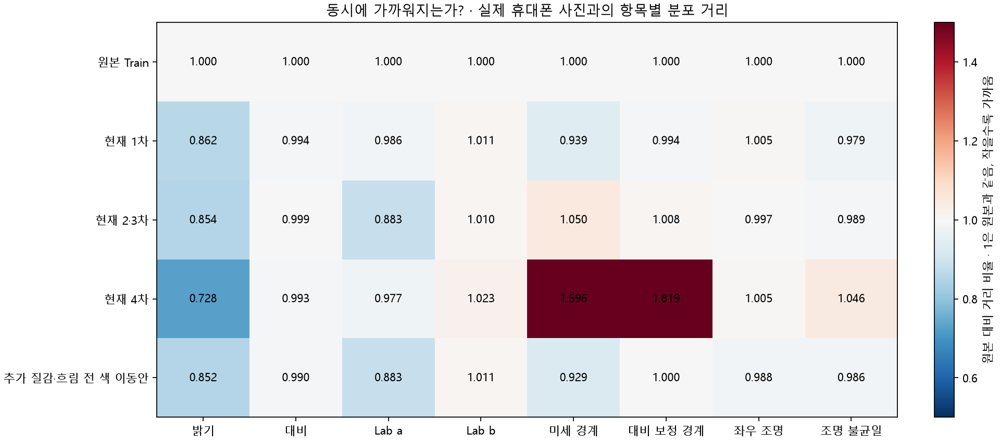
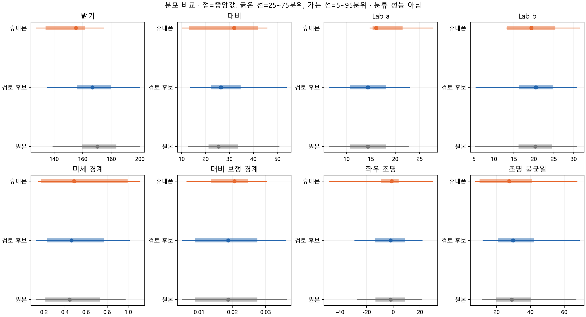
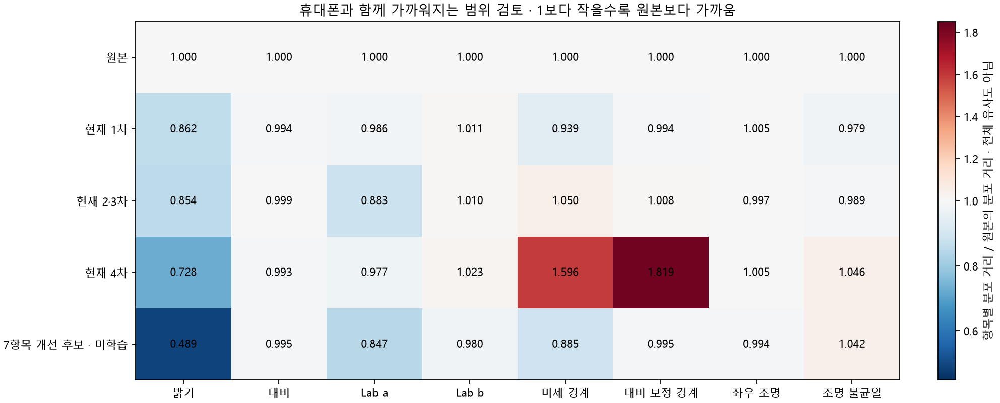

# 휴대폰 촬영 특성 공동 유사성 검토 · 2026-11-12

**후속 상태:** 사용자가 7항목 근접 후보의 탐색 학습을 승인해 [독립 1회 실행안](SMARTPHONE_JOINT_TRAINING_20261112.md)을 준비했다.
아래의 영상 유사성 보호 기준 미통과 판정은 유지한다. 이 문서는 검토 당시 기록이며 새 학습 결과는 아직 없다.

## 결론

**밝기·대비·색·질감·좌우 조명 등 8개 중 7개 지표를 함께 원본보다 가깝게 한 후보를 찾았다.**
추가 흐림을 빼고 조명·작은 색 이동을 함께 조절한 조합이다. 다만 조명 불균일성은 더 멀어졌고
설정용 네 사람 중 두 사람에게만 전반적인 개선이 나타나 최종 설정으로 채택하지 않았다.
정확한 범위·거리·비교 그림은 아래 ‘추가 해석: 7개 항목을 함께 가깝게 한 후보’에 있다.

이번 후보 범위에서는 **모든 항목·세 시드·사람별 보호 기준을 함께 통과한 변환은 찾지 못했다**.
그렇다고 모든 가능한 방법에서 불가능함을 증명한 것은 아니다. 아래의 ‘균형 후보’는 별도로
가장 나빠진 항목의 증가를 최소화한 보수적인 순위이며, 7항목 개선 후보나 통과한 최종 설정을 뜻하지 않는다.

기존 원본 Train과 비교해 검토 후보의 지표 6/8개가 비악화했고,
증가한 지표는 `['lab_b', 'side_light']`다. 사람별 개선 2/4,
사람 하나씩 제외한 개선 2/4,
세 난수 조건에서 모든 항목 비악화는 `False`였다.
이는 촬영 관련 영상 통계의 비교이며 실제 카메라의 재현·질환 보존·분류 정확도를 입증하지 않는다.

이번에는 **검토만 수행했다. 현재 설정·노트북·실행 ZIP·5개 학습 모델·공식 후보는 바꾸지 않았다.**
이전 웹캠에서도 모든 지표를 일치시킨 것은 아니며, 색과 경계 등 선택한 지표의 악화를 막고
실측에 맞지 않는 변환을 제외했다. 이번에는 항목별 순위를 단순히 합치는 대신 8개 지표를 함께 점검했다.

[원본 검토 JSON](../../../presentation/report_assets/smartphone_joint_review_20261112/review.json) ·
[전체 측정·시드별 기록](../../../presentation/report_assets/smartphone_joint_review_20261112/measurements.json) ·
[분포·개인차 요약](../../../presentation/report_assets/smartphone_joint_review_20261112/distribution_summary.json).
[7항목 후보와 보수적 후보의 구분](../../../presentation/report_assets/smartphone_joint_review_20261112/findings.json).

## 자료와 방법

- 유지된 Source Train 표본 118장, 고정 볼 관심 영역 측정 가능 104장. 클래스·원본 경로·PNG 해시를 대조했다.
- P01~P04의 기존 휴대폰 설정용 42장만 사용했다. P05·Source Validation/Test·기존 모델 점수는 탐색 입력으로 사용하지 않았다.
- 조명 17개에서 시작해 색과 질감·흐림을 공동 조합했다. 총 고유 후보 **196개**를 클래스당 4장씩 고정 표본·seed 42로 점검했다.
- 상위 후보와 기존 대조군 총 **12개**를 전체 표본·seed 42/707/1707로 재생했다.
- 클래스별·사람별 비중을 같게 한 Wasserstein-1 거리다. 동일 지표에서 낮을수록 가까우며 단위가 다른 거리를 직접 더하지 않았다.
- 점검 순위에는 각 지표의 원본 대비 거리 비율을 사용했다. 이것은 유사도 백분율·정확도가 아니다.
- 채택 조건은 원본 대비 8개 지표 모두 비악화·하나 이상 개선, 각 시드에서도 비악화, 3/4 이상 사람/누락 비교 개선,
  개인별 평균 상대 거리 악화 5% 이내, 공간 상관 하위 5% 0.95 이상, 신규 float 0/255 비율 0이다.
- 밝기 범위는 휴대폰 사람별 중앙값의 25~75분위와 경계 보호 역변환으로 정했고 그 0.25/0.5/0.75/1배를 비교했다.
  0 포함 범위와 실측 분위 범위를 비교해 현재 약한 변환에서 남는 평균 이동 부족도 검토했다.
- 색·미세 대비는 이전 실측 검토의 참여자 내 변동 예산을 재사용했다. 흐림은 없음 또는 기존에 검토한 작은 ROI64 범위를 비교했다.
  강한 흐림을 무조건 유지하지 않았다. 기하 배율은 1로 유지했다.

탐색은 후보 일부를 남기는 제한된 탐색이다. 모든 변환 중 최적해나 모든 지표 동시 개선의 불가능성을 증명하지 않는다.
보호 기준도 임상 검증 기준이 아닌 미리 고정한 공학적 점검 조건이다.

## 항목별 실제 분포 거리

아래 값은 정확도 아닌 영상 지표 거리다. 원래 계산값의 자릿수를 그대로 기록했다.
현재 2·3차의 사진 변환은 같으며 3차 MMD·CORAL 학습 손실은 이 사진 변환 비교에 포함되지 않는다.

| 지표 | 원본 | 현재 1차 | 현재 2·3차 | 현재 4차 | 검토 후보 |
| --- | --- | --- | --- | --- | --- |
| 밝기 | 19.59136385980494 | 16.890772624198068 | 16.72971508060055 | 14.26628842554866 | 16.890772624198068 |
| 대비 | 6.151448596858905 | 6.115864500666541 | 6.14510095003257 | 6.107409350956919 | 6.115864500666541 |
| Lab a | 4.365609174283588 | 4.3032921350049325 | 3.8550687325016404 | 4.263297590373839 | 4.3032921350049325 |
| Lab b | 2.7215111371870826 | 2.75056354990118 | 2.7477213541666607 | 2.784271811182471 | 2.75056354990118 |
| 미세 경계 | 0.14857599940273566 | 0.1394647536622609 | 0.15599653780121567 | 0.23714479976953198 | 0.1394647536622609 |
| 대비 보정 경계 | 0.0035760892196840034 | 0.003555817068942281 | 0.0036041951923578884 | 0.006503996167214983 | 0.003555817068942281 |
| 좌우 조명 | 6.134571837750734 | 6.166697965152096 | 6.114314097001225 | 6.166555512595482 | 6.166697965152096 |
| 조명 불균일 | 5.180339020765414 | 5.0693990801633415 | 5.124010356078758 | 5.419347050255919 | 5.0693990801633415 |



그림 숫자는 표시용 소수점 세 자리다. 원본 대비 거리 비율 1이 기준이며 작을수록 가깝다.
그림의 한 행이 모두 낮아져도 개인별·시드별 검사를 통과해야 채택한다.



## 검토 후보의 수치 · 현재 실행안에 미적용

후보 ID는 `5e37b7d56f041881`이며 통과 여부는 `False`다.

| 항목 | 범위 |
| --- | --- |
| 밝기 | [-9.812064954152099, 0.0] |
| 대비 | [1.0, 1.0904393083614523] |
| 좌우 조명차 | [-0.21119308471679688, 0.0] |
| Lab a | [0.0, 0.0] |
| Lab b | [0.0, 0.0] |
| 미세 질감 배율 | [1.0, 1.0] |
| 흐림 σ · ROI64 | [0.0, 0.0] |
| 최대 흐림 σ · 256px | 0.0 |

밝기·좌우 조명은 RGB 가산 제안값이며 퍼센트가 아니다. Lab은 색 좌표, 질감은 회색조 고주파 잔차 배율,
흐림은 픽셀 σ다. RGB 범위 보호 후의 실제 변화량과 설정값을 구분한다. 외부 `/255`는 추가하지 않았다.
색·질감·흐림이 함께 바뀐 조합을 점검했으므로 개별 항목 하나의 분류 효과를 입증한 것이 아니다.

## 사람별·시드별 안정성

| 설정용 참여자 | 원본 상대 비용 | 후보 상대 비용 | 개선 |
| --- | --- | --- | --- |
| P01 | 2.263202891686879 | 2.2014417714039065 | True |
| P02 | 1.7817467373141183 | 1.845095080840609 | False |
| P03 | 2.399011841844414 | 2.32865949427466 | True |
| P04 | 2.4081965327537063 | 2.4767162858440575 | False |

이 비용은 8개 지표의 원본 거리로 정규화한 평균으로 순위·민감도 진단용이며 질환 정확도가 아니다.
모든 난수 조건의 항목별 값과 사람 누락 비교는 원본 JSON에 있다.
검토 후보의 공간 상관 하위 5%는 `0.9995307647805073`,
새 float 끝점 비율 최댓값은 `0.0`다.
사람 간 통계 차이도 요약 JSON에 저장했지만 동등성 통과 기준으로 사용하지 않았다.

## 실제 사진과 예시

[원본·현재 변환·후보·실제 휴대폰 예시](../../../camera_capture/_review/smartphone_web_skin_20261111/joint_review_20261112/joint_candidate_actual_phone_examples.png)를 만들었다.
Source의 클래스별 첫 유효 표본과 P01~P04의 첫 사진을 고정해 사용했다. 같은 사람·장면을 두 카메라로 찍은 비교가 아니다.
변환을 강제로 적용한 한 난수 예시이며, 실제 학습의 50% 적용 혼합분포와 구분한다.
실제 촬영 참여자가 포함된 이미지는 로컬 전용이고 키·원본 사진은 새 공개 자료에 넣지 않았다.

## 남는 차이와 다음 단계

촬영 특성을 함께 가깝게 하더라도 얼굴 크기·위치·촬영 범위·질환 구성·피부색·개인·카메라 효과는 완전히 분리되지 않는다.
기하 왜곡·패딩·다른 인물 생성으로 이를 억지로 맞추지 않았다. 노이즈·압축도 이번에 측정되지 않은 변환으로 추가하지 않았다.
4명·4기기의 통계를 일반적인 휴대폰 분포로 간주하지 않는다. 실제 장비와 거의 동일하다는 전체 유사도 수치는 만들지 않았다.
기존 학습 모델의 MMD·CORAL 결과는 [이전 실제 학습 분석](SMARTPHONE_ADAPTATION_RESULT_REVIEW_20261112.md)을 따른다.
이번에는 모델을 새로 학습하거나 특징 거리를 다시 측정하지 않았으므로 영상 지표 개선을 모델 개선으로 표현하지 않는다.

다음 단계는 이 검토에서 남은 악화 항목과 안정성을 기준으로 후보 범위를 확정하는 것이다.
통과하지 못한 후보를 장비 유사성 보장 설정으로 바꾸거나 기존 실행 ZIP에 자동 반영하지 않았다.
새 학습·Test·패키징·업로드·Git 커밋·푸시는 수행하지 않았다.

## 추가 해석: 7개 항목을 함께 가깝게 한 후보

위의 ‘균형 후보’는 가장 나빠진 항목의 증가를 최소화한 후보여서 현재 1차와 같은 설정이다.
그와 별도로 **동시에 가까워진 항목 수가 가장 많은 후보**를 기록했다. 전체 재생 후보 중 비악화 항목 수,
가장 나빠진 상대 거리, 낮은 흐림 순서로 정리했으며 기존 채택 기준을 완화한 것은 아니다.

후보 `f10926b662a4a43c`는 밝기·대비·두 색 축·두 경계 지표·좌우 조명의 **7개 지표가 모두 원본보다 가까워졌다**.
다만 조명 불균일성의 거리는 커졌다. 같은 통계가 모든 사람에게 좋아진 것은 아니며 2/4명에서 평균 비용이 감소했다.
이것이 이번 검토에서 확인한 ‘여러 항목을 함께 맞출 수 있는 범위’다. 원본과 실제 촬영 사진이 같아졌다는 뜻은 아니다.

| 지표 | 원본의 거리 | 7항목 후보의 거리 | 변화 |
| --- | --- | --- | --- |
| 밝기 | 19.59136385980494 | 9.5751122147356 | 가까워짐 |
| 대비 | 6.151448596858905 | 6.121784599213804 | 가까워짐 |
| Lab a | 4.365609174283588 | 3.69880818202404 | 가까워짐 |
| Lab b | 2.7215111371870826 | 2.666033638010531 | 가까워짐 |
| 미세 경계 | 0.14857599940273566 | 0.1315412272888135 | 가까워짐 |
| 대비 보정 경계 | 0.0035760892196840034 | 0.0035589463828795916 | 가까워짐 |
| 좌우 조명 | 6.134571837750734 | 6.09777283938671 | 가까워짐 |
| 조명 불균일 | 5.180339020765414 | 5.39645999574218 | 커짐 |

| 변환 항목 | 미학습 검토 후보의 범위 |
| --- | --- |
| 밝기 제안값 | [-19.624129908304198, -10.181201425385177] |
| 대비 배율 | [1.0, 1.1808786167229048] |
| 좌우 조명차 | [-0.42238616943359375, 0.0] |
| Lab a | [0.0, 1.0117187500000009] |
| Lab b | [-1.2126953125000002, 0.0] |
| 미세 질감 배율 | [1.0, 1.0] |
| 추가 흐림 σ | [0.0, 0.0] |

이 후보는 **추가 흐림과 질감 증감을 넣지 않았다**. 실제 휴대폰의 미세 경계가 더 큰 관측을 고려하면,
기존 강한 흐림을 유지하며 강도를 높이기보다 조명·작은 색 이동을 함께 조절하는 쪽이 이번 자료에 더 적합한 탐색 방향이다.
이 역시 카메라만의 효과라고 확정하지 않는다. 특히 Lab 색 이동은 질환 색 차이까지 맞추지 않도록 기존 변동 예산에 제한했다.



[같은 Train 사진의 기존 2·4차와 7항목 후보 예시](../../../camera_capture/_review/smartphone_web_skin_20261111/joint_review_20261112/joint_seven_metric_candidate_examples.png)도 만들었다.
범위 안 한 난수의 예시이며 전체 학습 사진이 항상 같은 변화량을 받는 것은 아니다.

### 다음 진행 방향

1. 현재 4차는 강한 변화에 대한 견고성 비교 기록으로 보존한다. 장비에 가장 가깝다는 후보로 자동 승격하지 않는다.
2. 추가 흐림을 제외한 위 7항목 후보를 **촬영 특성 재검토의 기준 후보**로 보관한다. 모든 채택 기준은 미통과여서 새 학습·실행 ZIP에는 아직 반영하지 않는다.
3. 실제 사용할 촬영 조건을 한 가지로 먼저 고정하고, 같은 사람·부위·세션에서 비교 촬영하면 조명 불균일과 사람/기기의 혼동을 줄일 수 있다.
   네 사람·각자 다른 기기의 자료만으로 모든 휴대폰에 맞는 하나의 변환을 확정하지 않는다.

보고서에는 ‘196개 조합을 점검하고 12개를 전체 표본·세 시드로 재생했으며 7개 영상 지표를 함께 개선한 후보를 확인했다.
조명 불균일성과 개인별 차이는 남아 적용을 보류했다’고 쓸 수 있다.

## 검증과 재현

`ruff check src tests` 통과, 전체 `pytest` 248개 통과·선택 의존성 pandas가 없는 기존 3개 건너뜀을 확인했다.
지표 하나의 악화가 평균 개선에 가려지지 않는지, 세 난수 중 한 조건만 나빠져도 거부되는지,
P05·Validation 입력 거부와 사람별·공간·포화 보호 조건을 검사했다.
분포 거리 392개를 별도의 CDF 적분 계산으로 다시 확인했고, 기존 보호 대상 603개 파일·원본 휴대폰 52장·
Train PNG 118장의 해시가 같았다. 새 비교 그림 5개를 화면에서 확인했다.
그림의 색상은 원본 대비 거리 비율 1을 흰색 기준으로 사용한다. 숫자는 표시용이며 정확한 값은 JSON과 본문 표를 따른다.

[검사·환경·코드 해시](../../../presentation/report_assets/smartphone_joint_review_20261112/verification.json)와
[분석 코드 보관본](../../../presentation/report_assets/smartphone_joint_review_20261112/code/src/mediflow_datasets/smartphone_joint_review.py)에
코드 commit·미커밋 상태·환경 버전·입력/출력 해시를 기록했다. 이번 검토는 다음처럼 없는 새 출력 폴더에 재현한다.

```powershell
.venv/Scripts/python.exe -X utf8 -B -m mediflow_datasets.smartphone_joint_review --output "새검토폴더"
```

이 명령은 후보 탐색·전체 표본 재생 JSON을 만든다. 본 보고서의 추가 그림은 같은 JSON의 진단값과
고정 Train 표본으로 작성한 설명 자료다. 기존 출력 폴더가 있으면 중단하며 자동 삭제하지 않는다.
