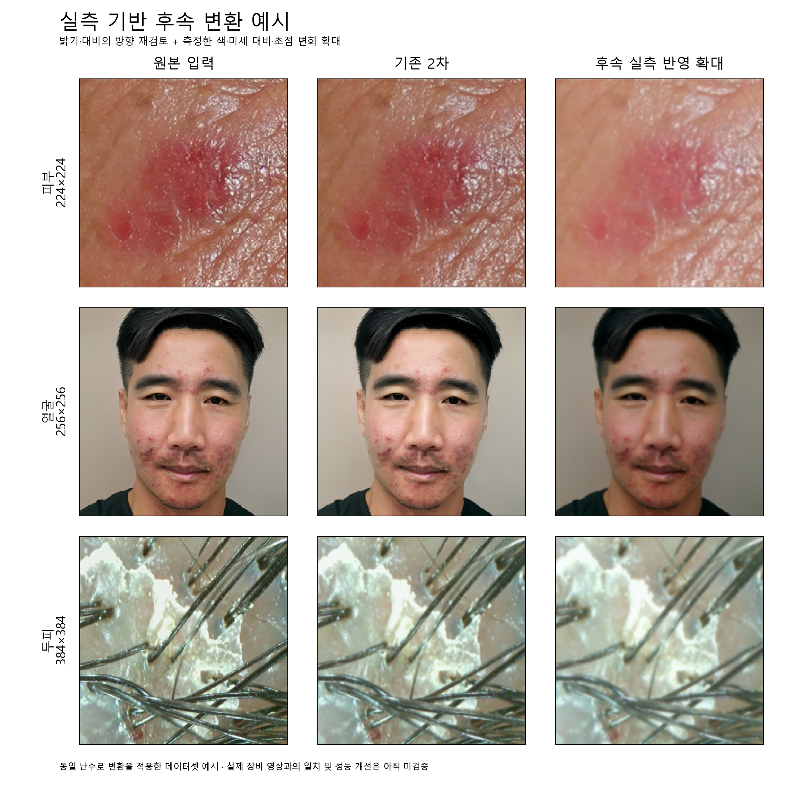

# 실측 기반 촬영 변환 확대 후속 실험

> 2026-11-11 정리 상태: **대체된 계획·준비본, 현재 실행 지시 아님**. [현재 작업 안내](../../../README.md) · [전체 문서 대조표](../../../DOCUMENT_INDEX.md). 아래 본문은 작성 시점 기록이며, 본문·원본 JSON의 이전 경로는 정리 대조표로 추적한다.

작성일은 2026-11-10이다. 기존 1·2·3차 학습과 최종 Source Test를 보존하고,
사용자가 요청한 더 강한 촬영 변화의 후속 학습을 준비했다.
**코드·설정·실행 노트북 준비 단계이며 실제 세 분야의 새 학습 결과는 아직 없다.**

## 1. 연구 질문과 변경 범위

기존 2차의 출발 모델·데이터 분할·학습량을 유지하면서, 측정에 근거해 다시 정한
촬영 변환 묶음이 원본·기존 변환·새 변환 Validation 성능에 어떤 영향을 주는지 비교한다.
Validation은 학습 중 모델을 고르는 검증 자료다.

실험에서 바꾸는 조건은 **촬영 변환 설정 전체**다. 밝기·대비의 보정 기준과 방향도 함께
바꾸므로 단순히 기존 강도에 두 배를 곱한 실험으로 해석하지 않는다.
개별 밝기·색·초점 항목의 기여를 따로 측정하는 실험도 아니다.

이번 후속 실험에는 MMD·CORAL 학습 손실을 추가하지 않는다. 우선 기존 2차와 이미지 변환의
차이를 비교한다. 이전 3차의 특징 정렬 결과는 그대로 보관한다.

## 2. 실제 측정 자료와 적용 규칙

[고정 설정](../../../../configs/camera_strength_20261110.json)에 측정 자료의 경로·SHA-256,
원래 데이터 분할의 SHA-256, 기존 모델의 SHA-256, 코드 버전과 변경 코드의 SHA-256을 기록했다.
SHA-256은 파일이 같은지 확인하는 식별값이다.

| 분야 | 실제 유지한 Source Train 측정 수 | 실제 촬영 측정 수 | 출발 모델 |
| --- | ---: | ---: | --- |
| 피부 `skin` | 6,753 | 42 | 초기 EfficientNet-B0 · 224 |
| 얼굴 `web_skin` | 3,535 | 42 | 선정 PMG · EfficientNet-B0 · 256 |
| 두피 `hair` | 10,032 | 40 | 선정 EfficientNet-B1 · 384 · 5클래스 |

Source는 기존 학습 사진, Target은 실제 장비로 촬영한 사진이다.
Source 측정 캐시를 이전 누수 점검 후 유지한 **원본 Train 목록과 클래스 번호**로 다시
제한했다. 밝기·대비 기준을 정할 때 Source Validation·Test 측정값을 사용하지 않았다.

Source 기준은 클래스별 중앙값을 구한 뒤 그 중앙값을 사용한다.
Target은 4명의 기준·변경 조건별 중앙값 8개를 같은 비중으로 사용한다.
개인별 촬영 장수 차이가 기준을 바꾸지 않도록 했다.

- 밝기는 Target 조건별 중앙값에서 Source 기준을 뺀 값의 25·75분위수를 사용하고,
  RGB 0–255 척도에서 이동 폭을 −32부터 +32까지 제한한다.
- 대비는 Target/Source 측정 비율의 25·75분위수를 사용하고 0.8–1.25배로 제한한다.
  두피는 모발 가림의 영향이 커 전체 대비를 1배로 유지한다.
- 색은 같은 참여자 안에서 관찰한 Lab 색상 채널 a·b 변화의 25·75분위수를 반영하며
  각 채널 이동을 ±3으로 제한한다. 기존 반영 비율 0.5를 1.0으로 높인다.
- 미세 대비는 참여자 내 측정 비율을 0.85–1.15배로 제한한다.
- 흐림은 참여자별 초점 비교에 맞춘 값의 75분위수를 사용한다.
  ROI 64픽셀 기준 sigma 상한은 0.75이며 모델 입력 크기에 따른 기존 환산을 유지한다.
- 얼굴의 좌우 조명 차이는 참여자 내 측정값의 25·75분위수를 ±24 안에서 반영한다.
  피부·두피의 방향성 조명 변화는 추가하지 않는다.

범위 제한은 질환 정보를 과도하게 바꾸지 않기 위한 **공학적 선택**이다.
실제 카메라를 물리적으로 보정해 검증한 값은 아니다.

## 3. 확정한 새 변환 설정

아래 값은 모델 성능 수치가 아닌 실제 실행에 쓰는 변환 파라미터다.
소수 전체 값과 측정 근거는 고정 설정 JSON에 보관한다.

| 분야 | 밝기 이동 범위 | 대비 배율 범위 | 좌우 조명 이동 | 흐림 sigma 범위 · ROI 64 기준 | 입력 환산 배율 |
| --- | --- | --- | --- | --- | --- |
| 피부 | `[32.0, 32.0]` | `[0.8, 0.8]` | `[0.0, 0.0]` | `[0.0, 0.6000000000000001]` | `1.75` |
| 얼굴 | `[-32.0, -32.0]` | `[0.8, 1.0152967817078993]` | `[24.0, 24.0]` | `[0.0, 0.4]` | `1.9375` |
| 두피 | `[15.043113708496094, 26.26080894470215]` | `[1.0, 1.0]` | `[0.0, 0.0]` | `[0.0, 0.7125]` | `3.0` |

피부는 Source가 실제 촬영보다 어두워 밝히는 방향이다. 얼굴은 실제 촬영이 Source보다
어두워 어둡게 하는 방향이다. 두피는 밝기를 높이며 모발 가림에 민감한 전체 대비는 유지한다.
피부·얼굴의 일부 범위가 한 값인 이유는 원래 측정 차이가 제한을 넘었기 때문이다.
Target 전체 외형을 그대로 맞추는 방식은 사용하지 않았다.



예시는 분야별 한 장에 seed 42로 변환을 반드시 적용한 그림이다.
실제 학습에는 기존과 같은 50% 확률로 변환한다.
[예시 원본 경로·해시·설정](../../../../presentation/report_assets/measured_stronger_adaptation_20261110/preview_parameters.json)을 함께 보관한다.
예시 확인은 전체 Train의 질환 경계나 극단값 보존 검증을 뜻하지 않는다.
기존 약한 설정에 대한 시각 검토 승인을 새 설정의 승인으로 이어 쓰지 않도록 기록을 분리했다.

## 4. 고정 학습 조건과 평가

- 세 분야를 순서대로 각각 5 epoch, 총 3회 학습한다. epoch은 전체 학습 사진을 한 번 보는 회차다.
  기존 2차와 학습량을 맞춘 비교이며 5회면 항상 충분하다는 의미는 아니다.
- 출발점은 1차에서 선택한 방식의 **1차 학습 전 저장 가중치**다.
  2차나 3차의 학습 완료 가중치를 이어 학습하지 않는다.
- 데이터 버전·Train/Validation/Test 분할·클래스 순서·입력 크기를 유지한다.
  seed 42, Adam 학습률 0.00001, 배치 크기 피부 16·얼굴 8·두피 8,
  변환 확률 0.5를 유지한다. 후반부 30개 backbone 층과 분류층을 학습하며
  Batch Normalization은 고정한다. 얼굴 PMG의 배치당 4단계 갱신 방식도 유지한다.
- 모델 입력은 float32 RGB 0–255다. 외부 `/255`를 추가하지 않는다.
- 누수 검사를 다시 실행하고 이전 원본 분할 목록과 완전히 같은지 확인한다.
  사람·병변·세션 식별자가 없는 Source의 독립성 한계와 과거 저장 모델의 평가 독립성 한계를 유지한다.

각 모델을 같은 Validation의 원본, 기존 2차 변환, 새 조명 변환, 새 확장 변환에서 비교한다.
비교 모델은 학습 전·기존 2차·새 후속 학습본의 세 종류다.
분야별 12개, 총 36개 성능 행을 기록한다.
분야별 JSON에는 클래스별 Recall·F1·혼동행렬도 포함한다.

학습 회차는 원본과 새 확장 Validation Macro-F1 중 낮은 값을 우선으로 고르고,
같으면 원본 점수를 비교한다. 최종 후속 후보는 원본·기존 확장·새 확장의
최저 Macro-F1, 원본 Macro-F1, 먼저 존재한 모델 순서로 고른다.
기존 공식 후보 색인이나 과거 후보 선정 기록을 자동으로 바꾸지 않는다.

이미 확인한 Source Test는 이번 노트북에서 다시 추론하지 않는다.
나중에 재사용해도 독립적인 새 최종 Test로 표현할 수 없다.
정답이 없는 실제 촬영 자료의 Accuracy·Macro-F1도 계산하지 않는다.

## 5. 실행 방법과 저장 위치

1. 새 Colab 노트북 (삭제한 이전 준비 자료)을 Colab에서 연다.
2. GPU를 선택한 뒤 모두 실행하고 Google Drive를 연결한다.
3. 기존 Drive의 `mediflow_Project/MediFlow_Adaptation_Common_v3.zip`, `datasets`의 원본 ZIP,
   `MediFlow_adaptation_runs/4ae6e07eb4af1225/stage1`과 `stage2` 결과를 읽는다.
   별도 새 실행 ZIP 업로드나 Target 복호화 키 입력은 필요 없다.
4. 화면에 분야·epoch·배치·검증·저장을 표시한다. 같은 노트북을 다시 실행하면
   저장이 끝난 회차부터 이어가고 완료 분야는 재사용한다. 중단 회차의 일부 배치는 다시 실행한다.
5. 세 분야가 끝나면 학습곡선·비교표를 표시하고 결과 ZIP을 내려받는다.

Drive의 새 결과 위치는 다음과 같다.

```text
내 드라이브/MediFlow_adaptation_runs/4ae6e07eb4af1225/measured_strength_d1054f86cf15/
```

`MediFlow_Stronger_Adaptation_Results_20261110.zip`은 해당 폴더에도 같은 이름으로 저장한다.
ZIP에는 최적 모델 3개, 학습 이력, 고정 설정, 검증 결과·선정 기준, 누수 점검과 분할 목록,
실행 코드 사본, 학습곡선을 포함한다. 모든 회차의 큰 모델 파일을 중복 포함하지 않는다.
각 회차 체크포인트는 Drive의 새 결과 폴더에 남는다.

데이터 ZIP을 Colab 로컬 디스크로 복사하고 입력 캐시를 재사용한다.
세 분야를 동시에 띄워 GPU 메모리를 다투지 않도록 순서대로 실행한다.
TensorFlow 2.20.0·Keras 3.13.2는 별도 실행 환경에서 준비한다.
그래프는 화면 창이 필요 없는 Agg 방식으로 저장한다.

## 6. 구현과 검증 범위

- [측정 기반 파라미터 계산](../../../../src/mediflow_datasets/camera_strength.py)
- [세 분야 학습·검증·저장 실행기](../../../../src/mediflow_datasets/adaptation_strength.py)
- [고정 설정·노트북 생성 코드](../../../../scripts/build_adaptation_strength.py)
- [파라미터·자료 역할 검사](../../../../tests/test_camera_strength.py)
- [소형 실제 Keras 모델 학습·저장·재실행 검사](../../../../tests/test_adaptation_strength.py)

`ruff check src tests scripts/build_adaptation_strength.py`가 통과했다.
전체 pytest는 185개 통과·3개 건너뜀이다. 기본 로컬 환경에 matplotlib이 없어 관련 기존 검사
3개를 건너뛰었고, Colab 실행기는 해당 라이브러리를 준비하도록 구성했다.
노트북의 공통 ZIP 확인·압축 해제·출력 전달·29개 파일 결과 ZIP 구성·Drive 경로 복사·다운로드
호출은 작은 모의 실행으로 점검했다. 실제 GPU에서 세 분야 전체 학습을 마쳤다는 뜻은 아니다.

## 7. 해석의 한계와 다음 확인

실제 촬영은 4명·한 촬영 세션의 초기 조사 자료다. 질환 정답이 없으며 일반적인
카메라 분포로 가정할 수 없다. Source 병변과 실제 팔 피부, 얼굴 피부색·질환·구도,
두피 모발 가림의 차이가 카메라 특성과 섞여 있다.
얼굴 Source의 ROI 측정 성공률도 클래스마다 달라 건선은 714장 중 356장이다.
따라서 해당 클래스 기준은 측정에 성공한 사진만을 설명한다.

노트북 실행 후 먼저 원본 성능 저하와 기존·새 변환에서의 이득을 Validation으로 확인한다.
더 크게 보이는 변화나 예측 확신도 증가를 개선의 근거로 사용하지 않는다.
실제 장비에서 질환 분류가 개선됐다는 결론에는 정답이 확인된 별도 촬영 평가가 필요하다.
